# 🎓 CampusOS ERP — Project README & Roadmap

> **V.S.B. Engineering College, Coimbatore** | One Campus. One System. One Source of Truth.

---

## 📋 Table of Contents
- [What Has Been Done](#-what-has-been-done)
- [API Workflow Test Results](#-api-workflow-test-results)
- [What Is Missing / Incomplete](#-what-is-missing--incomplete)
- [Next Steps](#-next-steps)
- [Project Roadmap](#-project-roadmap)
- [Running the Project](#-running-the-project)

---

## ✅ What Has Been Done

### 🏗️ Infrastructure & DevOps
| Item | Status |
|------|--------|
| Docker Compose stack (Postgres, Redis, MinIO, API, Web) | ✅ Done |
| PostgreSQL 16 with async connection pooling | ✅ Done |
| Redis 7 for caching & rate limiting | ✅ Done |
| MinIO object storage for documents | ✅ Done |
| Alembic database migrations (50 migration files) | ✅ Done |
| Multi-environment config (.env.development, .env.production) | ✅ Done |
| Health check endpoints (`/health/live`, `/health/ready`) | ✅ Done |

### 🔐 Authentication & Security
| Item | Status |
|------|--------|
| JWT-based auth with HttpOnly cookies | ✅ Done |
| Access token + Refresh token rotation | ✅ Done |
| Role-Based Access Control (RBAC) | ✅ Done |
| Policy-Based Access Control (PBAC) | ✅ Done |
| Multi-tenancy (tenant isolation per institution) | ✅ Done |
| Rate limiting (per-route, per-user) | ✅ Done |
| Audit trail logging for all actions | ✅ Done |
| Password change / forgot password endpoints | ✅ Done |
| Security headers & CORS configuration | ✅ Done |

### 🎓 Core Academic Modules (API + UI)
| Module | API | UI | DB Model |
|--------|-----|----|----|
| Students (CRUD, enrollment, 360° view) | ✅ | ✅ | ✅ |
| Faculty management | ✅ | ✅ | ✅ |
| Staff management | ✅ | ✅ | ✅ |
| Departments | ✅ | ✅ | ✅ |
| Programs & Courses | ✅ | ✅ | ✅ |
| Academic Structure (Semesters, Batches) | ✅ | ✅ | ✅ |
| Subjects & Curriculum | ✅ | ✅ | ✅ |
| Course Offerings & Enrollments | ✅ | ✅ | ✅ |
| Timetable | ✅ | ✅ | ✅ |
| Attendance (Sessions, Records, Leaves, Corrections) | ✅ | ✅ | ✅ |
| Examinations & Results | ✅ | ✅ | ✅ |
| Library & Learning Resources | ✅ | ✅ | ✅ |

### 💰 Finance & HR
| Module | API | UI | DB Model |
|--------|-----|----|----|
| Fee management & Invoices | ✅ | ✅ | ✅ |
| Payments & Receipts | ✅ | ✅ | ✅ |
| Payroll | ✅ | ✅ | ✅ |
| Procurement & Inventory | ✅ | ✅ | ✅ |
| Workforce & HR management | ✅ | ✅ | ✅ |

### 🏠 Campus Life Modules
| Module | API | UI | DB Model |
|--------|-----|----|----|
| Housing / Hostel allocation | ✅ | ✅ | ✅ |
| Transport management | ✅ | ✅ | ✅ |
| Campus Events & Clubs | ✅ | ✅ | ✅ |
| Sports management | ✅ | ✅ | ✅ |
| Campus Security & Access control | ✅ | ✅ | ✅ |
| Student Affairs | ✅ | ✅ | ✅ |
| Placement & Career services | ✅ | ✅ | ✅ |
| Research management | ✅ | ✅ | ✅ |
| Sustainability tracking | ✅ | ✅ | ✅ |

### 🤖 Advanced / Enterprise Features
| Feature | Status |
|---------|--------|
| AI Intelligence / Query composer | ✅ Done (mock provider) |
| Notifications system (in-app, webhooks) | ✅ Done |
| Workflow & Case management engine | ✅ Done |
| Documents & Certificates management | ✅ Done |
| Analytics ingestion pipeline | ✅ Done |
| Reporting engine | ✅ Done |
| Accreditation tracking (NAAC/NIRF) | ✅ Done |
| Data import (CSV/bulk upload) | ✅ Done |
| Governance & Policy engine | ✅ Done |
| Event-driven architecture (domain events) | ✅ Done |

### 🖥️ Frontend (Next.js 15)
| Feature | Status |
|---------|--------|
| Role-based dashboards (Admin, VP, HOD, Faculty, Student, Accounts, Placement) | ✅ Done |
| Sidebar navigation with 60+ routes | ✅ Done |
| Command palette (⌘K search) | ✅ Done |
| Notification drawer | ✅ Done |
| Role switcher (demo personas) | ✅ Done |
| V.S.B. College logo in sidebar, login, landing page | ✅ Done |
| Favicon with college logo | ✅ Done |
| Responsive mobile layout | ✅ Done |
| White + Yellow institutional theme | ✅ Done |
| 251 statically generated pages | ✅ Done |

---

## 🧪 API Workflow Test Results

> Tested against live API at `http://localhost:8000`

| Test | Endpoint | Result | Notes |
|------|----------|--------|-------|
| Health check (live) | `GET /health/live` | ✅ Healthy | Service alive |
| Health check (API v1) | `GET /api/v1/health` | ✅ Healthy | v0.1.0 |
| Swagger UI | `GET /docs` | ✅ 200 OK | Full API docs available |
| Login — wrong field | `POST /api/v1/auth/login` body `{username}` | ✅ Proper 422 validation error | Expects `email` field |
| Login — email field | `POST /api/v1/auth/login` body `{email}` | ⚠️ No seed users in DB | Migrations not yet run |
| Students list | `GET /api/v1/students` | ✅ Auth guard: 401 | Correctly blocked without token |
| Faculty list | `GET /api/v1/faculty` | ✅ Auth guard: 401 | Correctly blocked without token |

> **Key Finding:** API is running correctly. Auth guards work properly. The frontend uses **mock/demo personas** because no real DB seed data exists yet.

---

## ❌ What Is Missing / Incomplete

### 🔴 Critical (Fix First)
| Issue | Impact |
|-------|--------|
| **DB migrations not applied** — 50 Alembic files exist but tables not created | No real data possible |
| **No database seed data** — No admin user, students, or records in Postgres | Cannot login via real API |
| **Frontend not connected to real API** — Auth and all data is mocked | App is a demo shell only |
| **No real login flow** — Frontend auth bypasses API entirely | Not production-ready |

### 🟡 Partially Implemented
| Item | What's Missing |
|------|----------------|
| AI Assistant | Only mock provider — no real Gemini/OpenAI integration |
| Email notifications | SMTP config missing; notifications stored but not sent |
| File uploads | MinIO configured but upload flows not wired in UI |
| Reports export | PDF/Excel service exists but UI download not complete |
| MFA / 2FA | Documented in `docs/mfa.md` but not implemented |
| International students | UI nav exists; backend partial |
| E2E tests (Playwright) | Framework set up; test coverage minimal |
| CI/CD pipeline | No GitHub Actions workflow file |

### 🔵 Frontend Pages With No Backend Wiring
- Student detail pages (no real API calls)
- Attendance marking UI (not calling API)
- Examination result entry (not wired)
- Finance payment forms (not submitting to API)
- Document upload (not calling MinIO storage API)

---

## 🚀 Next Steps

### Phase 1 — Make It Real (Do This Now)
```bash
# Step 1: Apply all DB migrations
docker exec campusos-api alembic upgrade head

# Step 2: Seed the database with initial admin user
docker exec campusos-api python -m app.scripts.seed_dev

# Step 3: Wire frontend login to real API
# Edit: apps/web/src/lib/auth-context.tsx
# Replace mock persona with real POST /api/v1/auth/login

# Step 4: Connect student/faculty CRUD pages to API
# Replace mock data with fetch() calls to API endpoints
```

### Phase 2 — Core Workflows
```
5.  Attendance marking flow (Faculty marks → saves to DB)
6.  Exam result entry and publication
7.  Fee invoice generation and payment recording
8.  Document upload (ID cards, certificates) via MinIO
9.  Real email notification delivery (configure SMTP)
10. Timetable auto-generation
```

### Phase 3 — Quality & Testing
```
11. Write unit tests for all service classes
12. Write integration tests for critical API flows
13. Complete Playwright E2E tests for key user journeys
14. Add GitHub Actions CI/CD pipeline
15. Add API rate limiting tests
```

### Phase 4 — Production Readiness
```
16. Integrate real AI provider (Gemini API) for intelligence module
17. Implement MFA (TOTP/OTP via authenticator app)
18. Configure SMTP for email notifications
19. Set up monitoring (Prometheus + Grafana)
20. Configure production Docker Compose with SSL/HTTPS
21. Load testing & performance benchmarks
```

---

## 🗺️ Project Roadmap

```mermaid
flowchart LR
    subgraph DONE["✅ Phase 0 — Foundation (DONE)"]
        A1[Docker Stack]
        A2[Auth & RBAC]
        A3[60+ API Modules]
        A4[50 DB Migrations]
        A5[Next.js 15 UI - 251 pages]
        A6[VSB College Branding]
    end

    subgraph P1["🔴 Phase 1 — Real Data (NOW)"]
        B1[Run Alembic Migrations]
        B2[Seed Admin User]
        B3[Wire Frontend Auth to API]
        B4[Connect CRUD Pages to API]
    end

    subgraph P2["🟡 Phase 2 — Core Workflows"]
        C1[Attendance Workflow]
        C2[Exam Results Entry]
        C3[Fee and Payments]
        C4[Document Uploads via MinIO]
        C5[Email Notifications via SMTP]
    end

    subgraph P3["🔵 Phase 3 — Quality"]
        D1[Unit Tests - pytest]
        D2[Integration Tests]
        D3[E2E Tests - Playwright]
        D4[CI/CD - GitHub Actions]
    end

    subgraph P4["🟢 Phase 4 — Production"]
        E1[Real AI - Gemini API]
        E2[MFA and 2FA]
        E3[Monitoring - Prometheus]
        E4[SSL and Production Deploy]
    end

    DONE --> P1 --> P2 --> P3 --> P4
```



### Timeline Estimate

| Phase | Effort | Milestone |
|-------|--------|-----------|
| **Phase 1** — Real Data | 1–2 weeks | Can login, view real student records from DB |
| **Phase 2** — Core Workflows | 3–4 weeks | End-to-end attendance, exams, fees working |
| **Phase 3** — Quality | 2–3 weeks | 80%+ test coverage, CI passing on every push |
| **Phase 4** — Production | 2–3 weeks | Live HTTPS deployment with monitoring |

---

## 🏃 Running the Project

### Start All Services
```bash
cd ERP---
docker compose up -d
```

### Service URLs
| Service | URL | Credentials |
|---------|-----|-------------|
| 🌐 Web App | http://localhost:3000 | Use demo personas on landing page |
| 📡 API | http://localhost:8000 | — |
| 📖 Swagger Docs | http://localhost:8000/docs | Full interactive API explorer |
| 🗄️ MinIO Console | http://localhost:9001 | `campusos_admin` / `campusos_minio_secret` |

### Apply Database Migrations
```bash
docker exec campusos-api alembic upgrade head
```

### Check Container Health
```bash
docker ps --format "table {{.Names}}\t{{.Status}}\t{{.Ports}}"
```

### Stop All Services
```bash
docker compose down
```

---

## 🏛️ Tech Stack

| Layer | Technology |
|-------|-----------|
| **Frontend** | Next.js 15, TypeScript, Tailwind CSS, Lucide Icons |
| **Backend API** | FastAPI (Python 3.11), SQLAlchemy (async), Alembic |
| **Database** | PostgreSQL 16 |
| **Cache** | Redis 7 |
| **Object Storage** | MinIO (S3-compatible) |
| **Auth** | JWT (HttpOnly cookies), RBAC + PBAC |
| **Containers** | Docker, Docker Compose |
| **Testing** | pytest (backend), Playwright (E2E) |
| **Code Style** | Prettier (frontend), Black/Ruff (backend) |

---

*📍 V.S.B. Engineering College, Karur — 639 111 | Hardwork is the Key to Success*
