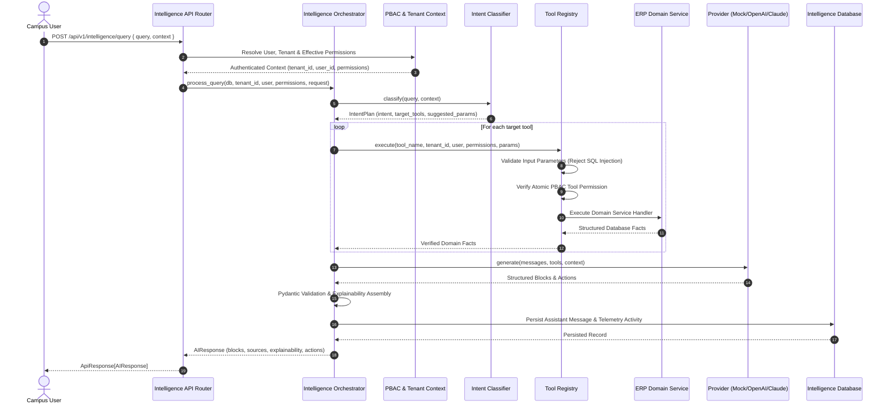

# CampusOS AI Architecture & Safety Boundary Specification

## 1. Architectural Philosophy

CampusOS AI is an **authoritative institutional facts extraction and synthesis engine**. It strictly separates:
1. **Understanding and intent recognition** (entrusted to language models / intent classifiers).
2. **Institutional fact derivation** (entrusted exclusively to deterministic domain services executing against PostgreSQL).
3. **Structured synthesis & explainability** (entrusted to LLMs producing validated JSON blocks).



---

## 2. The AI Safety Boundary

### 2.1 Forbidden Capabilities
The AI engine explicitly prohibits:
- Arbitrary SQL generation or LLM-driven raw SQL execution.
- ORM query synthesis generated dynamically by LLMs.
- Direct filesystem I/O or directory traversal.
- Python `eval()`, `exec()`, or sub-process spawning.
- Unrestricted HTTP requests or arbitrary web scraping.
- Autonomous mutation of authoritative state (e.g., publishing examination results, issuing refund transactions, modifying student grades, approving leave).

### 2.2 Allowed Actions
AI response actions are constrained strictly to **read-only navigational intents** that empower users to review relevant workflows in the web application:
- `VIEW_STUDENT`: Navigate to student profile.
- `VIEW_ATTENDANCE`: Navigate to attendance roster.
- `VIEW_INVOICE`: Navigate to fee ledger.
- `VIEW_EXAM_RESULT`: Navigate to grade card.
- `OPEN_DOCUMENT_VERIFICATION`: Navigate to compliance desk.

---

## 3. Provider Abstraction Model

The engine implements a standard protocol for pluggable LLM integrations:

```python
class LLMProvider(Protocol):
    """Protocol for institutional language model providers."""

    async def generate(
        self,
        messages: list[dict[str, Any]],
        tools: list[dict[str, Any]] | None = None,
        response_schema: type[BaseModel] | None = None,
        context: dict[str, Any] | None = None,
    ) -> LLMResponse:
        ...
```

### Supported Implementations:
1. **MockLLMProvider**:
   - Deterministic rule-based synthesizer used for testing and offline environments.
   - Evaluates incoming tool execution outputs and synthesizes multi-block responses (Metric cards, tables, advisory notes).
   - Generates deterministic explainability criteria and response structures.
2. **OpenAI / Claude / Gemini Adapters**:
   - Structured JSON output mode (`response_format={"type": "json_object"}`).
   - Grounded strictly on the JSON payload returned by executed domain tools.
   - Guarded by configurable system prompts enforcing adherence to provided facts.

---

## 4. How to Add a New Domain Tool

To expose a new institutional ERP capability to the Intelligence Engine:

1. **Implement Domain Tool Handler**:
   Create an async handler in `app/domains/intelligence/tools/<domain>.py`:
   ```python
   async def get_dormitory_occupancy_handler(
       db: AsyncSession, tenant_id: UUID, user: User, params: dict[str, Any]
   ) -> dict[str, Any]:
       # Query existing domain models within tenant_id scope
       ...
   ```

2. **Define Tool Definition**:
   Register a `ToolDefinition` with required permissions and sanitized parameter types:
   ```python
   ToolDefinition(
       name="infrastructure.get_dormitory_occupancy",
       domain="INFRASTRUCTURE",
       description="Hostel bed capacity and resident occupancy ratios",
       required_permissions=["hostel:read"],
       parameters=[ToolParameter("block_id", "string", False, "Hostel block UUID")],
       handler=get_dormitory_occupancy_handler,
   )
   ```

3. **Register in Tool Catalog**:
   Add the tool to the domain's tool list in `app/domains/intelligence/tools/__init__.py`.

4. **Update Intent Service**:
   Map natural language keywords or query patterns to the tool in `IntentService.classify()`.
