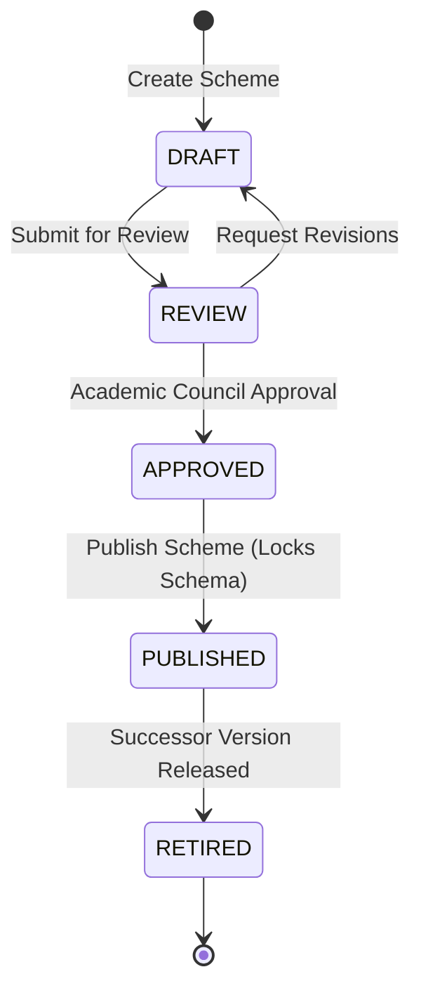
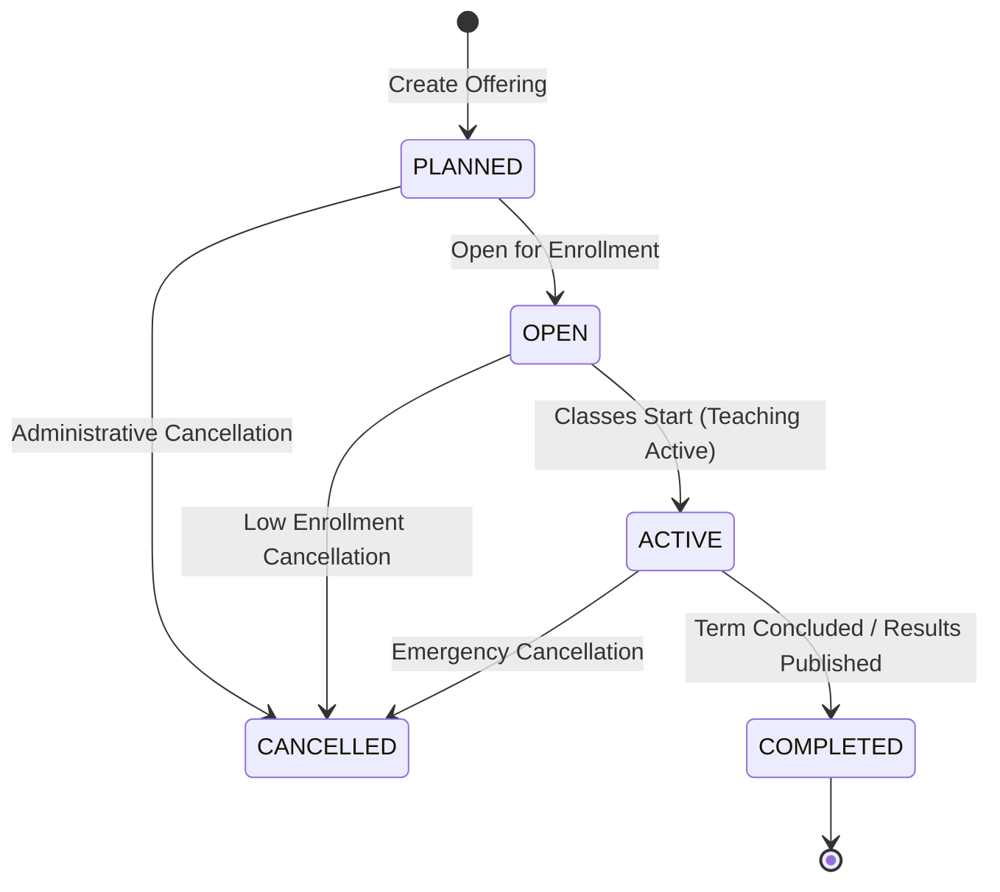

# Academic Management Engine — Architecture & Domain Model

## 1. Domain Concept Distinctions

CampusOS enforces clear separation across related academic concepts to avoid domain collapse:

| Domain Entity | Canonical Purpose | Lifetime & Scope |
| :--- | :--- | :--- |
| **Subject** (`Subject`) | Master catalog course definition (e.g., `CS201 Data Structures`). | Universal catalog across terms and regulations. |
| **Curriculum Scheme** (`CurriculumScheme`) | Program + Regulation degree syllabus roadmap with version tracking. | Versioned (`v1`, `v2`, ...), locked upon publishing (`is_locked = True`). |
| **Curriculum Subject** (`CurriculumSubject`) | Mapping of a subject into a specific semester roadmap with category & credits. | Component of a versioned curriculum roadmap. |
| **Course Offering** (`CourseOffering`) | Scheduled operational delivery of a subject for an Academic Year, Semester, and Section. | Operational academic term lifecycle (`PLANNED` -> `OPEN` -> `ACTIVE` -> `COMPLETED`/`CANCELLED`). |
| **Faculty Assignment** (`CourseFacultyAssignment`) | Instructor staffing on an offering with roles (`PRIMARY`, `CO_FACULTY`, `LAB_INSTRUCTOR`). | Temporal instructional assignment with start/end dates. |
| **Course Enrollment** (`CourseEnrollment`) | Student registration to an operational offering (`REGULAR`, `ELECTIVE`, `REPEAT`, `AUDIT`). | Term enrollment state (`ENROLLED`, `WITHDRAWN`, `COMPLETED`, `FAILED`). |
| **Classroom** (`Classroom`) | Physical or lab teaching space with seating capacity. | Physical campus infrastructure resource. |
| **Time Slot** (`TimeSlot`) | Configurable institution instructional period (e.g., `08:30 - 09:20`). | Standardized daily scheduling period. |
| **Timetable Entry** (`TimetableEntry`) | Weekly class allocation linking Offering, Day, TimeSlot, Section, Faculty, and Room. | Deterministic operational schedule. |

---

## 2. Institutional Hierarchy to Academic Execution Chain

```text
Tenant
 └── Institution
      └── Department
           └── Program
                ├── Regulation
                │    └── Curriculum Scheme (Versioned, e.g., v1, v2)
                │         └── Curriculum Subjects (Roadmap per Semester)
                │              └── Canonical Subject Catalog (L-T-P breakdown)
                │
                └── Academic Structure
                     ├── Academic Year (e.g., 2026-2027)
                     ├── Semester (e.g., Semester 3)
                     └── Section (e.g., Section A)
                          │
                          └── Course Offering (Operational Delivery Instance)
                               ├── Faculty Assignment (PRIMARY, CO_FACULTY, LAB_INSTRUCTOR)
                               ├── Student Course Enrollment (Roster & Batch Section Enrollment)
                               └── Timetable Entry (Day + TimeSlot + Room + Faculty)
```

---

## 3. Curriculum Versioning & Locking State Machine

To preserve historical accuracy for students admitted under past regulations, curricula are version-controlled:



- When a scheme transitions to **PUBLISHED**, `is_locked` is set to `True`.
- Additions or deletions of subjects on a locked curriculum are rejected with `422 Unprocessable Content`.
- Future curriculum revisions must be created as a new version increment (`version = v + 1`).

---

## 4. Course Offering Lifecycle State Machine



- **PLANNED**: Offering created; staffing planned; no students can register.
- **OPEN**: Student enrollment roster open (individual or batch section enrollment).
- **ACTIVE**: Classes underway; timetable scheduled; attendance sessions record against this offering.
- **COMPLETED**: Term ended; syllabus delivered; handed over to Examination/Grading.
- **CANCELLED**: Offering halted; historical records preserved.

---

## 5. Multi-Dimensional Timetable Clash Prevention

The timetable engine enforces deterministic validation before writing to `academics_timetable_slots`:

1. **Section Collision**: A section cannot be scheduled for two course offerings at the same day and time slot.
   ```text
   Conflict: (tenant_id, academic_year_id, semester_id, day_of_week, time_slot_id, section_id)
   ```
2. **Faculty Double-Booking**: A faculty member cannot teach two classes simultaneously anywhere on campus.
   ```text
   Conflict: (tenant_id, academic_year_id, semester_id, day_of_week, time_slot_id, faculty_id)
   ```
3. **Room Overbooking**: A classroom or lab cannot host two simultaneous sessions.
   ```text
   Conflict: (tenant_id, academic_year_id, semester_id, day_of_week, time_slot_id, room_id)
   ```

Any collision immediately returns `409 Conflict` with a descriptive message explaining the exact resource and period clash.

---

## 6. Audit Logging

Every critical academic event emits an immutable `AuditLog` entry:
- `SUBJECT_CREATED`, `SUBJECT_UPDATED`
- `CURRICULUM_CREATED`, `CURRICULUM_UPDATED`, `CURRICULUM_PUBLISHED`
- `COURSE_OFFERING_CREATED`, `OFFERING_STATUS_TRANSITIONED`
- `FACULTY_ASSIGNED`, `FACULTY_UNASSIGNED`
- `STUDENT_ENROLLED`, `SECTION_BATCH_ENROLLED`, `STUDENT_WITHDRAWN`
- `TIMETABLE_ENTRY_CREATED`, `TIMETABLE_ENTRY_DELETED`
