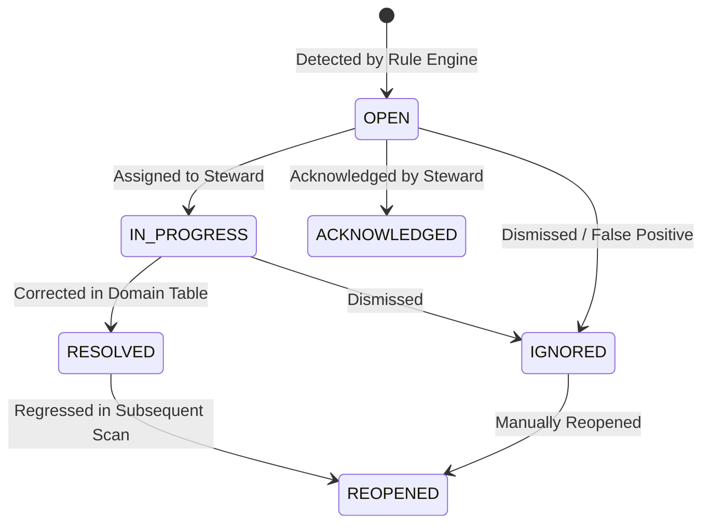
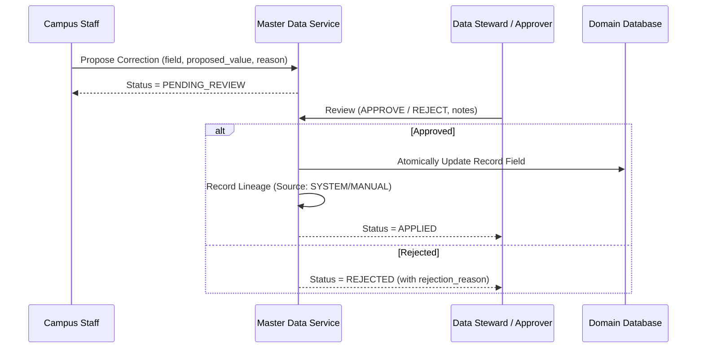

# Data Stewardship & Correction Workflows

CampusOS provides an institutional data stewardship control plane that empowers designated data stewards and administrators to triage quality defects, remediate data anomalies, and govern master attribute modifications.

---

## 1. Stewardship Roles & Ownership

Each master data entity defines a designated steward role responsible for its lifecycle integrity:

- **Student Master**: `STUDENT_ADMINISTRATOR` (People Domain)
- **Faculty Master**: `FACULTY_ADMINISTRATOR` (People Domain)
- **Staff Master**: `STAFF_ADMINISTRATOR` (People Domain)
- **Department / Program Master**: `ACADEMIC_ADMINISTRATOR` (Academics Domain)
- **Placement Company Master**: `PLACEMENT_OFFICER` (Placement Domain)
- **Fee Category Master**: `FINANCE_ADMINISTRATOR` (Finance Domain)
- **Document Category Master**: `RECORDS_OFFICER` (Digital Records Domain)

---

## 2. Quality Issue Remediation Lifecycle

Data quality issues are tracked as first-class entities in `data_quality_issues`:

### State Transitions

### Issue Attributes

- `id`: Unique defect UUID
- `tenant_id`: Multi-tenant boundary
- `master_type`: Governed domain entity category
- `record_id`: Target domain record UUID
- `rule_key`: Associated validation rule identifier
- `severity`: `INFO`, `WARNING`, `ERROR`, or `CRITICAL`
- `status`: Current remediation stage
- `issue_message`: Human-readable description of the anomaly
- `assigned_to`: User UUID of the assigned steward
- `resolved_at`: Resolution timestamp
- `resolution_notes`: Remediation rationale and changes made

---

## 3. Controlled Correction Workflow

To protect institutional integrity, changes to sensitive master attributes follow a controlled four-stage correction workflow in `master_data_corrections`:

---

## 4. Stewardship Queue APIs

- `GET /api/v1/master-data/quality/issues`: List pending issues with filters (`status`, `severity`, `master_type`).
- `GET /api/v1/master-data/quality/issues/{id}`: Detailed view of issue and context.
- `PATCH /api/v1/master-data/quality/issues/{id}`: Assign steward, update status, and attach resolution notes.
- `POST /api/v1/master-data/corrections`: Submit attribute correction proposal.
- `GET /api/v1/master-data/corrections`: List pending and historical correction requests.
- `POST /api/v1/master-data/corrections/{id}/review`: Approve or reject correction proposal.
