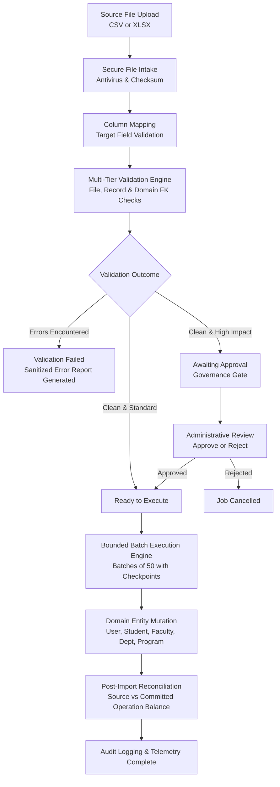

# CampusOS Enterprise Data Import, Bulk Migration & Reconciliation Operations Manual

## 1. Executive Summary & Architecture Overview

The **Enterprise Data Import, Bulk Migration, Data Reconciliation, and Operational Data Exchange** module provides CampusOS higher education institutions with a governed, audited, and repeatable pipeline for onboarding institutional datasets. When migrating from legacy ERPs, spreadsheets, or third-party academic systems, institutions can ingest data safely without compromising multi-tenant isolation, referential integrity, or audit compliance.

---

## 2. Supported Import Templates & Domain Catalogs

CampusOS ships with 5 certified system import templates out-of-the-box:

| Template Code | Target Domain | Target Entity | Required Fields | Supported Matching Keys | Approval Threshold | Supported Policies |
| :--- | :--- | :--- | :--- | :--- | :--- | :--- |
| **`STUDENTS_BULK_IMPORT`** | Students | `StudentProfile` & `User` | `email`, `first_name`, `last_name`, `admission_number`, `date_of_birth`, `gender`, `admission_date`, `expected_graduation_date`, `program_code`, `batch_name` | `admission_number`, `registration_number`, `roll_number`, `email` | 50 records | `CREATE_NEW`, `UPDATE_EXISTING`, `UPSERT`, `SKIP_CONFLICTS` |
| **`FACULTY_BULK_IMPORT`** | Faculty | `FacultyProfile` & `User` | `email`, `first_name`, `last_name`, `employee_code`, `department_code`, `designation`, `highest_qualification`, `joining_date` | `employee_code`, `email` | 25 records | `CREATE_NEW`, `UPDATE_EXISTING`, `UPSERT`, `SKIP_CONFLICTS` |
| **`DEPARTMENTS_IMPORT`** | Core | `Department` | `code`, `name` | `code` | 100 records | `CREATE_NEW`, `UPDATE_EXISTING`, `UPSERT` |
| **`PROGRAMS_IMPORT`** | Core | `Program` | `code`, `name`, `department_code`, `degree_level` | `code` | 50 records | `CREATE_NEW`, `UPDATE_EXISTING`, `UPSERT` |
| **`COURSES_IMPORT`** | Academics | `Subject` | `code`, `name`, `department_code` | `code` | 100 records | `CREATE_NEW`, `UPDATE_EXISTING`, `UPSERT` |

---

## 3. Secure File Intake & Sanitization

1. **Approved File Formats:**
   - `.csv` (Comma-Separated Values, UTF-8/Latin-1 with automatic delimiter sniffing).
   - `.xlsx` / `.xls` (OpenXML Spreadsheet via `openpyxl` with `data_only=True` and `read_only=True`).
2. **Formula & Macro Execution Defense:**
   - Spreadsheet formulas are evaluated statically using cell values (`data_only=True`). No VBA macros, external links, DDE commands, or embedded scripts are ever executed.
3. **CSV Formula Injection (DDE) Prevention:**
   - All cell values starting with `=`, `+`, `-`, `@`, `\t`, or `\r` are sanitized by prefixing with `'` (apostrophe) in downloadable error reports and exports.
4. **Storage & Isolation:**
   - Files are stored in tenant-isolated paths: `tenants/{tenant_id}/imports/{job_id}/{filename}` via `get_document_storage()`.
   - Direct server filesystem paths and arbitrary remote URLs are strictly rejected.
   - SHA-256 checksums are calculated upon upload to detect exact duplicates and ensure data integrity.

---

## 4. Protected System Fields & Mapping Engine

The column mapping pipeline converts arbitrary source headers into approved target entity fields.

### Strict Security Invariants:
- Tenant users cannot map or modify **`PROTECTED_SYSTEM_FIELDS`**:
  - `id`
  - `tenant_id`
  - `created_at`
  - `updated_at`
  - `deleted_at`
  - `password_hash`
  - `is_superuser`
  - `failed_login_attempts`
  - `locked_until`
- Attempting to map to any protected field immediately raises `PermissionDeniedException`.
- Arbitrary code, Python, SQL, or shell expressions are strictly prohibited. Supported transformations are declarative: `UPPER`, `LOWER`, `TRIM`, `DATE_FORMAT`, `NUMERIC`.

---

## 5. Multi-Tier Validation Engine

Validation runs deterministically before any execution:

1. **File-Level Validation:**
   - Extension and MIME type verification.
   - Header non-emptiness and uniqueness.
   - Record count ceiling enforcement (maximum 10,000 records per job).
2. **Record-Level Validation:**
   - Mandatory presence of all required template fields.
   - Email format matching RFC 5322 regex.
   - ISO date formatting (`YYYY-MM-DD`, `DD/MM/YYYY`).
   - Enumeration values (e.g. `gender` $\in$ `{MALE, FEMALE, OTHER}`).
   - Intra-file duplicate matching key detection.
3. **Domain-Level Referential Validation:**
   - Foreign key resolution against tenant-owned records:
     - `department_code` exists in tenant's `Department` table.
     - `program_code` exists in tenant's `Program` table.
     - `batch_name` exists in tenant's `Batch` table.
   - Duplicate checking against existing database state (e.g., student admission number, faculty employee code). Collision records are populated into `ImportConflictRecord`.

---

## 6. Approval Gating & Invalidation Workflows

To prevent catastrophic accidental bulk overwrites:
1. **Approval Threshold:**
   - Jobs exceeding template threshold (e.g. $\ge 50$ students, $\ge 25$ faculty) automatically enter `AWAITING_APPROVAL`.
   - Execution is blocked (`ImportApprovalRequiredException`) until an administrator submits formal approval.
2. **Approval Invalidation:**
   - If an approved job has its column mapping or source file updated, the approval is immediately invalidated (`approved_at = None`), returning the job to `MAPPING_PENDING` or `DRAFT`.

---

## 7. Bounded Batch Execution Engine

- **Batch Size:** Records are executed in configurable bounded batches (default 50 records) to avoid long database transaction locks.
- **Checkpointing:** The job persists `last_processed_row` and record counters (`created_record_count`, `updated_record_count`, `failed_record_count`).
- **Resumability:** Worker restarts or partial failures can resume from `last_processed_row + 1` without duplicating previous rows.
- **Atomic Entities:** Student profiles automatically provision both `User` authentication records and `StudentProfile` academic records inside the same transaction.

---

## 8. Post-Import Data Reconciliation

Post-import reconciliation audits the import:
- Measures:
  - Source Record Count ($N_{\text{src}}$)
  - Created Records ($N_{\text{created}}$)
  - Updated Records ($N_{\text{updated}}$)
  - Skipped Records ($N_{\text{skipped}}$)
  - Failed Records ($N_{\text{failed}}$)
  - Invalid Records ($N_{\text{invalid}}$)
- **Balance Equation:**
  $$\Delta = N_{\text{src}} - (N_{\text{created}} + N_{\text{updated}} + N_{\text{skipped}} + N_{\text{failed}} + N_{\text{invalid}})$$
- If $\Delta = 0$ and $N_{\text{failed}} = 0$, status is set to `MATCHED`. Otherwise, `DISCREPANCY_DETECTED`.

---

## 9. REST API Reference

| Endpoint | Method | Permission | Summary |
| :--- | :--- | :--- | :--- |
| `/api/v1/data-import/templates` | `GET` | `DATA_IMPORT_READ` | List supported import templates |
| `/api/v1/data-import/templates/{code}` | `GET` | `DATA_IMPORT_READ` | Get template specifications |
| `/api/v1/data-import/templates/{code}/download-blank` | `GET` | `DATA_IMPORT_READ` | Download blank CSV template |
| `/api/v1/data-import/jobs` | `POST` | `DATA_IMPORT_CREATE` | Create import job in DRAFT status |
| `/api/v1/data-import/jobs` | `GET` | `DATA_IMPORT_READ` | List tenant import jobs |
| `/api/v1/data-import/jobs/{id}` | `GET` | `DATA_IMPORT_READ` | Get import job status and telemetry |
| `/api/v1/data-import/jobs/{id}/upload` | `POST` | `DATA_IMPORT_CREATE` | Upload CSV or XLSX source file |
| `/api/v1/data-import/jobs/{id}/mapping` | `PUT` | `DATA_IMPORT_CREATE` | Configure column mappings |
| `/api/v1/data-import/jobs/{id}/validate` | `POST` | `DATA_IMPORT_CREATE` | Run multi-tier validation |
| `/api/v1/data-import/jobs/{id}/preview` | `GET` | `DATA_IMPORT_READ` | Preview planned operations |
| `/api/v1/data-import/jobs/{id}/approve` | `POST` | `DATA_IMPORT_APPROVE` | Approve or reject import job |
| `/api/v1/data-import/jobs/{id}/execute` | `POST` | `DATA_IMPORT_EXECUTE` | Execute batch import |
| `/api/v1/data-import/jobs/{id}/cancel` | `POST` | `DATA_IMPORT_CANCEL` | Cancel eligible in-flight job |
| `/api/v1/data-import/jobs/{id}/reconcile` | `POST` | `DATA_IMPORT_RECONCILE` | Run post-import reconciliation |
| `/api/v1/data-import/jobs/{id}/conflicts` | `GET` | `DATA_IMPORT_READ` | List detected duplicate conflicts |
| `/api/v1/data-import/conflicts/{id}/resolve`| `POST` | `DATA_IMPORT_MANAGE` | Apply conflict resolution policy |
| `/api/v1/data-import/jobs/{id}/error-report`| `GET` | `DATA_IMPORT_DOWNLOAD` | Download sanitized CSV error report |

---

## 10. Operational Runbooks & Troubleshooting

### Scenario A: Job Stuck in `AWAITING_APPROVAL`
- **Root Cause:** Total valid records $\ge$ template threshold.
- **Action:** Have an authorized institution administrator (`INSTITUTION_ADMIN` or `SUPER_ADMIN`) review `/api/v1/data-import/jobs/{id}/preview` and submit POST to `/api/v1/data-import/jobs/{id}/approve` with `{"approved": true}`.

### Scenario B: Validation Fails with Foreign Key Errors
- **Root Cause:** Referencing academic codes (e.g. `program_code="BTECH_AI"`) that do not exist in the tenant database.
- **Action:** First import `DEPARTMENTS_IMPORT` and `PROGRAMS_IMPORT` before executing `STUDENTS_BULK_IMPORT`.

### Scenario C: Partial Failure During Batch Execution
- **Root Cause:** Transient database error or bad payload on a specific row.
- **Action:** Inspect row errors via `/api/v1/data-import/jobs/{id}/error-report`. Resume execution with POST `/api/v1/data-import/jobs/{id}/execute`; the engine will resume from `last_processed_row + 1` without duplicating previous entries.
