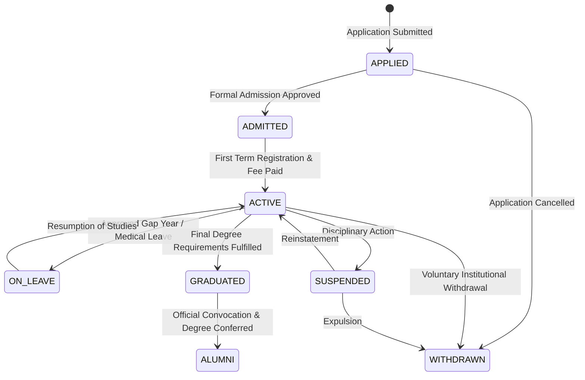
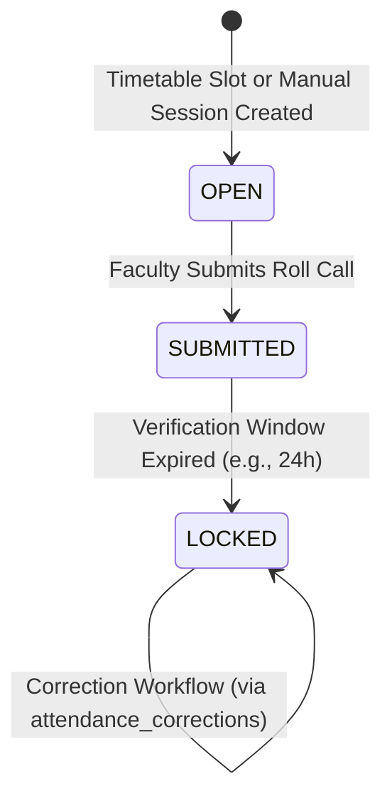
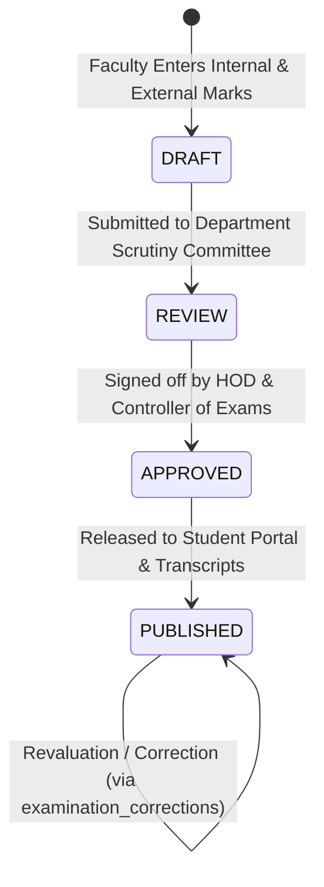
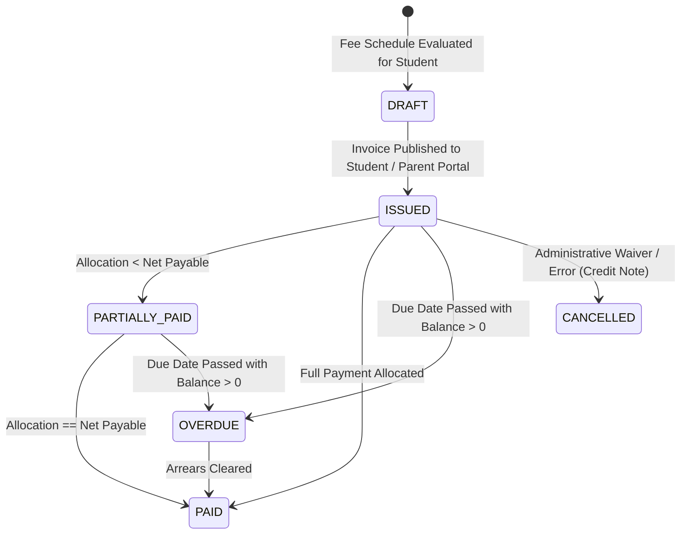
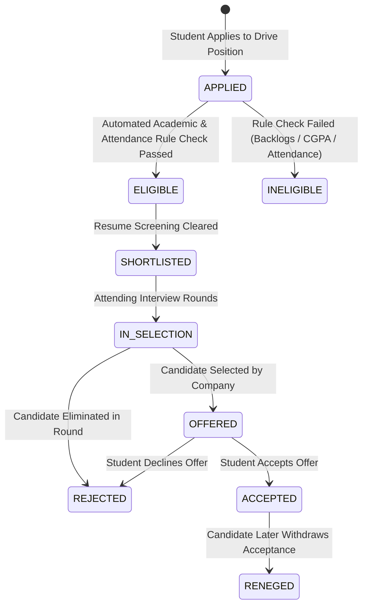
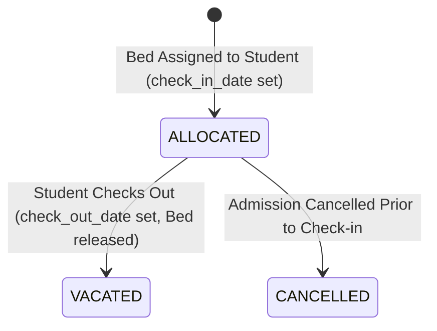

# CampusOS — Data Lifecycle & State Machines

## 1. Data Classification Model

CampusOS classifies all persistent entities into four operational categories to govern deletion, mutability, and auditing:

| Classification | Definition | Mutability | Deletion Strategy | Examples |
| :--- | :--- | :--- | :--- | :--- |
| **Mutable Operational** | Day-to-day administrative data subject to active updates during setup. | Fully mutable with audit logging. | Soft delete (`is_active = FALSE` or `deleted_at`). | Department profiles, club descriptions, announcement drafts, timetable draft slots. |
| **Historical Temporal** | State transitions and assignments that preserve institutional truth over time. | Append-only / Date-ranged (`start_date`, `end_date`). | Never deleted; marked superseded or vacated. | Semester enrollments, student status history, hostel bed allocations, bus pass allocations. |
| **Immutable Records** | Official legal, financial, or academic records that form the institutional ledger. | Write-once. Direct updates prohibited. | Never deleted. Corrections handled via adjustments. | Published exam results, invoices, payment transactions, official receipts, audit logs. |
| **Reference / Configuration** | Institutional master catalogs and system definitions. | Admin-controlled updates. | Soft delete or disabled flag. | Degree programs, grade scale items, fee category definitions, system permissions. |

---

## 2. Core Lifecycle State Machines

### 2.1 Student Lifecycle State Machine

- **Invariants**:
  - Transition from `ADMITTED` to `ACTIVE` requires creating a row in `people_student_semester_enrollments` for Semester 1.
  - Transition to `GRADUATED` requires validation of credit requirements against the student's statutory `Regulation`.
  - Every transition generates an immutable record in `people_student_status_history`.

---

### 2.2 Attendance Session Lifecycle

- **Invariants**:
  - When `OPEN`, faculty can toggle attendance marks freely.
  - When `SUBMITTED`, marks can only be modified with a logged reason.
  - When `LOCKED`, direct row updates are rejected by API guards. Any correction requires a formal `AttendanceCorrectionRequest` approved by the Head of Department.

---

### 2.3 Examination Result Lifecycle

- **Invariants**:
  - When `PUBLISHED`, the result is strictly immutable.
  - If a student requests revaluation or an administrative error is verified, a new audit-tracked `examination_corrections` transaction modifies the moderated marks with dual approval, preserving both original and revised marks.

---

### 2.4 Invoice Lifecycle

- **Invariants**:
  - Once `ISSUED`, line items cannot be deleted or mutated in-place.
  - Concessions, waivers, or billing adjustments are recorded as `finance_adjustments` (Credit Notes) referencing the invoice.
  - `balance_amount = net_payable - paid_amount`.

---

### 2.5 Placement Application Lifecycle

---

### 2.6 Hostel Bed Allocation Lifecycle

- **Historical Invariant**:
  - When a student moves from Room 101 to Room 204, the Room 101 allocation row is NOT updated to Room 204. The Room 101 row is updated with `check_out_date = CURRENT_DATE` and `status = 'VACATED'`. A new row for Room 204 is inserted with `check_in_date = CURRENT_DATE` and `status = 'ALLOCATED'`.
