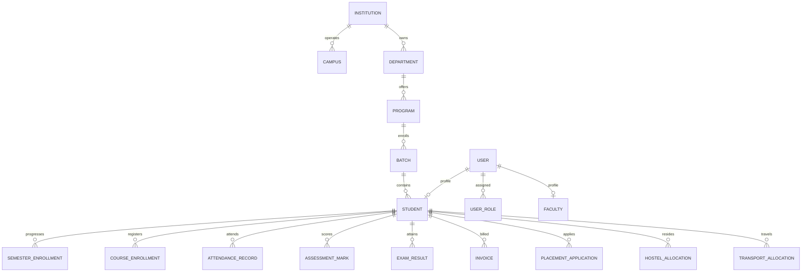
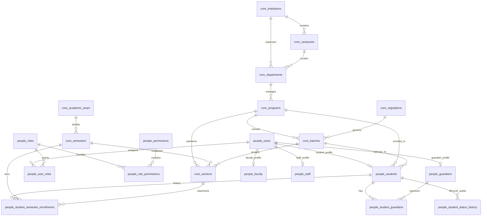
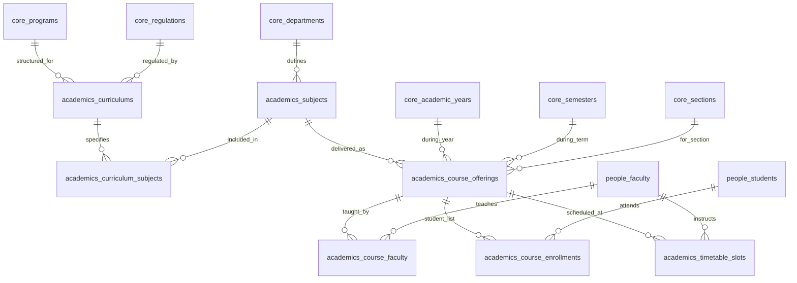
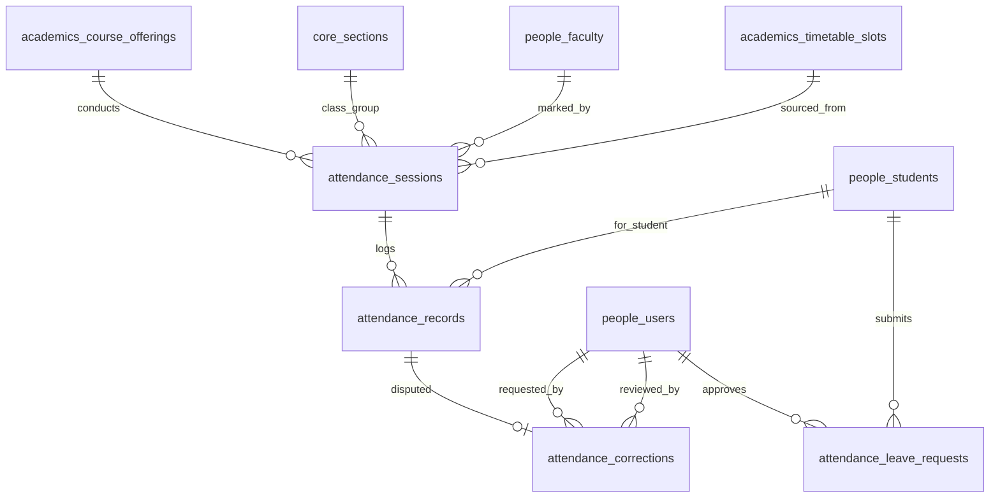
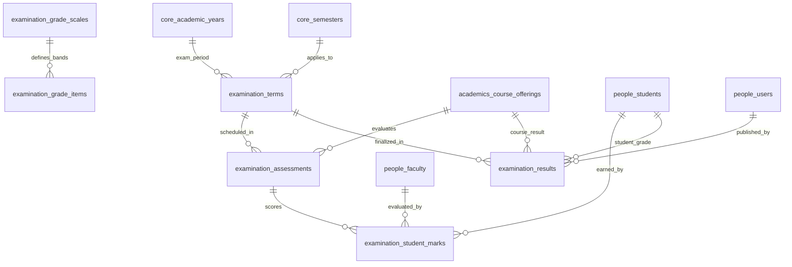
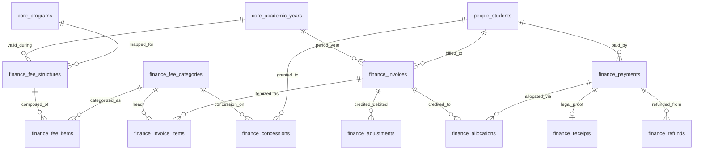
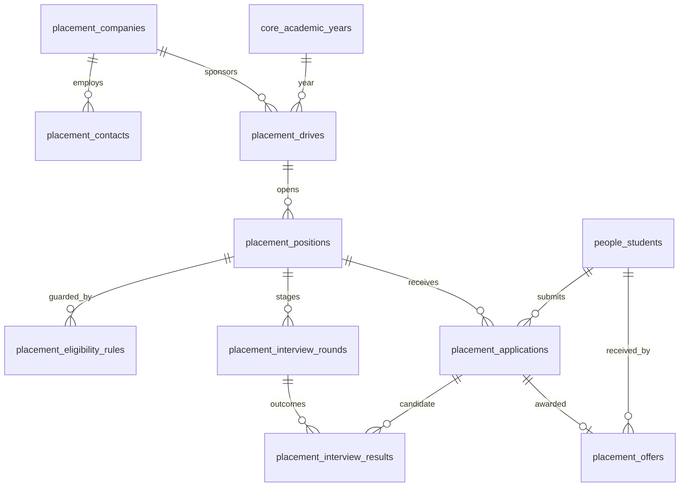
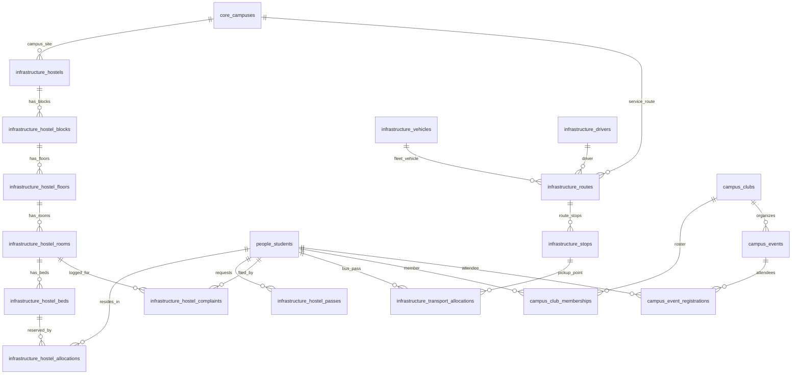
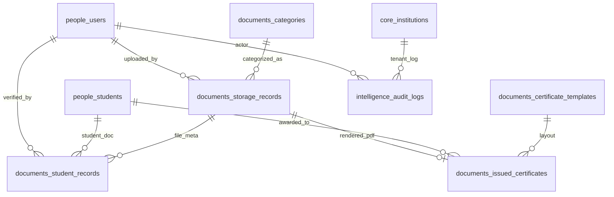

# CampusOS — Entity Relationship Diagrams (ERD)

This document contains visual Entity Relationship Diagrams for CampusOS using standard Mermaid syntax.

---

## 1. High-Level System Architecture ERD

---

## 2. Core & People Domain ERD

---

## 3. Academics Domain ERD

---

## 4. Attendance Domain ERD

---

## 5. Examination & Grading ERD

---

## 6. Finance & Billing Domain ERD

---

## 7. Placement Domain ERD

---

## 8. Campus & Infrastructure ERD

---

## 9. Documents & Audit ERD

