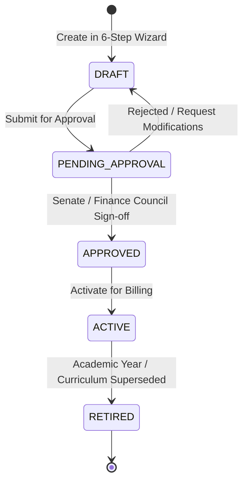
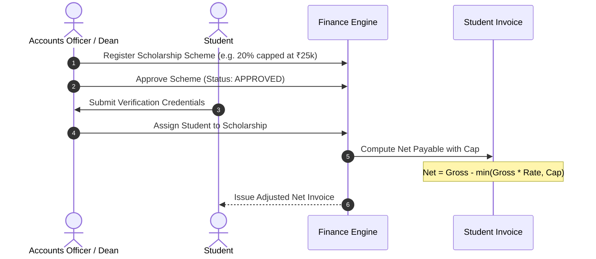
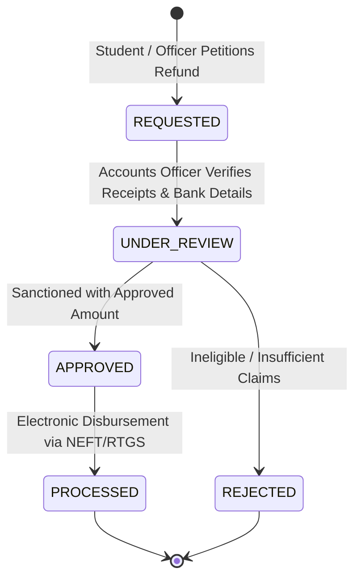

# CampusOS — Finance Workflows & Lifecycle State Machines

This document details the end-to-end operational workflows for fee lifecycle governance, student fee assignment, invoicing, payment allocation, receipting, scholarship distribution, and refunds.

---

## 1. Fee Structure Governance Lifecycle

Fee structures undergo strict academic and financial governance before being applied to students.



### State Definitions & Permitted Actions:
- **DRAFT**: Editable by Finance Officer. Components, heads, and applicability can be freely modified. Not applicable to students.
- **PENDING_APPROVAL**: Locked from routine edits. Displayed in Academic Senate / Dean Finance approval queue.
- **APPROVED**: Formally ratified. Awaiting academic term start.
- **ACTIVE**: In production. Available for student fee assignments and automatic cohort billing.
- **RETIRED**: Archived. Preserved for historical auditing and transcript verification. Cannot receive new student assignments.

---

## 2. Invoicing, Payments & Double-Entry Allocation Flow

The central revenue cycle moves through deterministic stages:

```text
1. Fee Structure (ACTIVE)
       │
       ▼
2. Student Fee Assignment
       ├── (-) Verified Scholarship Concession
       ├── (-) Institutional Early Bird Waiver
       ▼
3. Invoice Generation
       ├── Status: ISSUED
       ├── Net Payable = Gross - Scholarship - Discount - Adjustment
       ├── Outstanding Balance = Net Payable
       ▼
4. Inbound Payment Received (Bank / UPI / Cash)
       ├── Status: SUCCESS
       ├── Allocation Engine:
       │     Allocate to Invoice Lines (Priority: Tuition > Exam > Lab > Other)
       │     Invoice Paid Amount += Allocation
       │     Invoice Outstanding -= Allocation
       │     Status: PARTIALLY_PAID or PAID
       ▼
5. Instant Legal Receipt Generation
       ├── Receipt Voucher: REC-YYYY-XXXXX
       ├── Numeric Amount: ₹XX,XXX.00
       ├── Verified Words: "Rupees ... Only"
       └── Dual Verification Hash
```

### Invariant Rules:
1. Payments cannot exceed the invoice's remaining `outstandingBalance`.
2. Every successful payment produces exactly one immutable `Receipt`.
3. Invoices with `paidAmount > 0` cannot be directly deleted or cancelled; they require an explicit credit adjustment or formal refund petition.

---

## 3. Scholarship Application & Concession Workflow

Scholarships provide controlled tuition reductions based on merit, quota, or sports excellence:



---

## 4. Refund & Disbursement Workflow

Institutional refunds manage the reimbursement of caution deposits, excess fees, or cancelled enrollments:



### Controls & Audit Integrity:
- Every refund links to the original `Invoice` and `Payment` transaction reference.
- Approved amount cannot exceed the original payment's captured amount.
- Rejection requires an explicit justification stored in the immutable timeline.
- The `PROCESSED` state records the precise electronic disbursement timestamp and officer identity.
