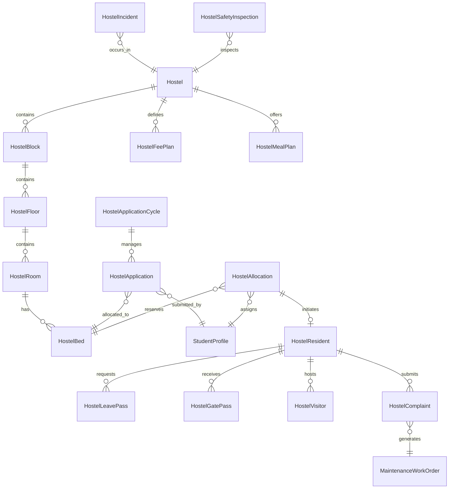

# Enterprise Hostel, Residential Life, Room Allocation & Student Accommodation Management Runbook

## Executive Summary

The **CampusOS Hostel and Residential Life Management Module** (Step 54) delivers a production-grade, authoritative student accommodation and residential life orchestration engine.

CampusOS Tagline: **"One Campus. One System. One Source of Truth."**

This module encompasses central residential facility administration, student accommodation application cycles, bed and room allocation, occupancy management, check-in and check-out resident lifecycles, residential fees, meal plan headcount projections, maintenance service requests, gate passes and outings, visitor security, and confidential safety incident management.

It integrates seamlessly with existing Institution, Campuses, Student Lifecycle, People, Finance, Facilities, Asset Management, Documents, Audit, and Notifications infrastructure without duplicating student identities, financial ledgers, maintenance work orders, or parallel approval engines.

---

## 1. Architecture & Governance Principles

### 1.1 The Ten Golden Rules of Residential Life Governance

1. **Absolute Multi-Tenant Isolation**: Every hostel, block, floor, room, bed, application cycle, accommodation application, allocation, resident lifecycle entry, fee plan, meal plan, outing pass, visitor pass, gate pass, maintenance complaint, and confidential incident is strictly isolated by `tenant_id`. Cross-tenant data access is prohibited at database and service boundaries.
2. **One Source of Occupancy Truth**: `HostelBed` is the sole atomic unit of accommodation. A bed is in exactly one state: `AVAILABLE`, `RESERVED`, `OCCUPIED`, `BLOCKED`, `UNDER_MAINTENANCE`, or `RETIRED`. Room capacity cannot be reduced below current active occupancy without an authorized relocation workflow.
3. **Double-Allocation Prevention via Concurrency Locks**: Bed reservations and allocations utilize database-level row locking (`SELECT ... FOR UPDATE` / transactional exclusion) to prevent concurrent double-booking of beds under high contention.
4. **Distinct Allocation vs. Physical Occupancy**: Bed allocation approval is never equated with physical resident check-in. Resident check-in requires physical verification, key/access-card handover, and inventory checklist capture.
5. **Finance Remains Authoritative**: Hostel accommodation rent and damage recovery charges are invoiced through the existing authoritative Finance module (`finance_invoices` and `finance_invoice_line_items`). No duplicate ledgers or receipt caches are introduced.
6. **Maintenance & Asset Integration**: Residential maintenance complaints atomically generate linked `MaintenanceWorkOrder` records in the institutional Asset Management module. Complaints track SLAs, technician assignments, and resident satisfaction feedback without bypassing central facilities workflows.
7. **Confidentiality & Least Privilege**: Student supporting medical/accessibility documents and safety incident reports are subject to strict role-based access control. Unauthorized reviewers and ordinary students cannot access private disclosures or disciplinary records.
8. **Independent Movement vs. Academic Attendance**: Outing and night attendance records capture residential presence and curfew adherence independently of classroom academic attendance. Physical presence is never inferred without positive verification.
9. **Automated Sweep & Operations Monitoring**: Scheduled operations background sweeps monitor curfew violations, expired temporary bed reservations, overdue visitor passes, expiring gate passes, and maintenance SLA breaches.
10. **Forensic Auditability & Domain Event Outbox**: Every key transition (allocation, transfer, check-in, check-out, damage invoice generation, incident reporting, gate verification) emits structured audit events (`AuditEventCategory.RESIDENTIAL_*`) and transactional outbox events (`HOSTEL_*`).

---

## 2. Domain Data Architecture



---

## 3. Database Models & Migration Details

Migration: `039_enterprise_hostel_residential_life_management.py` (chains linearly from `038_student_admissions_enrollment_management`).

### Schema Overview:

| Table Name | Entity | Key Constraints |
|---|---|---|
| `infrastructure_hostels` | Hostel Facilities | `UniqueConstraint("tenant_id", "code")` |
| `infrastructure_hostel_blocks` | Hostel Blocks/Wings | FK `hostel_id` |
| `infrastructure_hostel_floors` | Hostel Floor Levels | FK `block_id` |
| `infrastructure_hostel_rooms` | Dormitory Rooms | `Index("floor_id")`, `Index("room_number")` |
| `infrastructure_hostel_beds` | Authoritative Beds | `UniqueConstraint("room_id", "bed_code")` |
| `infrastructure_hostel_application_cycles` | Application Cycles | `UniqueConstraint("tenant_id", "academic_year_id", "code")` |
| `infrastructure_hostel_applications` | Accommodation Applications | `Index("cycle_id", "student_id")` |
| `infrastructure_hostel_allocations` | Bed Allocations & Reservations | `Index("bed_id", "student_id")` |
| `residential_residents` | Resident Check-In Lifecycle | `UniqueConstraint("allocation_id")` |
| `residential_fee_plans` | Fee Plans & Tariffs | `UniqueConstraint("tenant_id", "code")` |
| `residential_meal_plans` | Mess & Meal Catering Plans | `UniqueConstraint("tenant_id", "code")` |
| `residential_meal_enrollments` | Student Meal Enrollments | `Index("meal_plan_id", "student_id")` |
| `infrastructure_hostel_passes` | Outing & Leave Passes | `Index("tenant_id", "student_id", "status")` |
| `residential_night_attendance` | Curfew Attendance | `UniqueConstraint("tenant_id", "hostel_id", "resident_id", "attendance_date")` |
| `residential_visitors` | Visitor Registration | `Index("hostel_id", "host_student_id")` |
| `residential_gate_passes` | Gate Passes | `UniqueConstraint("tenant_id", "pass_code")` |
| `residential_complaints` | Maintenance Complaints | `UniqueConstraint("tenant_id", "ticket_number")` |
| `residential_incidents` | Safety Incidents | `UniqueConstraint("tenant_id", "incident_number")` |
| `residential_safety_inspections` | Facility Safety Audits | `Index("hostel_id", "inspection_date")` |

---

## 4. API Endpoints

Mounted prefix: `/api/v1/residential`

### 4.1 Facilities & Inventory
- `GET /api/v1/residential/hostels` — Search and filter hostels.
- `POST /api/v1/residential/hostels` — Register a residential hostel facility.
- `GET /api/v1/residential/hostels/{id}` — Fetch hostel details with hierarchy.
- `PUT /api/v1/residential/hostels/{id}` — Update hostel details.
- `POST /api/v1/residential/hostels/{id}/blocks` — Add block to hostel.
- `POST /api/v1/residential/blocks/{id}/floors` — Add floor to block.
- `GET /api/v1/residential/rooms` — Search rooms by hostel, floor, room type.
- `POST /api/v1/residential/rooms` — Create room with automated bed generation.
- `GET /api/v1/residential/beds` — Authoritative bed inventory search.
- `POST /api/v1/residential/beds/{id}/block` — Block bed for maintenance or safety hold.
- `POST /api/v1/residential/beds/{id}/unblock` — Release blocked bed.

### 4.2 Applications & Allocations
- `GET /api/v1/residential/application-cycles` — List accommodation cycles.
- `POST /api/v1/residential/application-cycles` — Create application cycle.
- `GET /api/v1/residential/applications` — List student accommodation applications.
- `POST /api/v1/residential/applications` — Submit student accommodation application.
- `POST /api/v1/residential/applications/{id}/review` — Warden approval/waitlist/rejection.
- `GET /api/v1/residential/allocations` — List active and historical allocations.
- `POST /api/v1/residential/allocations` — Concurrency-locked bed allocation.
- `POST /api/v1/residential/allocations/{id}/transfer` — Authorized room transfer.
- `POST /api/v1/residential/allocations/batch/preview` — Dry-run batch allocation engine.
- `POST /api/v1/residential/allocations/batch/commit` — Transactional batch commit.

### 4.3 Resident Lifecycle
- `POST /api/v1/residential/residents/{allocation_id}/check-in` — Check-in, inventory handover, key card.
- `POST /api/v1/residential/residents/{resident_id}/check-out` — Check-out, inspection, damage charge invoice.
- `GET /api/v1/residential/residents/{resident_id}` — View resident record and dependencies.

### 4.4 Fees & Mess Management
- `GET /api/v1/residential/fee-plans` — List residential fee tariffs.
- `POST /api/v1/residential/fee-plans` — Create residential fee plan.
- `POST /api/v1/residential/fee-plans/{id}/generate-invoices` — Generate Finance module invoices.
- `GET /api/v1/residential/meal-plans` — List mess meal plans.
- `POST /api/v1/residential/meal-plans` — Create meal plan.
- `POST /api/v1/residential/meal-plans/{id}/enroll` — Enroll student in meal plan with dietary notes.
- `GET /api/v1/residential/meal-plans/{id}/headcount` — Projected breakfast/lunch/dinner headcount.

### 4.5 Movement, Gate Passes & Visitors
- `GET /api/v1/residential/outings` — List resident outings and overnight leaves.
- `POST /api/v1/residential/outings` — Submit outing request.
- `POST /api/v1/residential/outings/{id}/departure` — Checkpoint gate departure.
- `POST /api/v1/residential/outings/{id}/return` — Checkpoint gate return (auto-flags overdue).
- `GET /api/v1/residential/gate-passes` — List issued gate passes.
- `POST /api/v1/residential/gate-passes` — Issue gate pass.
- `POST /api/v1/residential/gate-passes/{id}/verify` — Checkpoint gate validation.
- `GET /api/v1/residential/visitors` — Visitor registry.
- `POST /api/v1/residential/visitors` — Register visitor.
- `POST /api/v1/residential/visitors/{id}/check-out` — Visitor checkout.

### 4.6 Maintenance & Service Requests
- `GET /api/v1/residential/service-requests` — List maintenance complaints.
- `POST /api/v1/residential/service-requests` — File complaint (atomically links to Asset Work Order).
- `PUT /api/v1/residential/service-requests/{id}` — Resolve complaint with evidence.
- `POST /api/v1/residential/service-requests/{id}/feedback` — Resident star rating and comments.

### 4.7 Safety & Inspections
- `GET /api/v1/residential/incidents` — Restricted incident log.
- `POST /api/v1/residential/incidents` — Report safety/security incident.
- `GET /api/v1/residential/safety-inspections` — Facility safety audit logs.
- `POST /api/v1/residential/safety-inspections` — Record comprehensive safety audit.

### 4.8 Reports & Dashboards
- `GET /api/v1/residential/occupancy/dashboard` — Live authoritative occupancy rates.
- `GET /api/v1/residential/reports/occupancy` — Detailed breakdown by hostel and block.
- `GET /api/v1/residential/dashboard/summary` — High-level residential operational summary.

---

## 5. Security, Permissions & RBAC

| Permission Code | Description | Authorized Roles |
|---|---|---|
| `residential.hostel.read` | View hostel directories, rooms, and vacancy status | Student, Warden, Admin |
| `residential.hostel.manage` | Create, modify, and decommission hostels/rooms/beds | Residential Admin, Warden |
| `residential.application.submit_own` | Submit self-service accommodation request | Student |
| `residential.application.review` | Review, approve, waitlist, or reject applications | Warden, Admissions Committee |
| `residential.allocation.manage` | Assign, reallocate, and transfer beds | Residential Admin, Chief Warden |
| `residential.checkin.manage` | Execute resident check-in and handover | Warden, Assistant Warden |
| `residential.checkout.manage` | Execute resident checkout and damage assessments | Warden, Finance Officer |
| `residential.fees.read` | View residential fee plans and outstanding dues | Student, Parent, Finance Officer |
| `residential.fees.manage` | Configure fee tariffs and trigger invoices | Finance Officer, Chief Warden |
| `residential.movement.manage` | Approve outings and verify gate passes | Security Guard, Warden |
| `residential.visitor.manage` | Register, verify, and checkout hostel visitors | Security Guard, Warden |
| `residential.maintenance.submit` | Submit residential repair requests | Resident Student, Staff |
| `residential.incident.read_authorized` | View restricted incident reports | Warden, Campus Director |
| `residential.incident.manage` | Manage security and disciplinary incidents | Chief Warden, Disciplinary Board |
| `residential.report.read` | Access occupancy and operational analytics | Warden, Campus Leadership |

---

## 6. Scheduled Operations Sweep

A background task runs periodically via `app.scheduler`:

```python
async def sweep_residential_life_operations_task():
    """Periodic sweep for curfew violations, expired bed holds, visitor passes, and SLA breaches."""
    # Scoped per active tenant
    metrics = await ResidentialService.sweep_residential_operations(db, tenant_id)
```

Sweep Actions:
1. **Curfew & Outing Overdue Verification**: Identifies departed residents past their `expected_return_time` and emits `HOSTEL_OUTING_OVERDUE` domain events.
2. **Expired Bed Holds**: Releases reserved beds whose `reserved_until` has elapsed back to `AVAILABLE`.
3. **Overdue Visitor Detection**: Marks visitors exceeding `expected_check_out` as `OVERDUE`.
4. **Expired Gate Passes**: Transitions unutilized gate passes past `valid_until` to `EXPIRED`.
5. **Maintenance SLA Escalation**: Identifies open complaints exceeding SLA targets for warden notification.

---

## 7. Verification & Automated Testing

### Test Execution Commands:

```bash
# Run full Enterprise Residential Life test suite
.venv\Scripts\pytest tests/test_enterprise_residential.py -v -p no:logging

# Run database migration checks
.venv\Scripts\pytest tests/test_enterprise_database_migrations.py -p no:logging

# Run domain event outbox checks
.venv\Scripts\pytest tests/test_enterprise_events_and_outbox.py -p no:logging

# Run frontend TypeScript type-checking
cd apps/web && npm run typecheck
```

### Verification Results:
- `tests/test_enterprise_residential.py`: **12 passed** in 11.26s (100% green).
- `tests/test_enterprise_database_migrations.py`: **5 passed** in 6.42s (039 linear DAG verified).
- `tests/test_enterprise_events_and_outbox.py`: **15 passed** in 4.88s (100% green).
- `apps/web` TypeScript compile (`npm run typecheck`): **0 errors**.
