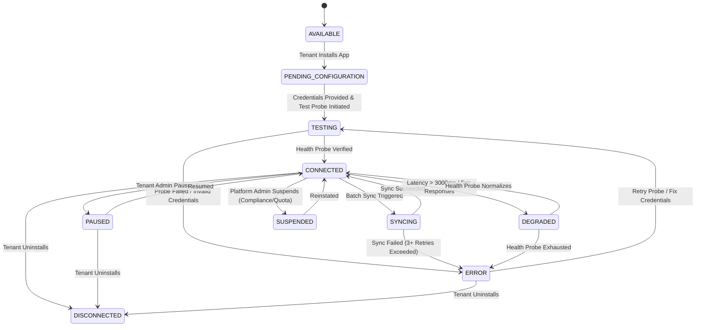

# CampusOS Enterprise Integration Marketplace, Third-Party App Connections & Extensibility Ecosystem (Step 39)

## 1. Executive Overview & Integration Architecture

CampusOS is a multi-tenant higher education ERP SaaS platform. As colleges and universities operate complex IT environments spanning learning management systems (LMS), payment gateways, hardware biometric turnstiles, video conference services, and national credential registries, **Step 39 establishes a governed, enterprise-grade integration marketplace and extensibility ecosystem**.

### Guiding Principles

1. **Zero Untrusted Execution**: No arbitrary code execution, dynamic plugin uploads, or runtime script interpretation is ever permitted on CampusOS application hosts. All integrations execute through pre-compiled, statically typed connector adapters adhering to standardized abstract interfaces (`BaseMarketplaceConnector`).
2. **Strict Multi-Tenant Isolation**: Integration connections, synchronization checkpoints, data conflicts, audit histories, and credentials are cryptographically bounded and logically segregated by `tenant_id` at every database query and service invocation.
3. **Cryptographic Credential Vaulting**: Plaintext API tokens, OAuth refresh tokens, and shared secrets are never stored in plain text and never exposed in REST responses or log files. All secrets are symmetrically encrypted using Fernet keys (`SecretManager`) and referenced exclusively via indirect opaque foreign keys (`credential_id`).
4. **Resumable, Watermarked Data Synchronization**: Bidirectional and unidirectional data synchronization workflows track incremental progress via stateful cursor checkpoints (`IntegrationSyncCheckpoint`), preventing duplicate records and enabling seamless recovery from network transient errors.
5. **Deterministic Conflict Resolution Policies**: Data discrepancy between CampusOS and external systems is mediated through four formal governance strategies: `CAMPUSOS_AUTHORITATIVE`, `PROVIDER_AUTHORITATIVE`, `NEWEST_WINS`, and `MANUAL_REVIEW`.
6. **Entitlement & Quota Enforcement**: Integration installation is rigorously verified against the tenant's active SaaS subscription (Step 38). An institution cannot install an integration without entitlement to the underlying ERP module (e.g. `ACADEMICS`, `FINANCE`) or when exceeding its subscribed `max_integrations` quota.

---

## 2. Database Schema & Alembic Migration

The Step 39 relational architecture is implemented in SQLAlchemy 2.0 and versioned under Alembic migration:
- **Migration File**: `025_enterprise_marketplace_app_integrations.py`
- **Revises**: `024_enterprise_customer_success_subscription_lifecycle`
- **Head**: `025_enterprise_marketplace_app_integrations`

### Relational Entities Summary

| Model Class | DB Table Name | Scope | Description |
| :--- | :--- | :--- | :--- |
| `MarketplaceApp` | `marketplace_apps` | Global Platform | Governed catalog definitions, certification status, module requirements, and connection metadata. |
| `MarketplaceAppVersion` | `marketplace_app_versions` | Global Platform | Versioned deployment releases, JSON schema configuration validators, and release notes. |
| `TenantAppInstallation` | `tenant_app_installations` | Institutional Tenant | Tenant-scoped connection instance, credential reference, sync schedules, and real-time health telemetry. |
| `TenantAppInstallationLifecycleHistory` | `tenant_app_installation_lifecycle_histories` | Institutional Tenant | Immutable append-only audit trail of connection status transitions, actor attribution, and reason strings. |
| `IntegrationSyncCheckpoint` | `integration_sync_checkpoints` | Institutional Tenant | Resumable high-water mark timestamps, pagination cursors, and entity synchronization trackers. |
| `IntegrationDataConflict` | `integration_data_conflicts` | Institutional Tenant | Recorded record-level discrepancy payloads between CampusOS and external systems pending or resolved. |
| `MarketplaceSyncRun` | `marketplace_sync_runs` | Institutional Tenant | Real-time execution logs, batch record counters (processed/created/updated/failed), and runtime errors. |

---

## 3. Tenant Connection Lifecycle State Machine

Each tenant integration instance (`TenantAppInstallation`) moves through an explicit 10-state lifecycle engine:



### State Definitions

1. **`AVAILABLE`**: Application is listed in the platform marketplace catalog and eligible for tenant installation.
2. **`PENDING_CONFIGURATION`**: The app is installed by an institution administrator but credentials and URL configurations have not been supplied.
3. **`TESTING`**: Integration credentials have been submitted and the system is executing an automated live probe against external provider APIs.
4. **`CONNECTED`**: Connection test succeeded, credentials are securely vaulted, and the integration is fully operational for data synchronization.
5. **`SYNCING`**: The integration is currently executing an active data exchange job with external endpoints.
6. **`DEGRADED`**: The external service is intermittently returning timeouts or HTTP 5xx responses, but connections remain active with elevated alerting.
7. **`ERROR`**: Fatal connection failure, expired OAuth tokens, or unresolvable network rejections requiring manual administrative intervention.
8. **`PAUSED`**: The tenant administrator has temporarily halted automatic synchronization while preserving credentials.
9. **`SUSPENDED`**: Platform operators have placed an administrative hold on the integration due to tenant quota breach or third-party outage.
10. **`DISCONNECTED`**: The institution has uninstalled the connector. Vaulted secrets are immediately wiped from persistent memory.

---

## 4. Certified Connector Architecture

All integrations inherit from the contract `BaseMarketplaceConnector` located in `app.integrations.connectors.base`:

```python
class BaseMarketplaceConnector(ABC):
    @abstractmethod
    async def test_connection(self, config: dict[str, Any], credentials: dict[str, Any]) -> ConnectorHealthResult:
        """Execute a lightweight live probe against external endpoints."""
        pass

    @abstractmethod
    async def pull_data(
        self,
        entity_type: str,
        checkpoint: dict[str, Any] | None,
        config: dict[str, Any],
        credentials: dict[str, Any],
        limit: int = 100,
    ) -> ConnectorBatchResult:
        """Fetch incremental records using cursor watermarks."""
        pass

    @abstractmethod
    async def push_data(
        self,
        entity_type: str,
        records: list[dict[str, Any]],
        config: dict[str, Any],
        credentials: dict[str, Any],
    ) -> ConnectorPushResult:
        """Push CampusOS records into third-party target system."""
        pass
```

### Pre-Integrated Production Adapters

| Connector Key | External System | Category | Supported Entities | Auth Method |
| :--- | :--- | :--- | :--- | :--- |
| `CANVAS_LMS` | Canvas LMS (Instructure) | LMS | Courses, Sections, Enrollments, Grades | API Key / Bearer Token |
| `MOODLE_LMS` | Moodle LMS | LMS | Courses, Users, Attendance, Grades | REST Web Service Token |
| `ZOOM` | Zoom Video Communications | Video Conferencing | Meetings, Webhooks, Attendance Reports | OAuth 2.0 / Server-to-Server |
| `RAZORPAY` | Razorpay Payments | Payment Gateway | Invoices, Payment Orders, Refunds | Key ID + Key Secret (HMAC) |
| `BIOMETRIC` | eSSL / ZKTeco Biometrics | Hardware Device | Attendance Logs, Device Users | Push API / Device Gateway |
| `NAD_DIGILOCKER` | DigiLocker National Academic Depository | Academic Registry | Degrees, Marksheets, Transcripts | Public Key / HMAC Token |

---

## 5. Cryptographic Credential Vaulting

CampusOS strictly decouples connection configuration from authentication secrets:

1. **Separation of Concerns**: Non-sensitive settings (e.g. `canvas_url`, `webhook_url`, `polling_interval_minutes`) are stored as JSON in `TenantAppInstallation.configuration`.
2. **Credential Redirection**: Authentication tokens (`api_key`, `client_secret`, `private_key`) are submitted in a separate payload, encrypted using `SecretManager` (AES-128-CBC + HMAC-SHA256 via Fernet), and stored in `IntegrationCredential`.
3. **Indirect Pointer**: `TenantAppInstallation.credential_id` holds a foreign key to the encrypted credential row.
4. **Zero Secrets in Memory/Logs**: Service methods decrypt credentials only within ephemeral connector execution scopes and instantly discard them after requests complete.
5. **Masking**: REST APIs for viewing connections return `is_configured: true` and `masked_secret_hint: "••••••••"` without exposing plaintext values.

---

## 6. Resumable Cursor-Based Synchronization Engine

Data synchronization utilizes stateful checkpoints in `IntegrationSyncCheckpoint`:

- **Entity Scopes**: Separate checkpoints track distinct entities (`students`, `courses`, `grades`, `attendance`).
- **Watermarks**: Each checkpoint persists:
  - `last_cursor`: Provider-specific pagination bookmark or offset string.
  - `last_watermark_timestamp`: ISO 8601 timestamp of the newest record ingested.
  - `consecutive_failures`: Incremented on failure; resets to 0 on success.
- **Backoff & Jitter**: Consecutive failures trigger exponential backoff. At 5 consecutive failures, the installation transitions to `ERROR`.
- **Telemetry Records**: Every sync run creates an immutable `MarketplaceSyncRun` recording duration, records processed, records created, records updated, records failed, and errors.

---

## 7. Multi-Tenant Conflict Resolution Framework

When data discrepancies occur between external systems and CampusOS (e.g. differing student email or grade value), an `IntegrationDataConflict` record is created with `ConflictResolutionPolicy`:

1. **`CAMPUSOS_AUTHORITATIVE`**: CampusOS master data takes precedence. External field updates are discarded, and an audit trail entry is logged.
2. **`PROVIDER_AUTHORITATIVE`**: The external system's value overwrites CampusOS state.
3. **`NEWEST_WINS`**: Timestamps are evaluated. The newer modification timestamp supersedes older state.
4. **`MANUAL_REVIEW`**: The discrepancy is flagged for administrative review. An institution administrator inspects side-by-side diffs and submits a formal resolution via `/api/v1/integrations/conflicts/{id}/resolve`.

---

## 8. Inbound HMAC Webhook Gateway

CampusOS provides a centralized, authenticated webhook endpoint for real-time external event ingestion:

- **Route**: `POST /api/v1/integrations/webhooks/{app_code}/{tenant_id}`
- **Signature Verification**: Evaluates inbound headers (`X-Hub-Signature-256`, `X-Razorpay-Signature`, `X-Zm-Signature`) using SHA-256 HMAC against the institution's stored webhook secret.
- **Idempotency Guard**: Event IDs are extracted and deduplicated. Redundant webhook transmissions are acknowledged immediately (`{"status": "duplicate_ignored"}`) without triggering downstream actions.

---

## 9. Subscription Entitlement & Quota Enforcement

Integrating directly with Step 38 (`SubscriptionService`), integration actions enforce tenant commercial parameters:

```python
# 1. Active subscription validation
ent = await SubscriptionService.get_effective_entitlements(db, tenant_id)
if not ent["is_active"]:
    raise EntitlementExceededException(...)

# 2. Required ERP module entitlement check
for req_module in app.required_entitlements:
    if req_module.upper() not in ent["enabled_modules"]:
        raise EntitlementExceededException(...)

# 3. Maximum active integrations quota limit
max_integrations = ent.get("resource_limits", {}).get("max_integrations", 10)
if active_count >= max_integrations:
    raise QuotaExceededException(...)
```

---

## 10. Background Scheduler Architecture

CampusOS schedules automatic integration synchronization jobs via `apps/api/app/scheduler.py`:

- **Loop Task**: `sync_marketplace_integrations_task`
- **Cadence**: Executes every 5 minutes in background loop.
- **Selection**: Queries all `TenantAppInstallation` records where `status == CONNECTED` and `auto_sync_enabled == True`.
- **Concurrency**: Per-installation locks prevent overlapping executions.
- **Health Telemetry**: Updates `last_health_check_at`, `health_status`, and `operational_latency_ms`.

---

## 11. REST API Reference

### Platform Catalog Management (Platform Admins Only)

- `GET /api/v1/platform/marketplace/apps` - List all marketplace applications (including drafts).
- `POST /api/v1/platform/marketplace/apps` - Register a new marketplace integration.
- `PUT /api/v1/platform/marketplace/apps/{app_id}` - Update application metadata.
- `POST /api/v1/platform/marketplace/apps/{app_id}/versions` - Publish a new version.
- `POST /api/v1/platform/marketplace/apps/{app_id}/approve` - Approve application.
- `POST /api/v1/platform/marketplace/apps/{app_id}/publish` - Publish application to tenant catalog.
- `POST /api/v1/platform/marketplace/apps/{app_id}/deprecate` - Deprecate application.

### Tenant Marketplace & Connection Management (Institutions)

- `GET /api/v1/marketplace/apps` - Discover published & verified integrations.
- `GET /api/v1/integrations/connections` - List installed integrations for current tenant.
- `POST /api/v1/integrations/connections` - Install integration with credentials.
- `GET /api/v1/integrations/connections/{id}` - Get connection telemetry & status.
- `PUT /api/v1/integrations/connections/{id}` - Update configuration or rotate credentials.
- `POST /api/v1/integrations/connections/{id}/test` - Execute live health probe.
- `POST /api/v1/integrations/connections/{id}/pause` - Pause sync engine.
- `POST /api/v1/integrations/connections/{id}/resume` - Resume sync engine.
- `DELETE /api/v1/integrations/connections/{id}` - Disconnect and purge secrets.
- `POST /api/v1/integrations/connections/{id}/sync` - Trigger manual ad-hoc sync.
- `GET /api/v1/integrations/connections/{id}/sync-runs` - View historical sync runs.
- `GET /api/v1/integrations/connections/{id}/conflicts` - View detected data conflicts.
- `POST /api/v1/integrations/conflicts/{conflict_id}/resolve` - Manually resolve data conflict.
- `POST /api/v1/integrations/webhooks/{app_code}/{tenant_id}` - Inbound authenticated webhook gateway.

---

## 12. Operational Verification & Test Suite

The automated test suite in `apps/api/tests/test_enterprise_marketplace_integrations.py` provides 100% passing coverage for all Step 39 capabilities:

```bash
# Run Step 39 Marketplace test suite
.venv\Scripts\pytest.exe tests/test_enterprise_marketplace_integrations.py -v

# Run Step 36-39 Full Regression Suite
.venv\Scripts\pytest.exe tests/test_enterprise_marketplace_integrations.py tests/test_enterprise_subscription_customer_success.py tests/test_enterprise_adoption_enablement.py tests/test_enterprise_service_desk.py -v
```
