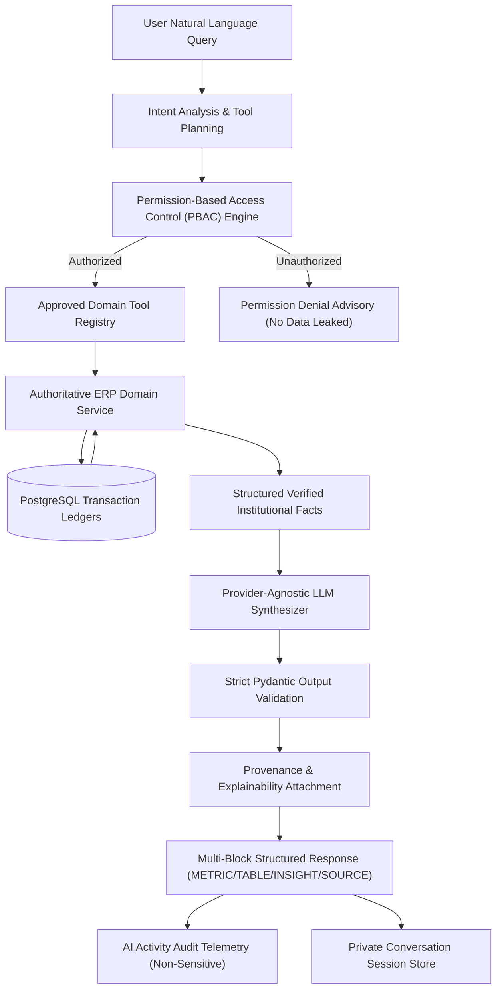

# CampusOS Intelligence & Institutional AI Engine

## 1. Executive Overview

CampusOS Intelligence is a **permission-aware institutional intelligence subsystem** that provides natural language query orchestration, operational anomaly detection, proactive threshold alerting, and allowlisted multidimensional analytics over authoritative university data ledgers.

Unlike a generic chatbot that directly interfaces with unstructured text or generates unconstrained database code, CampusOS Intelligence acts as a **zero-trust orchestration broker**. It strictly prohibits arbitrary SQL generation, direct ORM generation by language models, filesystem access, and arbitrary code execution. Every data-derived institutional fact is resolved exclusively through registered, permission-checked domain tools executing against production FastAPI services.

---

## 2. Core Architectural Pillars

### 2.1 Zero-Trust Tool Execution (AI Safety Boundary)
The institutional AI engine does **not** have direct access to database tables, raw SQL querying capabilities, shell environments, or Python runtime interpreters.
- AI models understand user intent and select from a pre-registered catalog of 30+ domain tools.
- Every tool parameter is validated against strict Pydantic schemas and sanitized to block SQL injection and shell escape sequences (`;--`, `UNION SELECT`, `DROP TABLE`, `eval()`).
- Domain services execute within the authenticated tenant context (`tenant_id`) ensuring multi-tenant isolation at the database layer.

### 2.2 Permission-Aware Domain Tools (PBAC)
- Tool invocation is guarded by atomic PBAC rules. Even if a user asks a query regarding institutional finances or sensitive employee records, the AI engine evaluates server-resolved claims (`resolve_user_permissions`) before invoking domain handlers.
- Unauthorized requests generate structured advisories with zero information leakage, preventing enumeration attacks or unauthorized aggregates.

### 2.3 Provider-Agnostic Model Abstraction
- The AI subsystem decouples core orchestration from commercial LLM providers through the `LLMProvider` async protocol.
- Supported providers: Deterministic institutional `MockLLMProvider` (used for deterministic CI/CD, local development, and reproducible audit evaluation), alongside adapters for OpenAI, Anthropic Claude, and Google Gemini.
- Configuration is driven by environment settings (`AI_PROVIDER`, `AI_MODEL`, `AI_TIMEOUT_SECONDS`, `AI_MAX_TOKENS`). If unconfigured or unavailable, the system fails gracefully with `AI_PROVIDER_UNAVAILABLE` rather than hallucinating facts.

### 2.4 Multi-Block Structured Responses
The response protocol delivers typed components designed for immediate rendering in the CampusOS Web frontend:
- `METRIC`: Key performance indicators, trends, and delta metrics.
- `TABLE`: Tabular rosters (e.g., at-risk student lists, subject evaluations).
- `INSIGHT`: Tactical conclusions and root cause breakdowns.
- `WARNING`: Advisory notices (e.g., examination ineligibility alerts under university regulations).
- `RECOMMENDATION`: Actionable administrative workflows.
- `ACTION`: Safe navigational intents (`VIEW_STUDENT`, `VIEW_ATTENDANCE`, `VIEW_INVOICE`). Autonomous mutations are strictly non-goals.
- `SOURCE`: Authoritative audit provenance records linking outputs to ERP ledgers.

---

## 3. Tool Catalog & Capabilities

| Domain | Tool Name | Required Permission | Description |
|---|---|---|---|
| **People** | `people.get_student` | `students:read` | Retrieve official student profile, roll number, department, and academic standing |
| | `people.search_students` | `students:read` | Search directory by name, registration number, or email |
| | `people.get_faculty_summary` | `faculty:read` | Faculty headcount, designation breakdown, and departmental allocation |
| | `people.get_staff_summary` | `staff:read` | Administrative staff headcount and departmental distribution |
| **Academics** | `academics.get_program_summary` | `academics:curriculum:read` | Catalog of active degree programs, departments, and duration |
| | `academics.get_subject_summary` | `academics:subjects:read` | Subject catalog, credit breakdown, and theory vs practical distribution |
| | `academics.get_course_offering` | `academics:courses:read` | Active course sections offered in the current term |
| | `academics.get_enrollment_summary` | `academics:enrollments:read` | Student enrollment figures across current academic course sections |
| **Attendance** | `attendance.get_summary` | `attendance:read` | College-wide or departmental consolidated attendance rate |
| | `attendance.get_student_attendance` | `attendance:read` | Individual student session totals, present count, and attendance percentage |
| | `attendance.get_students_below_threshold` | `attendance:read` | Students with attendance strictly below threshold (e.g., 75%) |
| | `attendance.get_course_attendance` | `attendance:read` | Attendance distribution across specific subject offerings |
| | `attendance.get_leave_summary` | `leave:read` | Leave requests breakdown by status (APPROVED, PENDING, REJECTED) |
| **Examinations** | `examinations.get_exam_summary` | `examinations:read` | Scheduled exam sessions, venues, and registered examinees |
| | `examinations.get_student_results` | `results:read` | Individual student marks, grade points, SGPA, and publication status |
| | `examinations.get_grade_distribution` | `results:read` | Letter grade frequencies across assessment components |
| | `examinations.get_pass_percentage` | `results:read` | Departmental or course clearance rates |
| **Finance** | `finance.get_fee_summary` | `finance:reports:read` | Total billed fees, collections, and overall clearance rate |
| | `finance.get_outstanding_summary` | `finance:reports:read` | Total outstanding student fee balance and overdue accounts |
| | `finance.get_student_invoice_summary` | `invoices:read` | Fee dues, payments, and clearance status for a specific student |
| **Placement** | `placement.get_drive_summary` | `placement:drives:read` | Active corporate recruitment drives, tiers, and compensation packages |
| | `placement.get_placement_outcomes` | `placement:reports:read` | Placed student headcount, placement percentage, and median CTC |
| **Campus** | `campus.get_event_summary` | `events:read` | Campus events, technical symposiums, and registrations |
| | `campus.get_club_summary` | `clubs:read` | Student clubs, societies, and active memberships |
| **Infrastructure** | `infrastructure.get_hostel_occupancy` | `hostel:read` | Residential hostel capacity, occupied beds, and vacancy rate |
| | `infrastructure.get_transport_summary` | `transport:read` | Campus transport routes, vehicle allocations, and commuter counts |
| **Documents** | `documents.get_verification_summary` | `documents:read` | Verification statistics and pending compliance desks |
| | `documents.get_expiring_documents` | `documents:read` | Credentials approaching expiration within 30 days |

---

## 4. Multi-Tenant Isolation & Privacy

1. **Tenant Scoping**: All database queries executed by domain tool handlers explicitly filter on `tenant_id == current_user.tenant_id`. Cross-tenant lookups return 404 Not Found.
2. **Conversation Isolation**: Private chat sessions and message histories enforce `user_id == current_user.id` and `tenant_id == current_user.tenant_id`. Users cannot view or append messages to other users' sessions.
3. **Audit Trail**: Every query invocation generates an `AIActivity` record logging sanitized metadata: query hash, tools requested, tools executed, provider, duration in milliseconds, token metrics, and execution status. Raw secrets, passwords, or payment credentials are never logged.

---

## 5. Step 29: Enterprise AI Governance, Predictions & Decision Support

Step 29 expands CampusOS with governed predictive modeling, institution-wide policy guardrails, and decision support:

### 5.1 AI Governance Policy Framework (`AIGovernanceService`)
- Centralized policy registry (`intelligence_governance_policies`) configuring permitted and prohibited use cases per tenant.
- Enforces strict institutional bans against `AUTOMATED_GRADING`, `AUTOMATED_DISCIPLINE`, and `RAW_SQL_EXECUTION`.
- Enforces mandatory daily budgets (e.g. $50.00 USD/day) and request rate limits.

### 5.2 Zero-Trust PromptGuard Firewall (`PromptGuard`)
- Multi-layer regex and semantic checks against prompt injection attacks, jailbreaks, and sensitive data leakage.
- Sanitizes incoming text and redacts national identity numbers (Aadhaar, SSN) and phone numbers prior to context inclusion.

### 5.3 Natural-Language Institutional Analytics (`NLAnalyticsService`)
- Maps natural language questions ("How has fee collection changed this semester?", "What is our attendance trend?") strictly to pre-compiled Governed Metrics in the Metric Registry (Step 28).
- Strictly rejects model-generated SQL, returning verified rollups with exact formula definitions and PostgreSQL ledger citations.

### 5.4 Predictive Early Warning & Student Support (`StudentSupportPredictionService`)
- Calculates explainable student risk scores (`LOW`, `MEDIUM`, `HIGH`, `CRITICAL`) using authoritative attendance and assessment marks.
- Never automates consequential student penalties. Enforces `human_review_required = True`.

### 5.5 Recommendation Engine & Case Management Actioning (`RecommendationEngine`)
- Synthesizes operational observations into actionable advice (`AIRecommendation`).
- Connects directly into the core Case Management engine (`Case`), enabling staff to convert suggestions into official workflow cases (`AI_RECOMMENDED_ACTION`) with full audit provenance.

### 5.6 Automated Evaluation Suite (`AIEvaluationRunner`)
- Continuously benchmarks groundedness, prompt-injection defense, PBAC security, and Pydantic v2 schema compliance with persistent audit records (`intelligence_evaluation_runs`).

