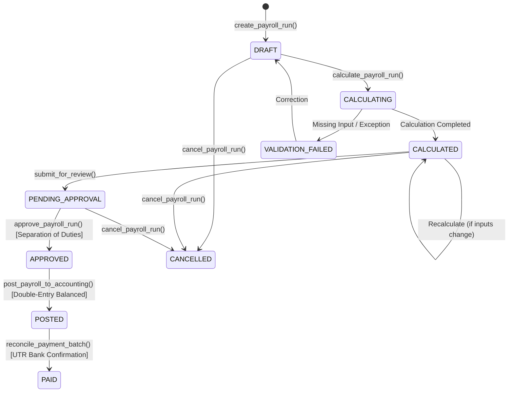

# Enterprise Payroll, Compensation, Benefits & Statutory Compliance Operations Manual (Step 52)

> **CampusOS Core Principle:** One Campus. One System. One Source of Truth.  
> **Module Scope:** Step 52 — Enterprise Payroll, Compensation, Benefits & Statutory Compliance

---

## 1. Executive Summary & Architecture Alignment

The **CampusOS Enterprise Payroll, Compensation, Benefits & Statutory Compliance module** delivers an auditable, deterministic, decimal-safe payroll processing pipeline for multi-campus higher education institutions.

The module strictly integrates with authoritative existing modules across CampusOS:
- **Workforce Management (Step 51):** Extends `WorkforceEmployee` identities, job designations, salary grades, contract tenures, and leave requests.
- **Attendance & Leave Engine:** Queries approved unpaid leave (`is_paid=False`) for automatic Loss of Pay (LOP) proration without altering leave records.
- **Finance & Accounting (Step 28):** Generates balanced double-entry general ledger journal entries (`PayrollJournalEntry`, `PayrollJournalLine`) linking gross payroll expenses, employer statutory contributions, employee withholdings, and net salaries payable.
- **HR Case System (Step 51):** Direct employee dispute logging into `workforce_hr_cases` under category `SALARY_QUERY`.
- **Identity & Access Management (IAM):** Granular PBAC permissions and separation of duties preventing preparers from self-approving payroll runs.

---

## 2. Mathematical Models & Decimal-Safe Calculation Engine

All monetary calculations use fixed-precision decimal arithmetic (`Decimal`, `ROUND_HALF_UP`) with zero floating-point arithmetic.

### 2.1 Loss of Pay (LOP) & Proration

$$\text{Period Days} = (\text{Period End Date} - \text{Period Start Date}) + 1$$

$$\text{Unpaid Days} = \sum \text{WorkforceLeaveRequest.total\_days} \quad (\text{where } \text{status} = \text{APPROVED} \land \text{is\_paid} = \text{False})$$

$$\text{Loss of Pay (LOP)} = \text{round}\left(\frac{\text{Base Pay}}{\text{Period Days}} \times \text{Unpaid Days}\right)$$

$$\text{Earned Base Pay} = \max(0, \text{Base Pay} - \text{LOP})$$

### 2.2 Salary Structure Assembly

For each active structure component:
- **FLAT_AMOUNT:** Fixed allowance or deduction. If component represents basic pay, $\text{Amount} = \max(0, \text{Fixed Amount} - \text{LOP})$.
- **PERCENTAGE_OF_BASIC:** $\text{Amount} = \text{round}\left(\frac{\text{Earned Base Pay} \times \text{Factor Value}}{100}\right)$.
- **PERCENTAGE_OF_GROSS:** Calculated against aggregated regular earnings.

### 2.3 Statutory Rule Processing (EPF, ESI, TDS)

Each compliance rule specifies an employee rate ($r_{ee}$), employer rate ($r_{er}$), and wage ceiling ($C$):

$$\text{Calculation Basis} = \begin{cases} 
\min(\text{Earned Base Pay}, C) & \text{if } C > 0 \\ 
\text{Earned Base Pay} & \text{otherwise} 
\end{cases}$$

$$\text{Employee Deduction} = \text{round}(\text{Calculation Basis} \times r_{ee})$$

$$\text{Employer Contribution} = \text{round}(\text{Calculation Basis} \times r_{er})$$

$$\text{Net Pay} = \max\left(0, \sum \text{Earnings} - \sum \text{Deductions}\right)$$

---

## 3. Payroll State Machine & Lifecycle Transitions



### Transition Safeguards:
1. **Recalculation:** Permitted only prior to approval (`DRAFT` / `CALCULATED`). Clears and re-evaluates all line items.
2. **Approval Locking:** Sets `is_locked = True`. Re-calculation or direct modification is strictly blocked.
3. **Separation of Duties:** Enforces `actor_id != run.created_by_user_id`. The user who prepared or calculated the payroll cannot approve it.
4. **General Ledger Posting:** Generates an idempotent, balanced double-entry transaction. Duplicate postings are rejected. Automatically publishes digital payslips.
5. **Bank Reconciliation:** Transitions to `PAID` only when all batch items are reconciled with valid bank transaction references (UTR).

---

## 4. Finance & General Ledger Integration

When an approved payroll run is posted, CampusOS generates a balanced double-entry journal:

| Account Code | Account Name | Line Type | Formula | Normal Balance |
| :--- | :--- | :--- | :--- | :--- |
| `EXP-SALARIES` | Salaries & Wages Expense | **DEBIT** | $\sum \text{Gross Earnings}$ | Debit |
| `EXP-STATUTORY` | Employer Statutory Expense | **DEBIT** | $\sum \text{Employer Contributions}$ | Debit |
| `LIA-NET-PAY` | Salaries Payable (Net) | **CREDIT** | $\sum \text{Net Pay}$ | Credit |
| `LIA-DEDUCTIONS` | Statutory Withholdings & Liabilities Payable | **CREDIT** | $\sum (\text{Deductions} + \text{Employer Contributions})$ | Credit |

$$\sum \text{Debits} = \sum \text{Credits} \implies \text{Total Debit} = \text{Total Credit}$$

---

## 5. Database Schema & Alembic Migration (Revision 037)

The module introduces 19 normalized tables under revision `037_enterprise_payroll_compensation_compliance.py`:

```
core_tenants (Institution)
  ├── payroll_salary_grades
  ├── payroll_salary_components
  ├── payroll_salary_structures
  │     └── payroll_salary_structure_items
  ├── payroll_employee_compensations
  │     └── payroll_employee_compensation_history
  ├── payroll_employee_bank_details
  ├── payroll_statutory_rules
  ├── payroll_calendars
  ├── payroll_periods
  ├── payroll_runs
  │     ├── payroll_run_items
  │     │     └── payroll_run_item_details
  │     ├── payroll_journal_entries
  │     │     └── payroll_journal_lines
  │     ├── payroll_payment_batches
  │     │     └── payroll_payment_items
  │     └── payroll_payslips
  └── payroll_accounting_mappings
```

---

## 6. Granular PBAC Permission Registry

| Permission Code | Description | Default Roles Assigned |
| :--- | :--- | :--- |
| `payroll.compensation.read` | View salary grades, structures & employee compensation | `SUPER_ADMIN`, `INSTITUTION_ADMIN`, `ACCOUNTS`, `HOD` |
| `payroll.compensation.manage` | Create grades, modify pay bands, assign compensation | `SUPER_ADMIN`, `INSTITUTION_ADMIN`, `ACCOUNTS` |
| `payroll.calendar.manage` | Configure payroll frequencies, calendars, and periods | `SUPER_ADMIN`, `INSTITUTION_ADMIN`, `ACCOUNTS` |
| `payroll.run.create` | Initialize draft payroll runs | `SUPER_ADMIN`, `INSTITUTION_ADMIN`, `ACCOUNTS` |
| `payroll.run.calculate` | Trigger deterministic payroll calculation engine | `SUPER_ADMIN`, `INSTITUTION_ADMIN`, `ACCOUNTS` |
| `payroll.run.review` | Access calculation breakdowns, pre-approval reports | `SUPER_ADMIN`, `INSTITUTION_ADMIN`, `ACCOUNTS`, `HOD` |
| `payroll.run.approve` | Authorize and lock payroll calculations | `SUPER_ADMIN`, `INSTITUTION_ADMIN` |
| `payroll.run.post` | Post approved payroll to Finance General Ledger | `SUPER_ADMIN`, `INSTITUTION_ADMIN`, `ACCOUNTS` |
| `payroll.payment.manage` | Generate payment batches and export disbursement files | `SUPER_ADMIN`, `INSTITUTION_ADMIN`, `ACCOUNTS` |
| `payroll.reconciliation.manage` | Record bank settlement UTR references | `SUPER_ADMIN`, `INSTITUTION_ADMIN`, `ACCOUNTS` |
| `payroll.compliance.manage` | Maintain statutory deduction rules, ceilings & rates | `SUPER_ADMIN`, `INSTITUTION_ADMIN` |
| `payroll.payslip.read_own` | Access and download personal digital payslips | `SUPER_ADMIN`, `INSTITUTION_ADMIN`, `FACULTY`, `STAFF`, `HOD` |
| `payroll.payslip.read_auth` | View institution-wide payslip archives | `SUPER_ADMIN`, `INSTITUTION_ADMIN`, `ACCOUNTS` |
| `payroll.reports.read` | Generate compensation registers & variance audits | `SUPER_ADMIN`, `INSTITUTION_ADMIN`, `ACCOUNTS`, `HOD` |

---

## 7. REST API Endpoints Specification

FastAPI routes are registered under prefix `/api/v1/payroll`:

- `GET /api/v1/payroll/salary-grades` — List salary grades
- `POST /api/v1/payroll/salary-grades` — Create salary grade
- `GET /api/v1/payroll/salary-components` — List earnings & deductions components
- `POST /api/v1/payroll/salary-components` — Register new salary component
- `GET /api/v1/payroll/salary-structures` — List configured salary structures
- `POST /api/v1/payroll/salary-structures` — Create versioned salary structure
- `GET /api/v1/payroll/employee-compensations` — Query compensation records
- `POST /api/v1/payroll/employee-compensations` — Assign effective-dated compensation
- `GET /api/v1/payroll/employees/{employee_id}/bank-details` — Retrieve masked bank details
- `POST /api/v1/payroll/employees/{employee_id}/bank-details` — Save bank details
- `POST /api/v1/payroll/employees/{employee_id}/bank-details/verify` — Verify bank account
- `GET /api/v1/payroll/statutory-rules` — List statutory deduction rules
- `POST /api/v1/payroll/statutory-rules` — Define compliance rule
- `GET /api/v1/payroll/calendars` — List payroll calendars
- `POST /api/v1/payroll/calendars` — Create payroll calendar
- `GET /api/v1/payroll/periods` — List payroll periods
- `POST /api/v1/payroll/periods` — Create payroll period
- `GET /api/v1/payroll/runs` — Query payroll runs
- `POST /api/v1/payroll/runs` — Initialize payroll run
- `GET /api/v1/payroll/runs/{run_id}` — Get run details with itemized calculations
- `POST /api/v1/payroll/runs/{run_id}/calculate` — Execute calculation
- `POST /api/v1/payroll/runs/{run_id}/approve` — Approve calculation
- `POST /api/v1/payroll/runs/{run_id}/cancel` — Cancel payroll run
- `POST /api/v1/payroll/runs/{run_id}/post` — Post to General Ledger
- `GET /api/v1/payroll/runs/{run_id}/journal` — Query double-entry journal
- `GET /api/v1/payroll/payment-batches` — List disbursement batches
- `POST /api/v1/payroll/payment-batches` — Create disbursement batch
- `GET /api/v1/payroll/payment-batches/{batch_id}` — Get batch with items
- `POST /api/v1/payroll/payment-batches/{batch_id}/reconcile` — Reconcile bank UTRs
- `GET /api/v1/payroll/payslips/my-payslips` — Employee self-service payslips
- `GET /api/v1/payroll/employees/{employee_id}/payslips` — Administrator employee payslips
- `GET /api/v1/payroll/payslips/token/{token}` — Authenticated payslip retrieval

---

## 8. Verification & Test Evidence

### 8.1 Backend Pytest Test Suite
Command:
```bash
.venv\Scripts\python.exe -m pytest tests/test_enterprise_payroll_compliance.py -v
```
**Results:** `12 passed in 8.07s (100% pass rate)`

Covered tests:
1. `test_salary_grades_and_components_crud` — Configuration of pay grades and components.
2. `test_salary_structure_assembly_and_versioning` — Grouping components into versioned structures.
3. `test_employee_compensation_assignment_and_history` — Compensation assignment and immutable history.
4. `test_employee_bank_details_masking_and_verification` — Account encryption, masking, and verification.
5. `test_statutory_compliance_rules_configuration` — Ceilings, employee/employer rates.
6. `test_payroll_calendar_and_period_lifecycle` — Periods, cutoff dates, locking.
7. `test_payroll_calculation_deterministic_and_decimal_safe` — Deterministic decimal engine.
8. `test_leave_and_attendance_lop_integration` — Unpaid leave Loss of Pay proration.
9. `test_payroll_approval_separation_of_duties` — Preparer cannot approve own calculation.
10. `test_finance_accounting_integration_balanced_double_entry` — Balanced debits and credits.
11. `test_payment_batch_disbursement_and_reconciliation` — Disbursement file and UTR settlement.
12. `test_payslips_generation_and_dispute_reporting` — Digital payslips and HR dispute case logging.

### 8.2 Regression Testing
Command:
```bash
.venv\Scripts\python.exe -m pytest tests/test_enterprise_workforce_management.py -q
```
**Results:** `11 passed in 4.98s (100% pass rate, 0 regressions)`

### 8.3 Frontend Typecheck & Build
Commands:
```bash
npm run typecheck
npm run build
```
**Results:**
- `tsc --noEmit`: Exited with code 0.
- Next.js 15: Production build successfully generated.

---

## 9. Known Limitations & Institutional Recommendations

1. **Tax Slab Configuration:** While slab data structures are supported via JSONB configurations, institutions must input active jurisdictional tax brackets (e.g. Indian Old vs. New Tax Regimes, US W-4) through authorized compliance officers.
2. **Banking Gateway Connectors:** The module provides standardized ACH/CSV file generation and UTR reconciliation APIs. Direct real-time banking API integration (e.g. HDFC/ICICI Corporate Banking Host-to-Host) can be connected to the payment batch webhook interface.
