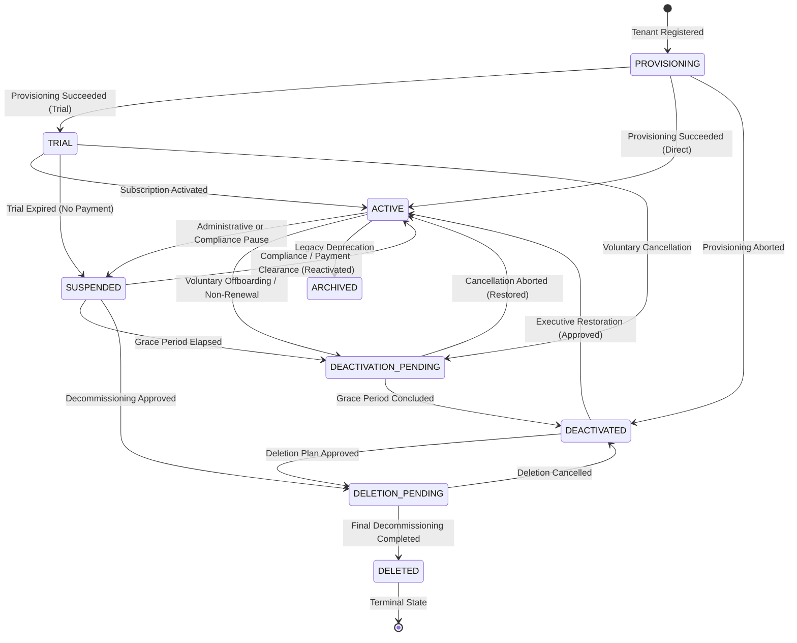

# CampusOS Enterprise Platform Administration, SaaS Operations & Tenant Lifecycle Management

## 1. Overview & Architectural Boundaries

CampusOS is engineered as a secure, multi-tenant Software-as-a-Service (SaaS) platform for higher education institutions. Step 30 introduces a dedicated, authoritative Platform Operations and SaaS Governance layer that cleanly separates **Platform Administration** from **Institutional Administration**.

Product Principle: **One Campus. One System. One Source of Truth.**

### Administrative Boundaries Matrix

| Boundary | Scope | Roles | Authorized Capabilities | Restricted Capabilities |
| :--- | :--- | :--- | :--- | :--- |
| **Platform Administration** | Global SaaS Service & Tenant Governance | `SUPER_ADMIN`, `PLATFORM_OPERATOR`, `PLATFORM_SUPPORT` | Institution onboarding, lifecycle state machine transitions (suspension, reactivation, deletion), plan packaging, quota limit adjustments, operational health telemetry. | Cannot directly view or tamper with institutional student records, exam grades, or financial transactions without audited support delegation. |
| **Institution Administration** | Single Institution (`tenant_id`) | `INSTITUTION_ADMIN` | Campus setup, academic programs, department structure, faculty/student management, course enrollments, fees, local institutional settings. | Strictly prohibited from cross-tenant access and platform-level operations (`/api/v1/platform/*`). |
| **Campus & Department Administration** | Campus or Department Scope | `CAMPUS_ADMIN`, `DEPT_HEAD` | Departmental resources, timetables, section allocation, room scheduling within authorized scope. | No platform operations or cross-department mutation outside assigned scope. |
| **End Users** | Personal Scope | `FACULTY`, `STUDENT`, `STAFF`, `PARENT` | Self-service attendance, grade inspection, learning materials, leave application, fee payment. | Enforced by Policy-Based Access Control (PBAC). |

---

## 2. Tenant Lifecycle State Machine

Each institution in CampusOS is governed by an explicit, finite state machine with transactional transitions, guards, and forensic transition history stored in `platform_tenant_lifecycle_transitions`.

### Permitted Transitions & Guards

1. `PROVISIONING`:
   - Permitted Targets: `TRIAL`, `ACTIVE`, `DEACTIVATED`.
   - Guard: Cannot transition to `ACTIVE` or `TRIAL` until all mandatory onboarding pipeline stages are marked `COMPLETED` in `platform_tenant_provisioning_operations`.
2. `TRIAL`:
   - Permitted Targets: `ACTIVE`, `SUSPENDED`, `DEACTIVATION_PENDING`, `ARCHIVED`.
   - Guard: Evaluated daily by the scheduler (`sweep_expired_trials`). If trial ends and 7-day grace period passes without plan upgrade, tenant transitions to `SUSPENDED`.
3. `ACTIVE`:
   - Permitted Targets: `SUSPENDED`, `DEACTIVATION_PENDING`, `ARCHIVED`.
   - Normal operation mode.
4. `SUSPENDED`:
   - Permitted Targets: `ACTIVE`, `DEACTIVATION_PENDING`, `DELETION_PENDING`, `ARCHIVED`.
   - Guard: Normal ERP requests from non-superadmins are rejected with HTTP 403 `TENANT_SUSPENDED`. Platform operations, compliance history, and billing records remain accessible.
5. `DEACTIVATION_PENDING`:
   - Permitted Targets: `ACTIVE`, `DEACTIVATED`, `ARCHIVED`.
   - Enters 30-day offboarding grace period allowing data exports and record retention clearance.
6. `DEACTIVATED`:
   - Permitted Targets: `ACTIVE`, `DELETION_PENDING`, `ARCHIVED`.
   - Tenant is soft-deactivated (`is_active = False`). Access blocked to non-platform actors.
7. `DELETION_PENDING`:
   - Permitted Targets: `DEACTIVATED`, `DELETED`.
   - Guard: Pre-flight checks verify zero active legal holds (`GovernanceHold`), zero outstanding unpaid invoices (`Invoice`), and retention schedule compliance.
8. `DELETED`:
   - Terminal state. Cannot be silently reactivated.

---

## 3. Automated Tenant Provisioning Pipeline

Institutional onboarding is managed by `TenantProvisioningService`, which coordinates existing domain services across 10 sequential, checkpointed stages:

1. `TENANT_INITIALIZED`: Validates uniqueness of institution code and URL slug. Creates `Institution` in `PROVISIONING` state.
2. `DEFAULT_ROLES`: Ensures standard system roles (`INSTITUTION_ADMIN`, `CAMPUS_ADMIN`, `DEPT_HEAD`, `FACULTY`, `STUDENT`) exist for the tenant.
3. `ADMIN_SETUP`: Provisions primary institutional administrator user account, creates authoritative `TenantMembership`, and assigns `INSTITUTION_ADMIN` role.
4. `ACADEMIC_DEFAULTS`: Seeds primary `Campus` ("MAIN"), default academic `Department` ("GEN" - General Sciences & Administration), and the initial `AcademicYear`.
5. `ENTITLEMENTS_SETUP`: Initializes `TenantEntitlement` record matching selected tier (`FREE`, `STARTER`, `PROFESSIONAL`, `ENTERPRISE`) and establishes resource quotas in `TenantResourceQuotaUsage`.
6. `CONFIG_DEFAULTS`: Initializes default institutional configuration settings.
7. `MODULES_SETUP`: Activates standard ERP modules through `ModuleConfigurationService`.
8. `STORAGE_NAMESPACE`: Registers storage directory namespace (`storage/tenants/{tenant_id}`).
9. `READINESS_VERIFIED`: Self-test execution validating relational integrity, membership bindings, and login readiness.
10. `COMPLETED`: Sets pipeline to completed, transitions tenant to `ACTIVE` (or `TRIAL`), and emits transactional outbox event `tenant.provisioning.completed`.

### Idempotency & Crash Recovery

- Each stage is independently recorded in `platform_tenant_provisioning_operations`.
- If a provisioning step fails (e.g. temporary network drop), the stage is flagged `FAILED` with sanitized error details.
- Operators can call `POST /api/v1/platform/tenants/{tenant_id}/provision/retry`, which inspects completed stages and resumes execution from the first incomplete stage without duplicating records.

---

## 4. Subscription Packaging & Feature Entitlements

The backend `EntitlementService` acts as the single source of truth for commercial packaging and capability boundaries. Frontend feature flags are never trusted as security boundaries.

### Plan Tiers & Capabilities

| Capability | FREE | STARTER | PROFESSIONAL | ENTERPRISE |
| :--- | :--- | :--- | :--- | :--- |
| **Max Users** | 100 | 500 | 2,500 | 50,000 |
| **Max Campuses** | 1 | 2 | 5 | 50 |
| **Storage Quota** | 5 GB | 20 GB | 100 GB | 1 TB |
| **API Rate Limit** | 60 RPM | 120 RPM | 300 RPM | 1,000 RPM |
| **AI Monthly Tokens** | Disabled (0) | 100,000 | 1,000,000 | 10,000,000 |
| **Active Modules** | Academics, Attendance | + Exams, Finance, Documents | + Placement, Campus, Integrations, Identity | All Modules |
| **AI Copilot** | No | Yes | Yes | Yes |
| **Advanced Analytics** | No | No | Yes | Yes |
| **SSO & SAML/OIDC** | No | No | Yes | Yes |
| **SLA & HITL Workflows**| No | No | No | Yes |

---

## 5. Tenant Quota Governance & Resource Limits

Resource consumption is governed by `TenantQuotaService` across 6 key metrics:
- `ACTIVE_USERS`
- `CAMPUS_COUNT`
- `STORAGE_BYTES`
- `API_CALLS_MONTHLY`
- `AI_TOKENS_MONTHLY`
- `ENABLED_MODULES`

### Enforcement Mechanics

- **Atomic Concurrency Protection**: `check_and_consume_quota` uses `SELECT ... FOR UPDATE` row locks to prevent race conditions from breaching hard limits.
- **Advisory Thresholds**: When consumption crosses the warning threshold (default 80%), a `tenant.quota.threshold_warning` domain event is published.
- **Hard Limit Rejection**: Requests attempting to exceed the hard limit fail immediately with HTTP 429 `QUOTA_EXCEEDED` without corrupting transactional data.
- **Administrative Overrides**: Operators can dynamically adjust limits via `POST /api/v1/platform/tenants/{tenant_id}/quotas/override` with forensic audit logging.

---

## 6. Controlled Platform Support Access

CampusOS enforces an audited support delegation workflow through `PlatformSupportService`:
- Platform engineers require explicit operational justification (`reason`) and optional issue ticket (`ticket_reference`).
- Sessions are strictly time-bounded (1 to 8 hours, default 2 hours).
- Permissions are narrowly scoped (e.g., `["support:diagnostics:read", "support:config:read"]`).
- Active sessions can be revoked immediately via `DELETE /api/v1/platform/tenants/{tenant_id}/support-access/{session_id}`.
- Expired sessions are automatically deactivated by the background scheduler (`sweep_platform_support_sessions`).
- Every session creation, access, and revocation is recorded in `AuditLog`.

---

## 7. Retention, Deactivation & Deletion Governance

Before an institution can be decommissioned, `TenantGovernanceLifecycleService` performs an automated pre-flight analysis via `GET /api/v1/platform/tenants/{tenant_id}/deletion-preview`.

### Deletion Blockers

1. **Active Legal Holds**: If any `GovernanceHold` is active for the tenant, deletion is blocked.
2. **Unpaid Financial Invoices**: If any `Invoice` has an unpaid balance, deletion is blocked.
3. **Active Student / Academic Records**: Tenants must first be placed into `SUSPENDED` or `DEACTIVATED` state before deletion scheduling.

### Decommissioning Execution

1. Operator submits `POST /api/v1/platform/tenants/{tenant_id}/deletion` with the exact uppercase institution confirmation code.
2. If clearance checks pass, a `TenantDeletionAuditPlan` is created, tenant status is moved to `DELETION_PENDING`, and deletion is scheduled with a 30-day compliance retention window.
3. Data is never hard-deleted indiscriminately.

---

## 8. Platform Operations API Reference

All platform endpoints require platform administration permissions (`require_platform_admin` or `require_platform_permission`).

| Method | Endpoint | Description |
| :--- | :--- | :--- |
| `GET` | `/api/v1/platform/tenants` | Directory of tenants with search, status, and plan filters |
| `GET` | `/api/v1/platform/tenants/{id}` | Full operational detail of an institution |
| `POST` | `/api/v1/platform/tenants` | Onboard and provision a new institution |
| `PATCH` | `/api/v1/platform/tenants/{id}/status` | Legacy status update endpoint |
| `POST` | `/api/v1/platform/tenants/{id}/lifecycle/transition` | Execute state machine lifecycle transition |
| `GET` | `/api/v1/platform/tenants/{id}/lifecycle/history` | Chronological lifecycle transition audit trail |
| `GET` | `/api/v1/platform/tenants/{id}/provision/status` | Stage-by-stage onboarding pipeline status |
| `POST` | `/api/v1/platform/tenants/{id}/provision/retry` | Idempotently retry failed provisioning stages |
| `GET` | `/api/v1/platform/tenants/{id}/entitlements` | Inspect tenant subscription plan and feature flags |
| `PUT` | `/api/v1/platform/tenants/{id}/entitlements` | Update plan tier or feature entitlements |
| `GET` | `/api/v1/platform/tenants/{id}/quotas` | Inspect resource consumption and quota limits |
| `POST` | `/api/v1/platform/tenants/{id}/quotas/override` | Apply administrative quota override |
| `POST` | `/api/v1/platform/tenants/{id}/support-access` | Initiate time-limited support session |
| `DELETE` | `/api/v1/platform/tenants/{id}/support-access/{sess_id}` | Immediately revoke support session |
| `GET` | `/api/v1/platform/tenants/{id}/support-access/history` | Audit log of support access sessions |
| `GET` | `/api/v1/platform/tenants/{id}/deletion-preview` | Pre-flight compliance and deletion impact analysis |
| `POST` | `/api/v1/platform/tenants/{id}/deletion` | Schedule institutional decommissioning |
| `GET` | `/api/v1/platform/ops/health` | Deep operator health check across DB, outbox, and queues |

---

## 9. Scheduled Background Maintenance

Integrated into `apps/api/app/scheduler.py`:

- `sweep_expired_trials`: Evaluates trial deadlines daily. Suspends tenants whose trials and grace periods have elapsed.
- `evaluate_tenant_resource_quotas`: Sweeps resource usage across active tenants and updates threshold warnings.
- `sweep_platform_support_sessions`: Deactivates expired platform support delegations.

---

## 10. Database Migrations

- Migration Revision: `017_enterprise_platform_administration_saas_operations`
- Revises: `016_enterprise_ai_governance_intelligence`
- Tables Created:
  1. `platform_tenant_lifecycle_transitions`
  2. `platform_tenant_provisioning_operations`
  3. `platform_tenant_entitlements`
  4. `platform_tenant_quota_usage`
  5. `platform_support_access_sessions`
  6. `platform_tenant_deletion_plans`
