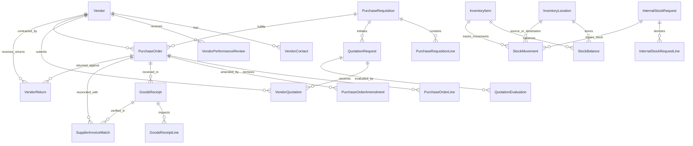

# Enterprise Procurement, Vendor Management, Purchase Orders & Inventory Control Runbook

## Executive Summary

The **CampusOS Procurement, Vendor Management, Purchasing, Receiving & Inventory Control Module** (Step 50) provides a unified, production-ready institutional purchasing and supply-chain orchestration engine.

CampusOS Tagline: **“One Campus. One System. One Source of Truth.”**

This module manages institutional purchasing from purchase requests and vendor evaluation through approvals, purchase orders, goods receipts, stock movements, three-way invoice reconciliation, and procurement reporting. It integrates cleanly with existing Finance & Fees, Infrastructure, Library, Documents, Workflow, Notifications, Audit, and Reporting domains without creating competing financial ledgers, duplicate library circulation catalogues, or parallel fixed-asset registers.

---

## 1. Architecture & Governance Principles

### 1.1 The Ten Golden Rules of Procurement & Inventory Governance
1. **Absolute Multi-Tenant Boundary Isolation**: Every vendor, contact, review, requisition, RFQ, quotation, evaluation, purchase order, amendment, goods receipt, location, catalogue item, stock balance, movement, internal request, invoice match, and return is strictly scoped by `tenant_id`. Cross-tenant querying, purchasing, or stock movements are blocked at both database and service layers.
2. **Finance Remains Authoritative**: This module does not create a competing financial ledger or accounts-payable disbursement engine. Requisition and PO commitments represent estimated financial encumbrances; they are never treated as posted expenses. Three-way invoice matching verifies commercial compliance but does not execute disbursements.
3. **Immutable Transactional Stock Movement Ledger**: `procurement_stock_movements` is an append-only immutable ledger. Inventory balances (`quantity_on_hand`, `quantity_reserved`, `quantity_available`, `quantity_in_transit`) are adjusted strictly via traceable movements (`RECEIPT`, `ISSUE`, `TRANSFER_OUT`, `TRANSFER_IN`, `RETURN_TO_VENDOR`, `ADJUSTMENT`). Direct in-place mutation without movement entries is prohibited.
4. **Negative-Stock Prevention**: Attempting to issue or transfer stock exceeding `quantity_available` is atomically rejected with `BadRequestException` (HTTP 400), guaranteeing physical stock integrity.
5. **Approved Vendor Enforcement**: Purchase orders can only be issued to vendors in `APPROVED` status with verified institutional credentials. Unapproved or suspended vendors are rejected server-side.
6. **Server-Side Decimal Precision**: All prices, taxes, discounts, totals, quantities, and variances are calculated server-side using arbitrary-precision decimal arithmetic (`Decimal`, `Numeric(12, 2)` or `Numeric(3, 2)`). Never rely on client-supplied totals.
7. **Over-Receipt Prevention**: Receiving goods against a purchase order line verifies that `quantity_received + previous_received <= quantity_ordered`. Excess deliveries are rejected unless an explicit authorized policy tolerance permits them.
8. **Versioned Purchase Order Immutability**: Issued purchase orders are binding commercial documents and cannot be edited in-place. Material changes require a formal, auditable `PurchaseOrderAmendment` incrementing the PO's version number.
9. **Three-Way Invoice Matching with Configurable Tolerances**: Invoice validation compares (1) Purchase Order line prices, (2) Goods Receipt accepted quantities, and (3) Supplier invoice amount. If price or quantity variances exceed configured tolerances, status is set to `PRICE_DISCREPANCY` or `QUANTITY_DISCREPANCY`, requiring an authorized finance review override with written justification.
10. **Forensic Auditability & Outbox Event Emission**: All critical lifecycle transitions (vendor approvals, requisition submissions, PO issuances, goods receipts, quality inspection outcomes, stock movements, and invoice match overrides) emit immutable audit logs (`AuditEventCategory.PROCUREMENT_*`) and transactional outbox events (`OutboxEvent`) for real-time downstream processing.

---

## 2. Domain Data Architecture



---

## 3. Core Procurement Subsystems

### 3.1 Vendor Management & Duplicate Detection
- **Lifecycle States**: `PENDING` -> `APPROVED`, `SUSPENDED`, `INACTIVE`.
- **Classification**: `GOODS`, `SERVICES`, `MAINTENANCE`, `TECHNOLOGY`, `EDUCATIONAL_SUPPLIES`, `LABORATORY_EQUIPMENT`, `FACILITIES`, `OTHER`.
- **Duplicate Detection**: Computes similarity scores using exact tax identifier (GSTIN/PAN/EIN) matching (0.9 weight), exact email matching (0.7 weight), and normalized legal/trade name matching (0.8 weight). Flags potential duplicates before onboarding.
- **Performance Reviews**: Multi-criteria scorecards evaluating delivery timeliness (1-5), quality compliance (1-5), and pricing competitiveness (1-5), automatically computing overall rating score on vendor profile.

### 3.2 Purchase Requisitions
- **Scope Tracking**: Linked to requesting employee, department, campus, cost center, and budget code.
- **Approval Workflow**: States include `DRAFT`, `SUBMITTED`, `UNDER_REVIEW`, `APPROVED`, `REJECTED`, `RETURNED_FOR_CORRECTION`, `PARTIALLY_FULFILLED`, `FULFILLED`.
- **Budget Checks**: Verifies departmental budget commitments before approval.

### 3.3 RFQs, Vendor Quotations & Scoring
- **Formal RFQ**: Includes deadline date, technical specifications, and JSON-configurable evaluation criteria weights (e.g. price 50%, quality 30%, delivery 20%).
- **Vendor Quotations**: Records quotation reference, validity period, lead time days, warranty months, payment terms, and document keys.
- **Committee Evaluation**: Calculates composite score based on RFQ criteria weights and records formal award recommendation or single-source justification.

### 3.4 Purchase Orders & Amendments
- **PO Issuance**: Server-side line-by-line total, tax, and discount arithmetic. PO status transitions: `DRAFT` -> `ISSUED` -> `ACKNOWLEDGED` -> `PARTIALLY_DELIVERED` -> `DELIVERED` -> `CLOSED` or `CANCELLED`.
- **Versioned Amendments**: In-place edits are rejected once issued. Changes must be recorded as versioned amendments (`PurchaseOrderAmendment`), preserving prior contracts for audits.

### 3.5 Goods Receipt Notes (GRN) & Quality Inspection
- **Receiving Controls**: Over-receipt protection prevents accepting quantities exceeding remaining order balances.
- **Quality Control**: Inspections yield `PASSED` (status `ACCEPTED`), `FAILED` (status `REJECTED`), or `WAIVED` (status `PARTIALLY_ACCEPTED`), routing goods to storage or quarantine.

### 3.6 Multi-Location Inventory Control
- **Location Hierarchies**: Central warehouses, department stores, lab stores, asset depots, quarantine stores.
- **Immutable Movement Ledger**: Records every stock change with movement type (`RECEIPT`, `ISSUE`, `TRANSFER_OUT`, `TRANSFER_IN`, `RETURN_TO_VENDOR`, `ADJUSTMENT`), unit cost, total valuation, and user ID.
- **Concurrency & Negatives**: Negative available inventory is strictly blocked.

### 3.7 Internal Stock Requests & Reservations
- **Departmental Supplies**: Academic departments request consumables and lab supplies.
- **Approval & Reservation**: Approved requests immediately decrease `quantity_available` and increase `quantity_reserved` at the target location.
- **Fulfillment**: Warehouse issues stock, decrements `quantity_reserved` and `quantity_on_hand`, and logs immutable issue movement.

### 3.8 Three-Way Invoice Matching
- **Automated Verification**: Reconciles (1) PO total amount and line prices, (2) GRN accepted quantities and received value, and (3) Supplier invoice amount.
- **Discrepancy Handling**: If variance exceeds configured price or quantity tolerance percentage, match is marked `PRICE_DISCREPANCY` or `QUANTITY_DISCREPANCY`.
- **Authorized Overrides**: Authorized finance reviewers can override discrepancies with recorded business justifications.

### 3.9 Returns to Vendor (RTV)
- **Defective / Damaged Goods**: Links to purchase order, goods receipt, and item SKU.
- **Resolution Tracking**: Supports `REPLACEMENT`, `CREDIT_NOTE`, or `REFUND` with credit note reference and financial value.

---

## 4. Role-Based Access Control (RBAC) Matrix

| Permission | Code | Roles with Access |
|---|---|---|
| `PROCUREMENT_READ` | `procurement:read` | Super Admin, Institution Admin, HOD |
| `PROCUREMENT_MANAGE` | `procurement:manage` | Super Admin, Institution Admin |
| `PROCUREMENT_VENDORS_MANAGE` | `procurement:vendors:manage` | Super Admin, Institution Admin |
| `PROCUREMENT_REQUISITIONS_CREATE` | `procurement:requisitions:create` | Super Admin, Institution Admin, HOD |
| `PROCUREMENT_REQUISITIONS_APPROVE` | `procurement:requisitions:approve` | Super Admin, Institution Admin |
| `PROCUREMENT_QUOTATIONS_MANAGE` | `procurement:quotations:manage` | Super Admin, Institution Admin |
| `PROCUREMENT_ORDERS_CREATE` | `procurement:orders:create` | Super Admin, Institution Admin |
| `PROCUREMENT_ORDERS_APPROVE` | `procurement:orders:approve` | Super Admin, Institution Admin |
| `PROCUREMENT_RECEIVING_MANAGE` | `procurement:receiving:manage` | Super Admin, Institution Admin |
| `PROCUREMENT_INVENTORY_MANAGE` | `procurement:inventory:manage` | Super Admin, Institution Admin |
| `PROCUREMENT_INVENTORY_READ` | `procurement:inventory:read` | Super Admin, Institution Admin, HOD |
| `PROCUREMENT_INVOICE_MATCH` | `procurement:invoice:match` | Super Admin, Institution Admin |
| `PROCUREMENT_REPORTS_READ` | `procurement:reports:read` | Super Admin, Institution Admin, HOD |

---

## 5. API Endpoint Inventory (42 Endpoints)

All endpoints are mounted under `/api/v1/procurement` with OpenAPI tag `"Procurement & Inventory"`.

### 5.1 Vendor Management
- `POST /api/v1/procurement/vendors` — Register a new vendor profile.
- `GET /api/v1/procurement/vendors` — List registered vendors with category/status/search filters.
- `POST /api/v1/procurement/vendors/duplicate-check` — Detect potential duplicate vendors.
- `GET /api/v1/procurement/vendors/{vendor_id}` — Get vendor profile, contacts, and reviews.
- `PATCH /api/v1/procurement/vendors/{vendor_id}` — Update vendor profile attributes.
- `POST /api/v1/procurement/vendors/{vendor_id}/status` — Transition lifecycle status (Approve, Suspend, Inactivate).
- `POST /api/v1/procurement/vendors/{vendor_id}/contacts` — Add authorized vendor contact.
- `PATCH /api/v1/procurement/vendors/{vendor_id}/contacts/{contact_id}` — Update authorized contact.
- `POST /api/v1/procurement/vendors/{vendor_id}/reviews` — Record vendor performance review.

### 5.2 Purchase Requisitions
- `POST /api/v1/procurement/requisitions` — Create purchase requisition with line items.
- `GET /api/v1/procurement/requisitions` — List purchase requisitions with filters.
- `GET /api/v1/procurement/requisitions/{requisition_id}` — Get requisition details and lines.
- `PATCH /api/v1/procurement/requisitions/{requisition_id}` — Update draft requisition.
- `POST /api/v1/procurement/requisitions/{requisition_id}/review` — Approve, reject, or return for correction.

### 5.3 RFQs & Quotations
- `POST /api/v1/procurement/rfqs` — Issue Request for Quotation (RFQ).
- `GET /api/v1/procurement/rfqs` — List RFQs with status filter.
- `GET /api/v1/procurement/rfqs/{rfq_id}` — Get RFQ details, quotations, and evaluations.
- `PATCH /api/v1/procurement/rfqs/{rfq_id}` — Update RFQ details or close bidding.
- `POST /api/v1/procurement/quotations` — Submit vendor quotation.
- `POST /api/v1/procurement/evaluations` — Record quotation evaluation and award decision.

### 5.4 Purchase Orders
- `POST /api/v1/procurement/orders` — Create purchase order for approved vendor.
- `GET /api/v1/procurement/orders` — List purchase orders with vendor/status filters.
- `GET /api/v1/procurement/orders/{po_id}` — Get purchase order details, lines, and amendments.
- `PATCH /api/v1/procurement/orders/{po_id}` — Update draft purchase order.
- `POST /api/v1/procurement/orders/{po_id}/issue` — Issue and approve purchase order to vendor.
- `POST /api/v1/procurement/orders/{po_id}/amendments` — Create versioned amendment.
- `POST /api/v1/procurement/orders/{po_id}/close` — Close fulfilled purchase order.
- `POST /api/v1/procurement/orders/{po_id}/cancel` — Cancel purchase order.

### 5.5 Goods Receipt & Quality Inspection
- `POST /api/v1/procurement/receipts` — Process Goods Receipt Note (GRN) with over-receipt protection.
- `GET /api/v1/procurement/receipts` — List goods receipts.
- `GET /api/v1/procurement/receipts/{grn_id}` — Get goods receipt and line items.
- `POST /api/v1/procurement/receipts/{grn_id}/inspection` — Record quality inspection and quarantine/reject goods.

### 5.6 Inventory Locations, Items & Movements
- `POST /api/v1/procurement/inventory/locations` — Create warehouse or store location.
- `GET /api/v1/procurement/inventory/locations` — List inventory locations.
- `PATCH /api/v1/procurement/inventory/locations/{loc_id}` — Update warehouse location.
- `POST /api/v1/procurement/inventory/items` — Register stock item in catalogue.
- `GET /api/v1/procurement/inventory/items` — List catalogue items with stock levels.
- `GET /api/v1/procurement/inventory/items/{item_id}` — Get catalogue item details.
- `PATCH /api/v1/procurement/inventory/items/{item_id}` — Update catalogue item.
- `GET /api/v1/procurement/inventory/balances` — List stock balances across locations.
- `POST /api/v1/procurement/inventory/movements` — Record immutable stock movement (Receipt, Issue, Adjustment).
- `POST /api/v1/procurement/inventory/transfers` — Perform atomic inter-store stock transfer.

### 5.7 Internal Stock Requests
- `POST /api/v1/procurement/internal-requests` — Create departmental stock supply requisition.
- `GET /api/v1/procurement/internal-requests` — List internal stock requests with filters.
- `GET /api/v1/procurement/internal-requests/{request_id}` — Get internal request details and lines.
- `POST /api/v1/procurement/internal-requests/{request_id}/approve` — Approve request and reserve quantities.
- `POST /api/v1/procurement/internal-requests/{request_id}/fulfill` — Issue stock and fulfill approved request.

### 5.8 Three-Way Invoice Matching
- `POST /api/v1/procurement/invoice-matches` — Execute three-way invoice matching between PO, GRN, and Invoice.
- `GET /api/v1/procurement/invoice-matches` — List invoice match records.
- `GET /api/v1/procurement/invoice-matches/{match_id}` — Get invoice match details and variances.
- `POST /api/v1/procurement/invoice-matches/{match_id}/override` — Authorize override on discrepancy.

### 5.9 Vendor Returns (RTV)
- `POST /api/v1/procurement/returns` — Initiate return to vendor for defective or damaged goods.
- `GET /api/v1/procurement/returns` — List vendor returns with filters.
- `GET /api/v1/procurement/returns/{return_id}` — Get vendor return details.
- `PATCH /api/v1/procurement/returns/{return_id}/status` — Update return status and credit note reference.

### 5.10 Procurement & Inventory Analytics
- `GET /api/v1/procurement/reports/summary` — Procurement KPIs: commitments, orders, receipts, invoice discrepancies.
- `GET /api/v1/procurement/reports/inventory-valuation` — Inventory valuation KPIs: stock levels, valuation, low stock alerts.

---

## 6. Verification & Operational Commands

### 6.1 Database Migration
```bash
alembic upgrade head
```
Migration file: `apps/api/migrations/versions/035_enterprise_procurement_vendor_inventory.py` (Revision ID: `035`, Down Revision: `034`).

### 6.2 Running Automated Tests
```bash
# Run Step 50 Procurement and Inventory tests
pytest tests/test_enterprise_procurement_inventory.py -v

# Run database migration verification tests
pytest tests/test_enterprise_database_migrations.py -v

# Run Step 49 Timetable scheduling tests
pytest tests/test_enterprise_timetable_scheduling.py -v
```

### 6.3 Code Quality & Linting
```bash
ruff check app/models/procurement.py app/schemas/procurement.py app/services/procurement_service.py app/api/v1/procurement.py app/api/v1/router.py app/core/audit.py app/core/permissions.py tests/test_enterprise_procurement_inventory.py
```
