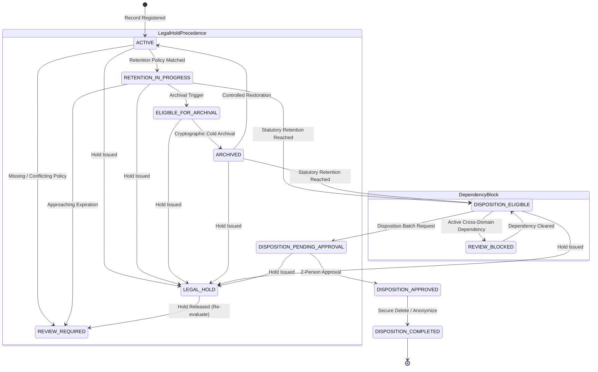

# CampusOS Enterprise Records Lifecycle, Retention, Archival & Legal Hold Management

## 1. Architectural Overview

The CampusOS Enterprise Records Lifecycle Management Engine (Step 41) establishes an institutional compliance framework for governing institutional records throughout their complete lifecycle:
**Creation ➔ Active Use ➔ Retention In Progress ➔ Archival ➔ Legal Hold ➔ Authorized Disposition ➔ Final Purge/Anonymization**.



### Core Architectural Principles
1. **Zero Unnecessary Content Duplication:** Authoritative domain tables (students, finance, academics, examinations) remain the source of truth. The records registry indexes metadata, source references, lifecycle state, hashes, and retention dates without duplicating sensitive payloads.
2. **Institutional Policy Approval Mandate:** Retention durations, triggers, and disposition methods are never hardcoded. All retention periods must be formally approved by the institution and applicable legal or compliance advisers before activation.
3. **Fail-Safe Policy Resolution:** Where a policy is missing, ambiguous, expired, or conflicting, the system fails safely by flagging the record as `REVIEW_REQUIRED` or `REVIEW_BLOCKED` rather than scheduling destruction.
4. **Absolute Precedence of Legal Holds:** Active legal holds immediately freeze the record, halting any pending or automated archival or disposition operations. Upon hold release, records are never automatically destroyed; they require fresh eligibility evaluation and standard dual approvals.
5. **Separation of Duties in Disposition:** A disposition batch request requires two-person administrative authorization. The user who requested disposition is cryptographically prevented from approving their own request.

---

## 2. Records Classification & Statutory Categories

CampusOS auto-seeds 9 statutory record categories aligned with national higher education and compliance standards (UGC, AICTE, Income Tax Act, Indian Contract Act):

| Category Code | Classification Name | Confidentiality | Default Retention | Statutory Reference |
| :--- | :--- | :--- | :--- | :--- |
| `STUDENT_ACADEMIC` | Permanent Student Academic Transcripts & Degrees | RESTRICTED | 35 Years | UGC & AICTE Academic Mandates |
| `STUDENT_ADMISSIONS` | Enrollment & Admission Applications | CONFIDENTIAL | 5 Years | Statutory Admission Authority |
| `ATTENDANCE_EXAMS` | Course Attendance, Midterms & Exam Answersheets | CONFIDENTIAL | 3 Years | Institutional Examination Regulations |
| `FINANCE_ACCOUNTING` | Student Invoices, Fee Receipts & Vendor Ledgers | RESTRICTED | 8 Years | Income Tax Act & Financial Audit |
| `EMPLOYEE_STAFF` | Faculty & Staff Service Books & Payroll | CONFIDENTIAL | 10 Years | Labor Law & Provident Fund Statutes |
| `GOVERNANCE_ADMIN` | Institutional Governance & Senate Minutes | INTERNAL | 50 Years | Institution Charter & Trust Statutes |
| `CONTRACTS_COMPLIANCE` | Legal Contracts, Leases & Regulatory Approvals | RESTRICTED | 7 Years | Indian Contract Act & Compliance |
| `PLACEMENT_INTERNSHIP`| Career Placement Drive Records & Offer Letters | INTERNAL | 5 Years | Career Services Governance |
| `GENERAL_DOCUMENTS` | Circulars, Event Permissions & Notices | INTERNAL | 3 Years | Institutional Office Manual |

---

## 3. Retention Policy Engine & Versioning

### Configurable Triggers
- `CREATION`: Triggered at record creation timestamp.
- `GRADUATION`: Triggered upon student degree conferral or graduation date.
- `TERMINATION`: Triggered upon employee resignation, retirement, or termination.
- `FY_CLOSE`: Triggered at the close of the financial year (March 31).
- `CONTRACT_EXPIRY`: Triggered upon formal expiration or completion of contract terms.
- `CASE_CLOSURE`: Triggered upon formal resolution of a disciplinary or legal proceeding.
- `COMPLETION`: Triggered upon course, internship, or event completion.

### Immutable Versioning
1. Retention policies are created in `DRAFT` status (v1).
2. Authoring officers configure duration units (`DAYS`, `MONTHS`, `YEARS`, `PERMANENT`) and review/archive/approval requirements.
3. Upon review by the Academic Senate or Legal Advisory Committee, the policy is published via `POST /api/v1/records/policies/{id}/publish`.
4. Subsequent updates automatically generate an immutable `RetentionPolicyVersionRecord` snapshot (`v2`, `v3`, ...), preserving complete historical audit evidence without altering historical records already governed under earlier policy versions.

---

## 4. Archival Management & Cryptographic Manifests

The archival engine moves eligible records from active operational access to cold tiered object storage:
- **Eligibility Assessment:** Evaluates records marked `archive_required` once active operational retention passes.
- **SHA-256 Integrity:** Calculates cryptographic hashes before and after archival storage transmission to guarantee tamper resistance.
- **Access Logging:** Every retrieval or metadata view of cold-archived records generates an immutable `RecordArchivalAccessLog` recording the actor's user ID, timestamp, IP address, and access justification.
- **Controlled Restoration:** Archived records can be restored to `ACTIVE` state through authorized workflows.

---

## 5. Legal Hold Management

Legal holds preserve records subject to litigation, government investigations, statutory inquiries, or internal audits.
- **Scopes:** `ALL` (institution-wide), `CATEGORY` (e.g., all `FINANCE_ACCOUNTING`), `MODULE` (e.g., `students`), `DEPARTMENT`, or `SPECIFIC_RECORD`.
- **Hold Locking:** When a hold is applied, the record's `is_held` flag is set to `True`, `active_hold_count` is incremented, and state transitions to `LEGAL_HOLD`.
- **Disposition Prevention:** Any attempt to request or execute disposition on held records fails with `409 Conflict: LegalHoldActiveException`.
- **Hold Release & Re-evaluation:** Releasing a hold never triggers destruction. The record transitions to `REVIEW_REQUIRED`, where retention eligibility is freshly recalculated against active statutory rules and cross-domain dependencies.

---

## 6. Controlled Disposition & Destruction Safeguards

### Mandatory Safeguards
1. **Dry-Run Preview:** Authorized compliance officers can preview qualifying records and block reasons via `POST /api/v1/records/dispositions/preview` with **zero destructive side-effects**.
2. **Two-Person Separation of Duties:**
   - Officer 1 creates a disposition batch request (`requested_by_user_id`).
   - Officer 2 reviews and formally approves the request (`approved_by_user_id != requested_by_user_id`).
   - Attempting self-approval raises `403 Forbidden: DispositionApprovalRequiredException`.
3. **Cross-Domain Dependency Verification:** Disposition checks active institutional dependencies before proceeding:
   - Active student enrollments.
   - Outstanding or unpaid fee invoices.
   - Allocated hostel beds or active transport passes.
   - Pending degree or credential verifications.
   If dependencies exist, the record transitions to `REVIEW_BLOCKED`.
4. **Tamper-Evident Disposition Certificate:** Execution generates a cryptographic certificate containing:
   - Unique certificate number (`CERT-DISP-{YEAR}-{HEX}`).
   - SHA-256 hash of all disposed record identifiers and metadata.
   - Digital signature hash binding the requesting officer and approving officer.
   - Audit trail preserved indefinitely in `records_disposition_certificates`.

---

## 7. Granular Permissions & Role-Based Access Control

The Records Lifecycle Engine introduces granular PBAC permissions scoped to the `INSTITUTION_ADMIN` role and compliance officers:

| Permission | Description |
| :--- | :--- |
| `records:read` | View categories, retention policies, registry entries, and dashboard summaries. |
| `records:create` | Register authoritative institutional records in the registry. |
| `records:manage` | Manage record lifecycle states and manually resolve review queues. |
| `records:policy:manage` | Author and edit institutional retention policy drafts. |
| `records:policy:publish` | Formally approve and publish retention policies and versions. |
| `records:archive:execute` | Transfer records to cold storage and generate archival manifests. |
| `records:archive:retrieve` | Audited retrieval or restoration of archived records. |
| `records:hold:create` | Issue legal and preservation holds. |
| `records:hold:manage` | Edit hold scope, add custodians, and extend review dates. |
| `records:hold:release` | Release legal holds and trigger eligibility re-evaluation. |
| `records:disposition:request` | Submit disposition batch requests for review. |
| `records:disposition:approve` | Formally approve disposition batch requests (dual control). |
| `records:disposition:execute` | Execute disposition actions and generate disposition certificates. |

---

## 8. Scheduled Background Processing

Integrated with the CampusOS scheduler loop in `app/scheduler.py`:
- **Task:** `records_lifecycle_sweep` executes background sweeps with bounded batch sizes (default: 50 records per tenant).
- **Sweep Types:**
  - `ELIGIBILITY_RECALCULATION`: Re-evaluates retention maturity dates and flags approaching expirations.
  - `RETENTION_REVIEW_SWEEP`: Moves mature records to `REVIEW_REQUIRED`.
  - `HOLD_COVERAGE_CHECK`: Re-verifies hold associations against newly registered domain records.
  - `ARCHIVE_CANDIDATE_SWEEP`: Identifies records requiring cold tier transfer.
- **Idempotency:** Background sweeps are fully idempotent, recording run metrics (records evaluated, modified, skipped, errors) in `records_lifecycle_scheduled_runs`.

---

## 9. API Reference Summary

### Categories & Policies
- `GET /api/v1/records/categories` — List statutory record categories.
- `POST /api/v1/records/categories` — Create custom institutional record category.
- `GET /api/v1/records/policies` — List retention policies with versions.
- `POST /api/v1/records/policies` — Author new retention policy draft.
- `GET /api/v1/records/policies/{id}` — Fetch policy details and version history.
- `POST /api/v1/records/policies/{id}/publish` — Publish and activate retention policy.
- `POST /api/v1/records/policies/{id}/versions` — Create new policy version.

### Registry & Auditing
- `GET /api/v1/records/registry` — Query records registry with pagination and filters.
- `POST /api/v1/records/registry` — Register domain record into lifecycle registry.
- `GET /api/v1/records/registry/{id}` — Fetch record details and lifecycle history.
- `GET /api/v1/records/registry/{id}/retention-evaluation` — Audit retention status and dependency checks.

### Archival & Retrieval
- `POST /api/v1/records/registry/{id}/archive` — Execute cold archival with SHA-256 manifest.
- `POST /api/v1/records/archival/{manifest_id}/retrieve` — Audited retrieval of archived record.
- `POST /api/v1/records/archival/{manifest_id}/restore` — Restore archived record to active lifecycle.

### Legal Holds
- `GET /api/v1/records/holds` — List institutional legal holds.
- `POST /api/v1/records/holds` — Issue preservation legal hold.
- `POST /api/v1/records/holds/{id}/release` — Release hold and trigger eligibility re-evaluation.

### Disposition & Certificates
- `POST /api/v1/records/dispositions/preview` — Non-destructive dry-run disposition preview.
- `GET /api/v1/records/dispositions` — List disposition requests and certificates.
- `POST /api/v1/records/dispositions` — Submit disposition batch request.
- `POST /api/v1/records/dispositions/{id}/approve` — Approve disposition request (2-person control).
- `POST /api/v1/records/dispositions/{id}/execute` — Execute disposition and issue certificate.
- `GET /api/v1/records/dispositions/{id}/certificate` — Retrieve tamper-evident certificate.

---

## 10. Database Migration & Rollback

- **Migration Script:** `apps/api/migrations/versions/027_enterprise_records_lifecycle_retention_archival.py`
- **Revises:** `026_enterprise_data_import_migration_reconciliation`
- **Tables Introduced:**
  - `records_categories`
  - `records_retention_policies`
  - `records_retention_policy_versions`
  - `records_registry`
  - `records_lifecycle_history`
  - `records_archival_manifests`
  - `records_archival_access_logs`
  - `records_legal_holds`
  - `records_legal_hold_associations`
  - `records_disposition_requests`
  - `records_disposition_items`
  - `records_disposition_certificates`
  - `records_lifecycle_scheduled_runs`

### Applying Migrations
```bash
cd apps/api
alembic upgrade head
```

### Rollback Guidance
```bash
cd apps/api
alembic downgrade 026_enterprise_data_import_migration_reconciliation
```

---

## 11. Verification & Testing

### Test Execution Commands
```bash
# 1. Run Step 41 Records Lifecycle Test Suite (12 tests)
apps/api/.venv/Scripts/pytest.exe apps/api/tests/test_enterprise_records_lifecycle.py -v

# 2. Run Steps 36–40 Enterprise Regression Test Suites (63 tests)
apps/api/.venv/Scripts/pytest.exe \
  apps/api/tests/test_enterprise_marketplace_integrations.py \
  apps/api/tests/test_enterprise_subscription_customer_success.py \
  apps/api/tests/test_enterprise_adoption_enablement.py \
  apps/api/tests/test_enterprise_service_desk.py \
  apps/api/tests/test_enterprise_data_import_migration.py -q

# 3. Compile Shared TypeScript Contracts
npm run build --prefix packages/types

# 4. Compile Web Frontend Application
npm run build --prefix apps/web
```

---

## 12. Known Limitations & Operational Prerequisites

1. **Storage Backend Integration:** Cold storage manifests reference configured S3 / object storage keys. In local/testing environments, manifest files are written through the platform `DocumentStorage` abstraction. Production deployment requires pre-configuring AWS S3 Glacier or equivalent cold tier lifecycle policies.
2. **Physical Erasure:** Digital disposition performs `SECURE_DELETE` (storage purging and metadata deactivation) or `ANONYMIZE` (PII masking). Hardware-level cryptographic shredding or physical magnetic media degaussing must be handled at the underlying cloud infrastructure provider level.
3. **Statutory Approval Requirement:** CampusOS strictly enforces that retention periods must be vetted and approved by the college governing body, institutional senate, and accredited legal counsel prior to publishing retention policies.
