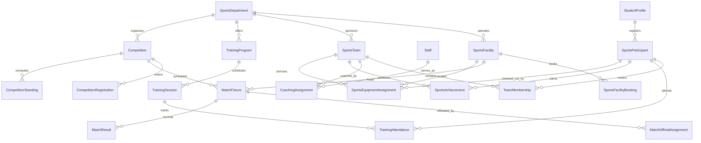

# Enterprise Sports, Athletics, Recreation & Student Fitness Management Runbook

## Executive Summary

The **CampusOS Sports, Athletics & Recreation Management Module** (Step 57) delivers an enterprise-grade institutional athletic and recreation orchestration engine.

CampusOS Tagline: **"One Campus. One System. One Source of Truth."**

This module encompasses central sports department administration, indoor/outdoor sports facility and court scheduling, conflict-free resource reservation, student-athlete participation directory with privacy-preserving medical clearance restrictions, team rosters, varsity coaching assignments, athletic training camps with interactive roll call attendance, competition fixture generation (Berger round-robin and single-elimination knockout), auditable match result recording and verification, automated standings and tiebreaker computation, campus athletic honors and records, equipment checkout/returns with maintenance and damage fee integration, sports registration fees linked to authoritative finance invoices, and institutional sports policy governance.

It integrates seamlessly with existing Institution, Campuses, Student Lifecycle, People, Workforce, Finance, Asset Management, Maintenance, Calendar, Events, Audit, and Notifications infrastructure without duplicating student identities, fixed-asset registries, staff profiles, financial ledgers, maintenance engines, or parallel event calendars.

---

## 1. Architecture & Governance Principles

### 1.1 The Ten Golden Rules of Sports Operations

1. **Absolute Multi-Tenant Isolation**: Every sports department, facility, court booking, athlete profile, squad, coaching assignment, training program, session, competition, fixture, match result, standing, achievement, and equipment checkout is strictly isolated by `tenant_id`. Cross-tenant queries and mutations are blocked at database and service boundaries.
2. **One Source of Asset Truth**: Sports facilities and physical sports equipment link directly to the institutional fixed-asset and inventory registries (`asset_registry.id` and `inventory_item_id`). Sports-specific operational parameters (court surfaces, lighting, safety netting, checkout status) are maintained in `sports_facilities` and `sports_equipment_assignments` without duplicating or mutating core fixed-asset records.
3. **One Source of Identity & Workforce Truth**: Coaches and officials link directly to institutional staff profiles (`staff.id`). Student-athletes link to `student_profiles.id`. Athletic clearance, jersey numbers, roster spots, and competition history are maintained without creating parallel student or employee databases.
4. **Privacy-Preserving Athletic Clearance**: Medical clearance records distinguish between `FIT_FULL_CONTACT`, `FIT_NON_CONTACT`, `CONDITIONAL_CLEARANCE`, `RESTRICTED_REHAB`, and `TEMPORARILY_INELIGIBLE`. Sensitive medical diagnoses, doctor notes, and medical records are never exposed to coaches or general administrators; only authorized operational safety flags (e.g., maximum contact minutes, non-contact required) are communicated.
5. **Deterministic Conflict-Free Facility Scheduling**: Facility bookings and match fixtures strictly validate against existing bookings for the same bookable space. Overlapping timeslots on the same facility are detected and rejected (`409 Conflict`) across both calendar bookings, match fixtures, and maintenance closures.
6. **Deterministic Tournament Fixture Engines**: Fixture schedules for round-robin tournaments follow the mathematically verified **Berger algorithm** (circle method), ensuring that every team plays every opponent exactly once with balanced home/away distribution without self-matches. Knockout brackets pair teams sequentially by seed, advancing winners across rounds.
7. **Auditable Result Verification & Anti-Tampering**: Match scores can be recorded by scorekeepers or team officials, but results remain in `RECORDED` state until verified by an authorized `SPORTS_OFFICER` or institutional admin. Verified results record the verifier's identity, timestamp, and audit trail. Verified results cannot be silently overwritten.
8. **Automated Standings & Sport-Specific Tiebreakers**: Standings are deterministically recalculated upon match verification. Standard league rules apply (3 pts for win, 1 pt for draw, 0 for loss), with multi-criteria tiebreakers: Points > Goal/Point Difference > Goals/Points Scored > Head-to-Head.
9. **Equipment Checkout with Damage Fee Synchronization**: Athletic equipment checkouts track issue dates, expected return dates, and return conditions (`PRISTINE`, `GOOD`, `FAIR`, `DAMAGED`, `LOST`). Damaged or lost items automatically trigger replacement fees linked to the authoritative Finance module and generate work orders in Asset Management.
10. **Finance Integration Without Duplicate Ledgers**: Athletic registration fees, tournament entry fees, and court rental charges generate invoices directly in the authoritative Finance module (`finance_invoices` and `finance_invoice_items`) with category `"SPORTS"`. Payment collection and refund workflows are handled exclusively through authoritative finance transactions.

---

## 2. Domain Data Architecture



---

## 3. Database Schema & Migration Details

### 3.1 Migration `041_enterprise_sports_athletics_recreation_management.py`

The database schema is created via Alembic revision `041`, containing 18 relational tables:

1. `sports_departments`: Central administrative units, recreation centers, athletic boards.
2. `sports_facilities`: Courts, pitches, indoor recreation halls, aquatic centers, fitness centers.
3. `sports_facility_operating_hours`: Day-of-week operating schedules with opening/closing hours.
4. `sports_facility_closures`: Maintenance, event, or weather-related closures with reopening gates.
5. `sports_facility_bookings`: Reservation ledger with time-range conflict checks and purpose codes.
6. `sports_participants`: Student and staff sports profiles, clearance statuses, and consent tracking.
7. `sports_teams`: Varsity, intercollegiate, intramural, and recreational squads.
8. `sports_team_memberships`: Team rosters with jersey numbers, positions, and active statuses.
9. `sports_coaching_assignments`: Head coach, assistant coach, and fitness trainer appointments.
10. `sports_training_programs`: Camps, development squads, fitness bootcamps, recreational classes.
11. `sports_training_sessions`: Session dates, times, venues, and curriculum focus.
12. `sports_training_attendances`: Roll call records (`PRESENT`, `ABSENT`, `EXCUSED`, `LATE`, `INJURED`).
13. `sports_competitions`: Tournaments, leagues, meets, and championship events.
14. `sports_competition_registrations`: Team and individual entrants with seeding and payment flags.
15. `sports_match_fixtures`: Match schedules, rounds, venues, scores, and status transitions.
16. `sports_match_official_assignments`: Referees, umpires, line judges, and timekeepers.
17. `sports_match_results`: Official verified scores, bonus points, winner ids, and verifier audit logs.
18. `sports_competition_standings`: Deterministic tables with P, W, D, L, GF, GA, GD, and Points.
19. `sports_achievements`: Medals, MVP trophies, university records, and all-conference honors.
20. `sports_equipment_assignments`: Physical gear checkouts, condition states, and damage charge links.
21. `sports_policy_configs`: Institutional policies (minimum CGPA, attendance thresholds, insurance mandates).

---

## 4. REST API Endpoint Catalog

All routes are mounted under `/api/v1/sports` and require authentication with valid tenant context.

| HTTP Method | Route | Description | RBAC Permission |
|-------------|-------|-------------|-----------------|
| `GET` | `/departments` | List institutional sports departments | `sports:read` |
| `POST` | `/departments` | Register sports department or rec center | `sports:admin` |
| `GET` | `/facilities` | List indoor/outdoor facilities and courts | `sports:read` |
| `POST` | `/facilities` | Register new sports facility | `sports:admin` |
| `POST` | `/facilities/{id}/maintenance-close` | Close court for maintenance | `facility:manage` |
| `POST` | `/facilities/{id}/reopen` | Reopen facility for bookings | `facility:manage` |
| `GET` | `/facility-bookings` | List active facility reservations | `sports:read` |
| `POST` | `/facility-bookings` | Book facility with conflict detection | `sports:write` |
| `GET` | `/participants` | List registered athletes and participants | `sports:read` |
| `POST` | `/participants` | Register student or staff athlete | `sports:write` |
| `POST` | `/participants/{id}/clearance` | Update athletic clearance status | `sports:officer` |
| `GET` | `/teams` | List athletic teams and squads | `sports:read` |
| `POST` | `/teams` | Create new varsity or intramural team | `sports:write` |
| `POST` | `/teams/{id}/members` | Add athlete to roster with capacity check | `coach:write` |
| `GET` | `/coaches` | List coaching assignments | `sports:read` |
| `POST` | `/coaches` | Assign coach to team | `sports:admin` |
| `GET` | `/training-programs` | List training camps and fitness clinics | `sports:read` |
| `POST` | `/training-programs` | Create training program | `sports:write` |
| `GET` | `/training-sessions` | List training sessions | `sports:read` |
| `POST` | `/training-sessions/{id}/attendance` | Record session roll call attendance | `coach:write` |
| `GET` | `/competitions` | List tournaments and leagues | `sports:read` |
| `POST` | `/competitions` | Create competition | `sports:admin` |
| `POST` | `/competitions/{id}/fixtures/generate` | Auto-generate fixtures (Berger/Knockout) | `competition:organizer` |
| `GET` | `/fixtures` | List match fixtures and schedule | `sports:read` |
| `POST` | `/fixtures/{id}/score` | Record provisional match score | `official:write` |
| `POST` | `/fixtures/{id}/verify` | Authorize and publish verified result | `sports:officer` |
| `GET` | `/standings` | Get competition standings and rankings | `sports:read` |
| `GET` | `/achievements` | List awards, medals, and records | `sports:read` |
| `GET` | `/equipment-assignments` | List equipment checkout ledger | `sports:read` |
| `POST` | `/equipment-assignments/checkout` | Check out equipment to team/athlete | `equipment:manage` |
| `POST` | `/equipment-assignments/{id}/return` | Record equipment return & damage fees | `equipment:manage` |
| `GET` | `/reports/telemetry` | Sports executive analytics & KPI telemetry | `sports:read` |

---

## 5. Tournament & Fixture Generation Algorithms

### 5.1 Round-Robin (Berger Circle Method)
For $N$ teams (if $N$ is odd, a dummy "BYE" team is added):
- Number of rounds: $R = N - 1$
- Matches per round: $M = N / 2$
- Rotation: Team 1 remains fixed at index 0. The remaining $N-1$ teams rotate clockwise each round.
- Properties: Every team plays every other team exactly once. Balanced home and away venues. Zero duplicate matchups.

### 5.2 Single-Elimination Knockout
For $2^K$ teams (e.g. 8, 16):
- Round 1 (Quarter-Finals for 8 teams): Seed 1 vs Seed 8, Seed 4 vs Seed 5, Seed 2 vs Seed 7, Seed 3 vs Seed 6.
- Progression: Winners advance to Semi-Finals, and subsequent winners to the Championship Final.

---

## 6. Frontend Navigation & User Interface

The module provides 17 dedicated screens integrated seamlessly into CampusOS under `/app/sports/...`:

1. **Dashboard** (`/app/sports`): Operational KPIs, quick action cards, today's schedule, and maintenance alerts.
2. **Departments** (`/app/sports/departments`): Administrative entities, operating policies, and leadership.
3. **Facilities & Courts** (`/app/sports/facilities`): Court surfaces, lighting, indoor/outdoor filters, maintenance status.
4. **Facility Calendar** (`/app/sports/calendar`): Visual booking timeline, reservation dialog with overlap detection.
5. **Participant Directory** (`/app/sports/participants`): Athlete directory, clearance badges, and eligibility rules.
6. **Teams & Rosters** (`/app/sports/teams`): Squad cards, roster capacity meters, and player management.
7. **Coaches & Officials** (`/app/sports/coaches`): Certified coaching staff, referee assignments, and credentials.
8. **Training Programs** (`/app/sports/training`): Camps, clinics, registration windows, and capacity indicators.
9. **Training Schedule & Attendance** (`/app/sports/training/schedule`): Calendar sessions with interactive roll call modal.
10. **Tournaments & Competitions** (`/app/sports/competitions`): Competition engine with fixture auto-generation.
11. **Fixtures & Match Calendar** (`/app/sports/fixtures`): Match list, venue filters, and score recording dialog.
12. **Match Results & Standings** (`/app/sports/results`): Scoreboard, verification badges, and live league tables.
13. **Achievements & Rankings** (`/app/sports/achievements`): Trophy room, MVP awards, and university records.
14. **Equipment Allocation** (`/app/sports/equipment`): Checkout ledger, condition inspection, and damage return workflow.
15. **Registrations & Fees** (`/app/sports/fees`): Tournament and camp fees linked directly to authoritative finance invoices.
16. **Reports & Analytics** (`/app/sports/reports`): Utilization rates, clearance compliance, and PDF/CSV export.
17. **Configuration & Policies** (`/app/sports/config`): CGPA eligibility gates, attendance thresholds, and insurance policies.

---

## 7. Testing & Verification Guide

### 7.1 Backend Test Execution
```powershell
cd "apps/api"
.venv\Scripts\pytest tests/test_enterprise_sports.py --show-capture=no
```
**Expected Output:** 9 passed in ~7-14s.

### 7.2 Frontend Test Execution
```powershell
cd "apps/web"
npx tsx src/__tests__/sports-module.test.ts
```
**Expected Output:** Passed: 84, Failed: 0.

### 7.3 TypeScript Verification
```powershell
cd "packages/types"
npm run build

cd "apps/web"
npm run typecheck
```
**Expected Output:** Clean build with 0 errors.

---

## 8. Role & Permission Matrix

| Role | Facilities & Courts | Rosters & Teams | Fixture Generation | Result Verification | Equipment Checkout | Finance Fees |
|------|--------------------|-----------------|-------------------|---------------------|--------------------|--------------|
| `SUPER_ADMIN` | Full Access | Full Access | Full Access | Full Access | Full Access | Full Access |
| `CAMPUS_ADMIN` | Full Access | Full Access | Full Access | Full Access | Full Access | Full Access |
| `SPORTS_OFFICER` | Manage / Close | Approve Rosters | Generate | Verify Results | Approve | View / Bill |
| `FACILITY_MANAGER` | Manage / Close / Reopen | View Only | View Only | View Only | View Only | View Only |
| `COACH` | Reserve Venue | Manage Team Roster | View Fixtures | Record Scores | Checkout Gear | View Team Fees |
| `MATCH_OFFICIAL` | View Only | View Rosters | View Fixtures | Record Scores | View Only | View Only |
| `STUDENT_PARTICIPANT` | View Available | View Own Team | View Fixtures | View Standings | Borrow (Self) | Pay Own Fees |

---

## 9. Known Limitations & Future Enhancements

1. **Weather Telematics**: Outdoor court weather-cancellation currently relies on manual facility closure by the Facility Manager rather than automatic integration with meteorological weather sensors.
2. **Double-Elimination Brackets**: Tournament fixture engine currently supports Round-Robin (Berger algorithm) and Single-Elimination Knockout. Multi-stage pool-play followed by double-elimination brackets can be configured through sequential competition stages.
3. **Locker Room Assignment**: Locker management is linked through sports facility assets; dedicated electronic biometric locker locks can be interfaced in future IoT gateway updates.
