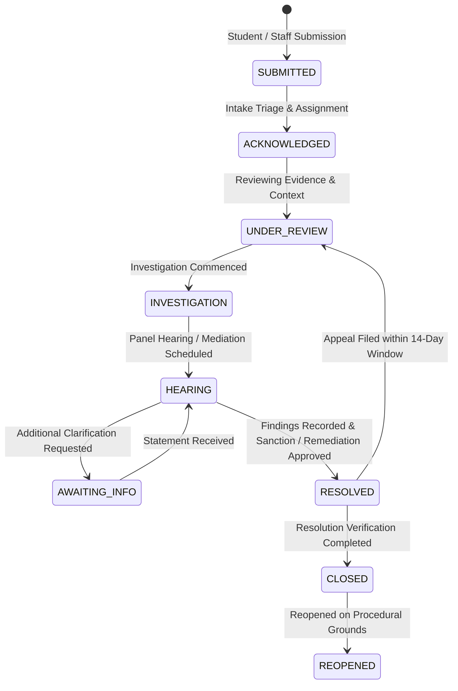

# CampusOS Student Affairs, Grievance Redressal & Disciplinary Operations Runbook
**Product:** CampusOS  
**Tagline:** "One Campus. One System. One Source of Truth."  
**Module:** Enterprise Student Disciplinary Affairs, Grievance Redressal & Institutional Case Management (Step 58)

---

## 1. Executive Summary & Architecture

The **CampusOS Student Affairs, Grievance Redressal & Disciplinary Case Management Module** delivers an enterprise-grade institutional framework for handling student complaints, service grievances, disciplinary proceedings, statutory appeals, voluntary mediation, and safeguarding escalations across multi-campus universities.

Operating under the core CampusOS architectural principle of the **Modular Monolith**, the module integrates with core institutional identity (`people_users`, `people_staff`), campuses (`core_campuses`), digital records (`documents_records`), and granular role-based access control (RBAC).

### Key Architectural Boundaries
- **Tenant Isolation:** Every database table inherits from `TenantScopedModel` with mandatory `tenant_id` constraints, indexing, and server-side filtering derived from trusted JWT claims.
- **Procedural Fairness Safeguards:** Allegations are never automatically assumed to be proven (`finding_status = PENDING`). Automated disciplinary punishment or opaque AI risk scoring is strictly prohibited.
- **Separation of Duties:** Under UGC and statutory procedural guidelines, the original decision-maker who authorized a disciplinary sanction is barred from acting as the appellate reviewer.
- **Confidentiality & Protected Reporting:** Submissions support anonymous reporting with masked persona records and controlled redaction of sensitive witness testimonies.
- **Legal Hold & Tamper-Proof Audit:** Evidence deletion is restricted, and all access, assignment, redaction, finding, and sanction events are recorded in `sa_case_access_audit`.

---

## 2. Database Entities & Relationships

The module introduces 14 relational tables in Alembic migration `042_enterprise_student_affairs_disciplinary_grievance`:

| Table Name | Entity Description | Primary Relationships |
|---|---|---|
| `sa_offices` | Student Affairs & Grievance Administrative Offices | Tenant scoped, Campus FK |
| `sa_categories` | Institutional Grievance Categories & SLA Definitions | Code uniqueness per tenant |
| `sa_cases` | Central Case Ledger (Grievances, Conduct, Appeals) | Office, Category, Officer, Submitter User |
| `sa_case_participants` | Case Roster (Submitter, Respondent, Witness, Panel) | Case FK, User FK |
| `sa_assignment_history`| Case Reassignment Audit Ledger | Case FK, Officer FKs |
| `sa_disciplinary_proceedings` | Formal Code of Conduct Proceedings | Case FK (1:1), Student FK |
| `sa_case_evidence` | Linked Documents, Testimonies & Redactions | Case FK, Document FK, Original Evidence FK |
| `sa_case_meetings` | Inquiry Hearings, Mediations & Conferences | Case FK, Facilitator Staff FK |
| `sa_case_communications`| Confidential Participant Message Thread | Case FK, Sender User FK |
| `sa_resolution_actions`| Remediations & Engineering Action Items | Case FK, Assigned Owner FK |
| `sa_appeal_records` | Formal Appeals & Appellate Review Determinations | Case FK, Appellant FK, Reviewer FK |
| `sa_case_escalations` | Safeguarding & Urgent Escalation Dispatch | Case FK, Lead FK |
| `sa_case_access_audit` | Immutable Access & Disclosure Audit Ledger | Case FK, User FK |
| `sa_policy_configs` | Institutional Statutes, SLAs & Appeal Windows | Tenant scoped policy versions |

---

## 3. Case Lifecycle & State Machine



### Procedural Milestones in Disciplinary Actions
1. **Intake Assessment:** Preliminary evaluation of institutional jurisdiction.
2. **Formal Notice Served:** Written allegation notice served to respondent student.
3. **Investigation Active:** Witness interviews, digital evidence collection, and statements.
4. **Hearing Scheduled:** Committee hearing session convened with notice to parties.
5. **Findings Recorded:** Committee determination (`SUBSTANTIATED`, `UNSUBSTANTIATED`, `INCONCLUSIVE`, `DISMISSED`).
6. **Sanction Approved:** Authorizing proportional sanction (`FORMAL_WARNING`, `DISCIPLINARY_PROBATION`, `SUSPENSION`, etc.).
7. **Appellate Window:** 14-day statutory filing period active.
8. **Concluded:** Final appellate determination or closure.

---

## 4. API Specification & Endpoints

All endpoints are mounted under `/api/v1/student-affairs` and require authenticated tenant tokens:

| Method | Endpoint | Description | Permission Required |
|---|---|---|---|
| `GET` | `/cases` | List cases with bounded filtering | `sa:cases:read` |
| `POST` | `/cases` | Register a new grievance submission | `sa:cases:submit` |
| `GET` | `/cases/{id}` | Retrieve case submission details | `sa:cases:read` |
| `PATCH` | `/cases/{id}` | Update case status or close record | `sa:cases:manage` |
| `POST` | `/cases/{id}/assignments` | Assign or reassign case officer | `sa:cases:assign` |
| `POST` | `/cases/{id}/conflict` | Declare conflict of interest | `sa:cases:assign` |
| `POST` | `/cases/{id}/disciplinary-proceeding` | Initiate formal disciplinary proceeding | `sa:disciplinary:manage` |
| `POST` | `/cases/{id}/findings` | Record committee findings | `sa:disciplinary:findings` |
| `POST` | `/cases/{id}/sanctions` | Authorize disciplinary sanction | `sa:disciplinary:sanction` |
| `POST` | `/cases/{id}/evidence` | Link evidence item to case | `sa:evidence:upload` |
| `POST` | `/evidence/{id}/redact` | Create redacted derivative for panel | `sa:evidence:redact` |
| `POST` | `/cases/{id}/meetings` | Schedule hearing panel or mediation | `sa:hearings:schedule` |
| `PATCH` | `/meetings/{id}` | Record minutes and agreed outcomes | `sa:hearings:schedule` |
| `POST` | `/cases/{id}/actions` | Log resolution corrective action | `sa:cases:manage` |
| `PATCH` | `/actions/{id}` | Certify completion of action | `sa:cases:manage` |
| `POST` | `/cases/{id}/appeals` | Lodge statutory appeal | `sa:appeals:file` |
| `POST` | `/appeals/{id}/review` | Issue appellate determination | `sa:appeals:review` |
| `POST` | `/cases/{id}/communications` | Transmit confidential message | `sa:cases:read` |
| `POST` | `/cases/{id}/escalations` | Trigger urgent safeguarding escalation | `sa:escalations:trigger` |
| `GET` | `/reports/dashboard` | Aggregated executive telemetry | `sa:reports:read` |
| `GET` | `/case-categories` | List configured categories | `sa:cases:read` |
| `POST` | `/case-categories` | Create new category | `sa:admin:config` |
| `GET` | `/offices` | List institutional affairs offices | `sa:cases:read` |
| `GET` | `/policies` | List regulatory policy frameworks | `sa:policies:read` |

---

## 5. Security, Permissions & Fair-Process Safeguards

### Separation of Duties on Appeals
Under UGC and statutory guidelines, the original decision-maker who authorized a sanction is prohibited from acting as the appellate reviewer. Both backend service layer and frontend calculators enforce:
```python
if proc and proc.decision_maker_id == data.assigned_reviewer_id:
    raise HTTPException(
        status_code=400,
        detail="Separation of Duties Violation: The original decision-maker cannot act as the appeal reviewer."
    )
```

### Anonymity & Persona Masking
When `is_anonymous = True`:
- `submitter_user_id` and `submitter_student_id` are set to `None`.
- `submitter_name_redacted` is sanitized to `"Anonymous Submitter (Identity Protected)"`.
- General query endpoints never expose submitter identity.

### Controlled Redaction Workflow
Sensitive witness testimonies containing phone numbers, dormitory addresses, or identifiers can be redacted. The system creates a child evidence record with `is_redacted = True` while preserving the parent `original_evidence_id` in the immutable vault.

---

## 6. Migration & Verification Commands

### Backend Migration
```bash
cd apps/api
.venv\Scripts\alembic upgrade head
# Current head: 042_enterprise_student_affairs_disciplinary_grievance
```

### Rollback (if necessary)
```bash
cd apps/api
.venv\Scripts\alembic downgrade 041_enterprise_sports_recreation_module
```

### Backend Test Execution
```bash
cd apps/api
.venv\Scripts\pytest tests/test_enterprise_student_affairs.py --show-capture=no
# Result: 9 passed, 1 warning in 8.30s
```

### Shared Types Compilation
```bash
cd packages/types
npm run build
# Result: tsc build successful with code 0
```

### Frontend Typecheck & Automated Test Execution
```bash
cd apps/web
npm run typecheck
# Result: tsc --noEmit exited with code 0

npx tsx src/__tests__/student-affairs-module.test.ts
# Result: Total Passed: 44, Total Failed: 0
```

---

## 7. Known Limitations & Institutional Considerations
1. **Physical Redaction:** The redaction workflow produces sanitized record entries with explicit redaction summaries. Automated image blurring or OCR-based redaction relies on institutional document management pipelines.
2. **Emergency Safeguarding:** The urgent escalation queue manages administrative, dean-level, and safeguarding workflows; in physical life-safety emergencies, direct police or ambulance contact remains mandatory.
