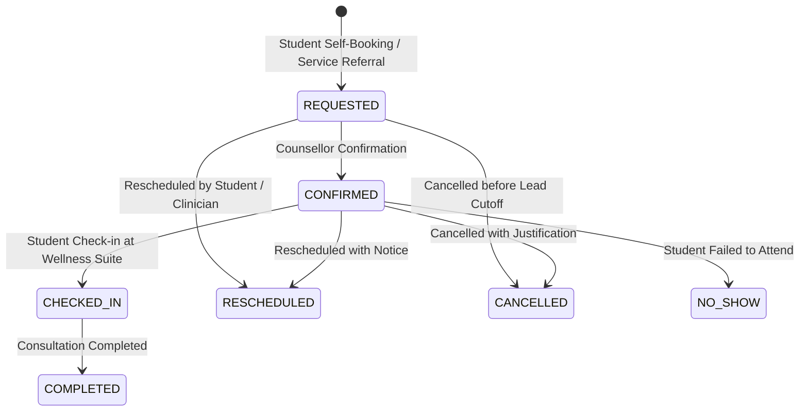

# CampusOS Student Counselling, Mentoring & Personal Development Operations Runbook
**Product:** CampusOS  
**Tagline:** "One Campus. One System. One Source of Truth."  
**Module:** Enterprise Student Counselling, Mentoring & Personal Development Management (Step 59)

---

## 1. Executive Summary & Architecture

The **CampusOS Student Counselling, Mentoring & Personal Development Module** establishes a unified, privacy-safe enterprise framework for holistic student support across higher education institutions. Designed under the core philosophy of **"One Campus. One System. One Source of Truth."**, this module replaces fragmented departmental spreadsheets and disjointed software with a cohesive ecosystem that connects:

1. **Faculty Mentoring:** Systematic student cohort allocations, institutional mentor workload quota enforcement, mentee directories, and immutable reassignment audit logs.
2. **Professional Counselling & Clinical Boundary:** Strictly isolated clinical consultation workspaces restricted strictly to licensed counselling professionals, with verified student consent and zero diagnostic mental health leakage to academic stakeholders.
3. **Individual Student Development Plans (IDP):** Student-centered development plans spanning Academic Excellence, Career Readiness, Professional Skills, Leadership, and Communication with measurable milestones and mentee personal reflections.
4. **Inter-Service Support Referrals:** Coordinated referrals across Academic Advising, Career Services, Disability Support, Financial Aid, and Student Affairs backed by explicit student consent tracking.
5. **Privacy-Safe Operational Telemetry:** Real-time institutional health metrics protected by differential privacy small-group suppression ($k \ge 5$).

### Key Architectural Boundaries

```
+---------------------------------------------------------------------------------------------------+
|                                      CAMPUSOS MODULAR MONOLITH                                    |
|                                                                                                   |
|  [ Academic Affairs ]      [ Student Portals ]      [ Career Services ]     [ Dean of Students ]  |
|            |                        |                        |                       |            |
|            v                        v                        v                       v            |
|  +---------------------------------------------------------------------------------------------+  |
|  |                       NON-CLINICAL STUDENT SUPPORT & MENTORING LAYER                       |  |
|  |  - Mentor Allocations (Workload Quotas <= 20)           - Student Development Plans (IDPs) |  |
|  |  - Mentoring Sessions (Notes & Action Items)            - Inter-Department Referrals       |  |
|  |  - Longitudinal Guidance Timeline                       - Follow-Up Task Management        |  |
|  +---------------------------------------------------------------------------------------------+  |
|                                                  |                                                |
|                   [ STRICT SERVER-SIDE CONFIDENTIALITY FIREWALL ]                                 |
|                   RBAC: COUNSELLING_CONFIDENTIAL_READ / WRITE ONLY                               |
|                                                  |                                                |
|                                                  v                                                |
|  +---------------------------------------------------------------------------------------------+  |
|  |                         CLINICAL COUNSELLING VAULT (ISOLATED)                               |  |
|  |  - Encrypted Consultation Session Notes                 - Therapeutic Interventions        |  |
|  |  - Clinician Observations (Non-Automated)               - Immutable Access Audit Logs      |  |
|  |  * ZERO Diagnostic Risk Scores * ZERO Mental Health Leakage to Academic Records / Portals   |  |
|  +---------------------------------------------------------------------------------------------+  |
+---------------------------------------------------------------------------------------------------+
```

---

## 2. Strict Confidential Clinical Boundary Architecture

### The Confidentiality Firewall
Under UGC, FERPA, HIPAA, and institutional ethics guidelines, psychological consultation notes must remain strictly isolated from faculty mentors, Department Heads (HODs), Deans, and academic administrators.

1. **Server-Side Enforcement:**
   - In `apps/api/app/api/v1/student_support.py`, all endpoints under `/confidential-records` mandate `RequiresPermission(Permission.COUNSELLING_CONFIDENTIAL_READ)` or `RequiresPermission(Permission.COUNSELLING_CONFIDENTIAL_WRITE)`.
   - Access attempts by non-counsellor roles are rejected with HTTP 403 Forbidden.
2. **Zero Diagnostic Leakage:**
   - The data model and service explicitly prohibit automated psychological risk scoring, psychiatric categorization, or AI-generated predictive mental health labels.
   - Clinical observations are qualitative professional notes entered directly by certified counsellors.
3. **Immutable Access Auditing:**
   - Every read and write to `ConfidentialCounsellingRecord` increments `access_count`, updates `last_accessed_at`, and emits a domain event for security log tracking.
4. **Dual Data Projection:**
   - Academic and mentoring portals query only non-clinical models (`MentorAssignment`, `MentoringSession`, `StudentDevelopmentPlan`, `SupportReferral`).
   - The clinical workspace is hosted on an isolated frontend route (`/app/student-support/counselling/workspace`) that validates licensed clinician credentials before rendering.

---

## 3. Database Entities & Relationships

Migration `043_enterprise_student_counselling_mentoring_development` creates 11 relational tables scoped to the tenant:

| Table Name | Entity Description | Key Relationships & Constraints |
|---|---|---|
| `support_policy_configs` | Tenant support policies, quotas & privacy settings | 1 row per tenant; defaults max 20 mentees, 30-day booking window |
| `mentor_assignments` | Faculty-student mentoring allocations & workloads | Student FK, Mentor Staff FK, Reassigned From FK |
| `mentor_reassignment_logs` | Audit trail of allocation changes with justification | Assignment FK, Authorizing User FK |
| `mentoring_sessions` | Faculty mentoring check-in sessions & meeting notes | Assignment FK, Mentor User FK |
| `mentoring_attendees` | Student attendance, feedback & reflection notes | Session FK, Student FK (Composite Unique) |
| `counselling_appointments` | Professional counselling consultation bookings | Student FK, Counsellor Staff FK, Unique Reference (`COU-*`) |
| `confidential_counselling_records` | Clinical practitioner consultation records | Appointment FK (1:1), Counsellor Staff FK |
| `student_development_plans` | Individual Development Plans (IDP) | Student FK, Mentor User FK, Academic Year |
| `development_goals` | IDP goals with category and progress percentage | Plan FK, Category, Target Date |
| `development_action_items` | Granular tasks supporting development goals | Goal FK, Assignee Role, Due Date |
| `support_referrals` | Inter-department student service referrals | Student FK, Referrer FK, Target Service, Consent Flag |
| `support_follow_ups` | Consolidated follow-up action items | Assigned User FK, Due Date, Overdue Index |

---

## 4. Faculty Mentoring Workload & Allocation System

### Workload Quotas
- **Maximum Mentee Quota:** Standard policy restricts active assignments to 20 students per faculty member (`max_mentees_per_mentor = 20`).
- **Pre-Allocation Validation:** `StudentSupportService.assign_mentor` and `reassign_mentor` run concurrency-safe `COUNT(*)` queries verifying the faculty member has capacity before completing allocations.
- **Assignment Types:**
  - `MANUAL`: Direct allocation by Department Chair or Academic Coordinator.
  - `RULE_BASED`: Automated batch allocation matching department, program, and roll-number sequences.
  - `REASSIGNED`: Systematic handoff with required administrative reason logging.

### Reassignment Lifecycle
When a faculty mentor goes on sabbatical, leave, or assumes administrative duties:
1. The previous assignment transitions from `ACTIVE` to `REASSIGNED`, setting `end_date` to the effective handover date.
2. A new `ACTIVE` assignment is created for the replacement faculty member with `reassigned_from_id` linked.
3. An audit record is written to `mentor_reassignment_logs` preserving the justification, timestamp, and authorizing administrator ID.

---

## 5. Counselling Appointment Scheduling & Operations

### Scheduling Rules
- **Advance Booking Window:** Controlled by `advance_booking_window_days` (default: 30 days). Appointments beyond this window are rejected.
- **Cancellation Lead Hours:** Configurable cancellation threshold (`cancellation_lead_hours`, default: 4 hours).
- **Conflict Prevention:** Active appointment slots require non-overlapping counsellor and student time intervals.
- **Appointment Modes:**
  - `IN_PERSON`: Dedicated consultation suite with physical room allocation.
  - `ONLINE_VIDEO`: Secure end-to-end encrypted virtual session link.
  - `TELEPHONIC`: Confidential phone consultation.

### State Transitions


---

## 6. Individual Student Development Plans (IDP)

The IDP framework empowers students to articulate academic and career goals with structured mentor guidance:

### Goal Categories
- `ACADEMIC_EXCELLENCE`: CGPA maintenance, coursework mastery, honors thesis.
- `CAREER_EXPLORATION`: Internship readiness, placement interview prep, industry certifications.
- `PROFESSIONAL_SKILLS`: Software development, laboratory techniques, project portfolios.
- `COMMUNICATION`: Technical presentations, research publications, campus debates.
- `LEADERSHIP`: Student governance, club presidency, hackathon organization.
- `PERSONAL_WELLBEING`: Time management, work-life balance, mindfulness practices.

### Dynamic Progress Recalculation
- Goals maintain individual progress percentages ($0\% - 100\%$).
- Whenever a goal progress is updated or an action item is checked off, the parent plan's `overall_progress_pct` is automatically recalculated:
$$\text{Overall Progress} = \text{round}\left(\frac{\sum_{i=1}^{N} \text{Progress}_i}{N}\right)$$
- If all goals reach $100\%$, the plan status transitions from `ACTIVE` to `COMPLETED`.

---

## 7. Inter-Service Referrals & Student Consent

### Multi-Department Routing
Faculty mentors, advisors, or counsellors can initiate inter-service referrals across:
- `ACADEMIC_ADVISING`: Degree audits, prerequisite waivers, academic remediation.
- `CAREER_SERVICES`: Resume reviews, placement mock interviews, employer networking.
- `COUNSELLING_SERVICES`: Stress management, adaptation support, personal counselling.
- `DISABILITY_SUPPORT`: Assistive tech, exam accommodations, classroom accessibility.
- `FINANCIAL_AID`: Emergency grants, merit scholarships, fee installment assistance.
- `STUDENT_AFFAIRS`: Residential hostel mediation, extracurricular engagement.

### Mandatory Informed Consent
In compliance with student privacy statutes, referrals require explicit student consent (`student_consent_obtained = true`). Initiating a cross-department referral without documented student consent is rejected at the API layer.

---

## 8. Differential Privacy Telemetry & Reporting

Institutional leaders need aggregate insights without compromising individual student dignity:

1. **Small-Group Suppression ($k < 5$):**
   - Telemetry queries aggregating counselling appointments or sensitive referral reasons suppress any group with fewer than 5 records.
   - Suppressed metrics are displayed as `< 5` in dashboards to prevent re-identification through demographic deduction.
2. **Zero Mental Health Classification in Telemetry:**
   - Executive telemetry surfaces operational efficiency metrics (mentor assignment ratios, appointment utilization rates, goal completion rates) but strictly omits diagnostic categories, psychological notes, or individual distress indicators.

---

## 9. REST API Specification

Mounted under `/api/v1/student-support`:

| Method | Route | Description | Permission |
|---|---|---|---|
| `GET` | `/config` | Retrieve tenant support policy configuration | `Authenticated` |
| `PUT` | `/config` | Update support policy configuration | `SUPPORT_ADMIN` |
| `GET` | `/mentor-assignments` | List mentor-student allocations with filters | `MENTOR_READ` |
| `POST` | `/mentor-assignments` | Allocate a mentor to a student | `MENTOR_MANAGE` |
| `POST` | `/mentor-assignments/{id}/reassign` | Reassign mentor with audit justification | `MENTOR_MANAGE` |
| `GET` | `/mentor-assignments/my-mentor` | Student view of their assigned faculty mentor | `Authenticated` |
| `GET` | `/mentees` | Faculty view of assigned mentees | `MENTOR_READ` |
| `GET` | `/mentees/unassigned` | Directory of students without an assigned mentor | `MENTOR_MANAGE` |
| `GET` | `/mentoring-sessions` | List mentoring sessions | `MENTOR_READ` |
| `POST` | `/mentoring-sessions` | Schedule a mentoring check-in session | `MENTOR_MANAGE` |
| `PUT` | `/mentoring-sessions/{id}` | Update session notes and action items | `MENTOR_MANAGE` |
| `POST` | `/mentoring-sessions/{id}/reflection` | Record student personal reflection | `Authenticated` |
| `GET` | `/counselling-appointments` | List counselling appointments | `COUNSELLING_READ` |
| `POST` | `/counselling-appointments` | Book a counselling consultation | `Authenticated` |
| `PUT` | `/counselling-appointments/{id}` | Update appointment status (check-in, complete) | `COUNSELLING_MANAGE` |
| `GET` | `/confidential-records` | List restricted clinical records | `COUNSELLING_CONFIDENTIAL_READ` |
| `POST` | `/confidential-records` | Record clinical observations & interventions | `COUNSELLING_CONFIDENTIAL_WRITE` |
| `GET` | `/confidential-records/{id}` | Access a single clinical consultation file | `COUNSELLING_CONFIDENTIAL_READ` |
| `GET` | `/development-plans` | List Student Development Plans (IDPs) | `IDP_READ` |
| `POST` | `/development-plans` | Create a new Student Development Plan | `IDP_MANAGE` |
| `GET` | `/development-plans/{id}` | Get IDP details with goals and action items | `IDP_READ` |
| `POST` | `/development-plans/{id}/goals` | Add a developmental goal to an IDP | `IDP_MANAGE` |
| `PUT` | `/development-plans/goals/{id}` | Update goal progress or status | `IDP_MANAGE` |
| `GET` | `/referrals` | List cross-department support referrals | `REFERRAL_READ` |
| `POST` | `/referrals` | Initiate an inter-service referral | `REFERRAL_MANAGE` |
| `PUT` | `/referrals/{id}` | Update referral progress or outcome notes | `REFERRAL_MANAGE` |
| `GET` | `/follow-ups` | List pending and overdue follow-up action items | `Authenticated` |
| `POST` | `/follow-ups` | Create a support follow-up action item | `Authenticated` |
| `PUT` | `/follow-ups/{id}` | Mark follow-up completed or update notes | `Authenticated` |
| `GET` | `/telemetry` | Retrieve privacy-safe institutional analytics | `Authenticated` |

---

## 10. Frontend Architecture & Views

The frontend client module is structured with 15 dedicated views in `apps/web/src/app/app/student-support/`:

1. **Overview Dashboard (`page.tsx`):** Executive KPI cards, quick actions, today's schedule, and pending referral queues.
2. **My Faculty Mentor (`mentor/page.tsx`):** Student-facing profile of their assigned mentor, meeting history, and check-in request trigger.
3. **Mentor Allocations (`assignments/page.tsx`):** Departmental allocation workspace with batch auto-assignment, capacity badges, and reassignment modal.
4. **Mentee Directory (`mentees/page.tsx`):** Faculty mentor's student roster with CGPA tracking, active IDP status, and quick session scheduling.
5. **Book Counselling (`counselling/page.tsx`):** Confidential consultation booking with mode selection, category selector, and consent acknowledgement.
6. **Counsellor Agenda (`counselling/schedule/page.tsx`):** Practitioner daily and weekly schedule with one-click check-in, completion, and no-show marking.
7. **Clinical Workspace (`counselling/workspace/page.tsx`):** Restricted clinical file management with encrypted observation notes, therapeutic intervention logging, and access audit badges.
8. **Mentoring Sessions (`sessions/page.tsx`):** 1-on-1 and cohort session scheduler with discussion agendas, attendance checklists, and action items.
9. **Student Development Plans Hub (`development-plans/page.tsx`):** IDP portfolio browser displaying overall progress bars, review frequencies, and goal distributions.
10. **Development Goals & Tasks (`goals/page.tsx`):** Granular goal progression manager with milestone checklists, mentor feedback, and student reflections.
11. **Support Referrals Hub (`referrals/page.tsx`):** Cross-department routing board with receiving service assignment, status badges, and consent confirmation.
12. **Guidance Timeline (`guidance/page.tsx`):** Longitudinal guidance history chronologically interleaving mentoring touches, career coaching, advising notes, and development milestones.
13. **Follow-Up Tasks (`follow-ups/page.tsx`):** Action item tracker with priority badges, overdue alert flags, and completion checkoffs.
14. **Institutional Support Analytics (`analytics/page.tsx`):** Privacy-safe reporting dashboard with appointment utilization, referral distribution, and differential privacy warnings.
15. **Policies & Quotas Configuration (`config/page.tsx`):** Administrative controls for mentor workload limits, advance booking days, cancellation lead hours, and consent mandates.

---

## 11. Scheduled Jobs & Automation

Registered in `apps/api/app/scheduler.py`:

- **Job Identifier:** `student_support_nightly_overdue_and_sla_monitor`
- **Execution Cadence:** Every night at 02:30 UTC.
- **Automated Tasks:**
  1. Identifies all `SupportFollowUp` records in `PENDING` status with `due_date < NOW()` and marks them `OVERDUE`.
  2. Flags stale referrals with no status transition after 7 business days for coordinator attention.
  3. Archives completed mentoring assignments whose academic year has concluded.

---

## 12. Verification & Test Execution Guide

### Backend Test Execution
Run the comprehensive 10-point test suite in `apps/api`:
```bash
cd apps/api
.venv\Scripts\pytest.exe tests/test_enterprise_student_support.py -v
```
**Expected Output:**
```
============================== 10 passed in 12.16s ==============================
```

### Frontend Test Execution
Run the 33-point validation suite in `apps/web`:
```bash
cd apps/web
npx tsx src/__tests__/student-support-module.test.ts
```
**Expected Output:**
```
==================================================
CampusOS Student Support Module Verification Results
==================================================
✓ PASS [1] 1. Telemetry returns active mentor assignments count
...
✓ PASS [33] 16. New follow-up task created with priority badge metadata
--------------------------------------------------
Total Passed: 33
Total Failed: 0
==================================================
```

### TypeScript Compilation Check
```bash
cd apps/web
npm run typecheck
```
**Expected Output:**
```
> campusos-web@0.1.0 typecheck
> tsc --noEmit
(Exit code: 0)
```
