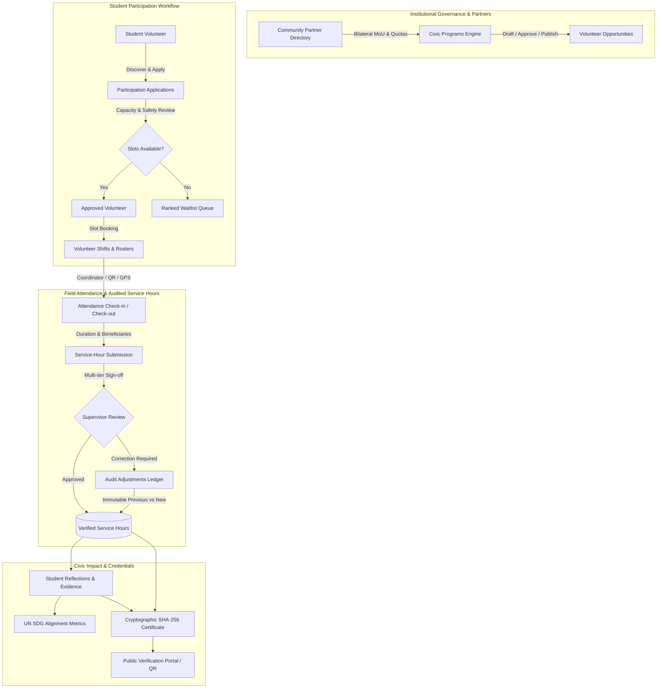

# CampusOS — Student Engagement, Community Service, Volunteering & Civic Impact Management (Step 65)
**Product Identity:** "CampusOS — One Campus. One System. One Source of Truth."

---

## 1. Executive Summary & Purpose

The **Student Engagement, Community Service, Volunteering & Civic Impact Management** module provides an enterprise-grade, auditable operational backbone for higher-education community partnerships, civic missions, volunteer rosters, and co-curricular service-hour verification.

Every service hour logged translates into verified institutional impact aligned directly with the **United Nations Sustainable Development Goals (SDGs)**, backed by a cryptographic SHA-256 verification ledger and tamper-evident credential verification.

---

## 2. Architecture & Data Flow

---

## 3. Database Schema Architecture

The module introduces 12 relational models in `apps/api/app/models/engagement.py`, integrated into PostgreSQL via Alembic migration `047_enterprise_student_engagement_civic_impact.py`:

| Table Name | Description | Key Indexes & Constraints |
|:---|:---|:---|
| `engagement_partners` | Bilateral community partner directory (NGOs, Trusts, Foundations). | `idx_eng_partner_tenant`, `idx_eng_partner_status`, Unique `(tenant_id, slug)` |
| `engagement_programs` | Institutional civic engagement programs with objectives & SDG mapping. | `idx_eng_program_tenant`, `idx_eng_program_status`, Unique `(tenant_id, code)` |
| `engagement_opportunities` | Specific volunteering roles tied to programs and partners. | `idx_eng_opp_prog`, `idx_eng_opp_status` |
| `engagement_applications` | Student candidacies, statements of interest, and waitlist order. | Unique `(opportunity_id, student_id)`, `idx_eng_app_waitlist` |
| `engagement_shifts` | Calendarized shifts with slot capacity and location coordinates. | `idx_eng_shift_opp`, `idx_eng_shift_date` |
| `engagement_shift_assignments` | Student allocations to specific shifts. | Unique `(shift_id, student_id)` |
| `engagement_attendances` | Check-in / check-out timestamps with method confirmation. | `idx_eng_att_student`, `idx_eng_att_opp` |
| `engagement_service_hours` | Logged volunteer hours, beneficiary counts, and review status. | `idx_eng_hour_student`, `idx_eng_hour_program`, `idx_eng_hour_status` |
| `engagement_hour_corrections` | Immutable historical audit ledger tracking every manual hour correction. | `idx_eng_correct_hour_id`, `idx_eng_correct_tenant` |
| `engagement_reflections` | Qualitative student reflection, rubric scores, and SDG mappings. | `idx_eng_refl_student`, `idx_eng_refl_program` |
| `engagement_safety_records` | Medical clearance, parental consent, and liability waivers. | `idx_eng_safety_student`, `idx_eng_safety_program` |
| `engagement_certificates` | Co-curricular certificates with SHA-256 tamper-evident hash. | Unique `(tenant_id, certificate_number)`, Unique `(verification_hash)` |

---

## 4. Role-Based Access Control (RBAC) Matrix

Permissions defined in `apps/api/app/core/permissions.py`:

| Role | Programs | Partners | Opportunities | Applications | Hours Verification | Hour Corrections | Certificates |
|:---|:---:|:---:|:---:|:---:|:---:|:---:|:---:|
| **Student** | Read (Published) | Read | Read (Published) | Apply / Withdraw | Submit (Own) | Read Own | View Own |
| **Faculty Coordinator** | Manage / Read | Read | Manage | Review / Roster | Verify Hours | Adjust (Ledgered) | Issue |
| **HOD / Department Chair** | Approve | Read | Manage | Review | Verify Hours | Audit | Issue |
| **Institution Admin** | Full Admin | Full Admin | Full Admin | Full Admin | Full Admin | Full Admin | Full Admin |
| **Community Partner** | View Assigned | Edit Profile | View Roster | Roster Check-in | Confirm Field Hours | - | - |

---

## 5. Lifecycles & State Machines

### Program Lifecycle
$$\text{DRAFT} \longrightarrow \text{PENDING\_APPROVAL} \longrightarrow \text{APPROVED} \longrightarrow \text{PUBLISHED} \longrightarrow \text{IN\_PROGRESS} \longrightarrow \text{COMPLETED} \longrightarrow \text{ARCHIVED}$$
*(Can be moved to `CANCELLED` by authorized coordinators if safety or partner terms require).*

### Participation Application & Waitlist Lifecycle
$$\text{APPLIED} \longrightarrow \text{PENDING\_REVIEW} \longrightarrow \begin{cases} \text{APPROVED} & \text{(Assigned slot)} \\ \text{WAITLISTED} & \text{(Ranked queue)} \\ \text{REJECTED} & \text{(Documented reason)} \end{cases} \longrightarrow \text{ACTIVE} \longrightarrow \text{COMPLETED}$$
- When an approved student withdraws, the first waitlisted student (`waitlist_position == 1`) is automatically promoted to `APPROVED` or flagged for coordinator notification.

### Service-Hour Verification & Audit Correction Lifecycle
$$\text{PENDING} \longrightarrow \begin{cases} \text{APPROVED} & \text{(Credited to student \& partner total)} \\ \text{CORRECTION\_REQUESTED} & \text{(Sent back to student)} \\ \text{REJECTED} & \text{(Not credited)} \end{cases}$$
- Any post-approval correction requires recording: `previous_hours`, `new_hours`, `reason_for_change`, and `changed_by_user_id` in `engagement_hour_corrections`.

---

## 6. Cryptographic Certificate Trust Model

Certificates issued through `POST /api/v1/engagement/certificates/issue` compute an immutable SHA-256 hash using the canonical payload:
$$\text{Payload} = \text{TenantID} \mathbin{\Vert} \text{CertNumber} \mathbin{\Vert} \text{StudentID} \mathbin{\Vert} \text{ProgramID} \mathbin{\Vert} \text{VerifiedHours} \mathbin{\Vert} \text{IssueTimestamp}$$
$$\text{verification\_hash} = \text{SHA256}(\text{Payload})$$

The hash is stored on `engagement_certificates.verification_hash` with a unique database index. Any employer, accreditation board, or student can query `GET /api/v1/engagement/certificates/verify/{hash}` to immediately confirm credential authenticity and view verified service hours.

---

## 7. Troubleshooting & Operational Playbooks

### Playbook 1: Participant Exceeds Daily Hours Boundary
- **Symptom:** API returns `ValidationException: Service duration must be between 0.25 and 24 hours.`
- **Action:** CampusOS strictly prohibits single-day submissions $> 24$ hours. Advise student to submit separate daily logs for multi-day workshops.

### Playbook 2: Resolving Attendance Discrepancies
- **Symptom:** Student check-out was missed or geolocation failed.
- **Action:** Coordinator navigates to `/app/engagement/service-hours`, clicks "Adjust", inputs the corrected verified hours along with the documented field attendance sheet reference, and saves to the immutable audit ledger.

### Playbook 3: Revoking a Credential
- **Symptom:** Fraudulent documentation or plagiarism detected post-certificate issuance.
- **Action:** Authorized Administrator calls `POST /api/v1/engagement/certificates/{id}/revoke` providing the documented reason. The status changes to `REVOKED` and any verification URL queries display an explicit warning watermark.

