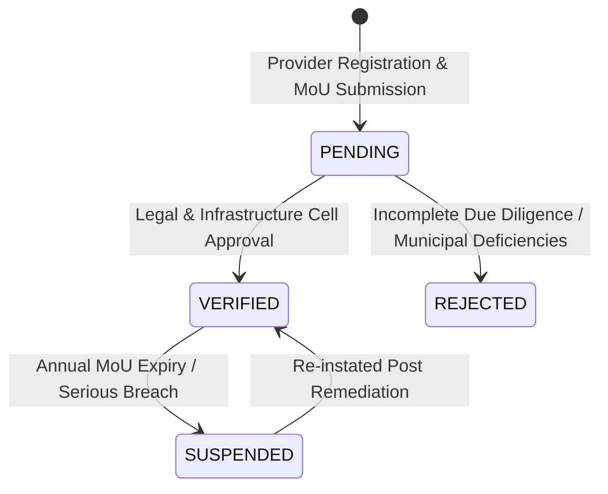
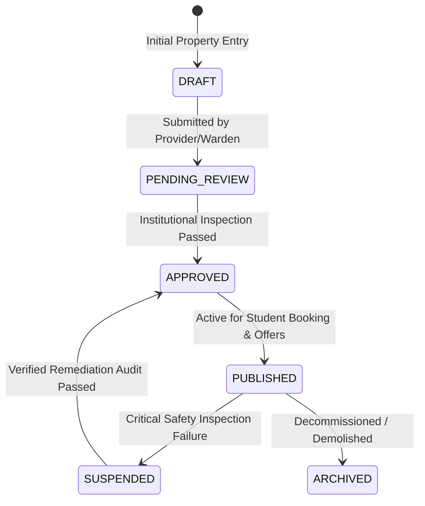

# CampusOS — Student Housing, Off-Campus Accommodation, Landlord Partnerships & Residential Compliance Operations Manual (Step 66)

**Product:** CampusOS — “One Campus. One System. One Source of Truth.”  
**Module:** Enterprise Student Housing & Off-Campus Accommodation Management  
**Release Version:** CampusOS v66.0 (Enterprise Suite)  
**Security Classification:** Highly Confidential / Institutional Operations  

---

## 1. Executive Summary & Purpose

The **Enterprise Student Housing, Off-Campus Accommodation, Landlord Partnerships & Residential Compliance Management** module extends the foundational residential life infrastructure established in Step 54 (`apps/api/app/models/residential.py`) to encompass a modern, hybrid collegiate residential ecosystem.

CampusOS integrates:
1. **On-Campus University Residences & Hostels**: Integrated with academic blocks, campus dining halls, and biometric access turnstiles.
2. **Accredited Off-Campus Hostels & Residences**: Institutionally vetted, partner-operated private hostels providing dedicated student shuttle transport.
3. **Student Apartments & Shared Housing**: Private landlords and housing corporations operating under legally binding Memoranda of Understanding (MoUs).
4. **Student Residence Trusts & University Affiliates**: Endowed philanthropic trusts and university housing societies.

The system prevents duplicate data silos, ensures concurrency safety in bed allocations, protects students with statutory fire, hygiene, and electrical compliance gates, and bridges residential operations with institutional ERP finance invoicing.

---

## 2. System Architecture & Domain Model

The housing architecture is partitioned across `apps/api` (FastAPI + SQLAlchemy + Alembic) and `apps/web` (Next.js 15 App Router + TailwindCSS + Lucide Icons).

```
                                  +------------------------------------+
                                  |     Accommodation Providers &      |
                                  |        Landlord Directory          |
                                  +-----------------+------------------+
                                                    | 1:N
                                                    v
+-------------------------------+ 1:N  +----------------------------+
|  Campus Hostels & Residences  +----->|  Accommodation Properties  |
|          (Step 54)            |      |      (Lifecycle State)     |
+-------------------------------+      +--------------+-------------+
                                                      | 1:N
                                                      v
                                       +----------------------------+
                                       |    Accommodation Units     |
                                       +--------------+-------------+
                                                      | 1:N
                                                      v
                                       +----------------------------+
                                       |     Addressable Beds       |
                                       | (Concurrency Locks/Blocks) |
                                       +--------------+-------------+
                                                      ^
                                                      | 1:1
+-------------------------------+      +--------------+-------------+
|    Student Housing Request    +----->|    Housing Allocations &   |
|   (Priority Weighted Queue)   |      |        Formal Offers       |
+-------------------------------+      +--------------+-------------+
                                                      | 1:1
                                       +--------------+-------------+
                                       |   Digital Leases & ERP     |
                                       |   Finance Invoices (Dep.)  |
                                       +----------------------------+
```

### Persisted Entities & Tables

| Table Name | Description | Key Attributes |
|---|---|---|
| `accommodation_providers` | Landlord & Operator Directory | `organization_name`, `provider_type`, `mou_reference_no`, `verification_status`, `rating_score` |
| `accommodation_properties` | Registered Residence Halls & Off-Campus Properties | `code`, `name`, `property_type`, `lifecycle_status`, `distance_to_campus_km`, `total_capacity_beds`, `occupied_beds`, `available_beds` |
| `accommodation_units` | Residence Rooms, Suites, and Apartments | `unit_number`, `floor_number`, `unit_type`, `bed_capacity`, `monthly_base_rent`, `security_deposit`, `is_accessible` |
| `accommodation_beds` | Addressable Bed Assignment Slots | `bed_number`, `status` (`AVAILABLE`, `RESERVED`, `OCCUPIED`, `BLOCKED_MAINTENANCE`), `position_type` |
| `student_housing_requests` | Applications & Waitlist Queue | `academic_term`, `preferred_unit_type`, `max_budget_monthly`, `priority_score`, `waitlist_position`, `status` |
| `housing_offers` | Formal Electronic Offers | `offered_rent_monthly`, `offered_deposit`, `offer_valid_until`, `status` (`OFFERED`, `ACCEPTED`, `DECLINED`, `EXPIRED`, `REVOKED`) |
| `housing_assignments` | Concurrency-Safe Bed Allocations | `assignment_number`, `start_date`, `end_date`, `monthly_rent`, `security_deposit`, `status` (`ASSIGNED`, `ACTIVE`, `TRANSFERRED`, `CHECKED_OUT`) |
| `housing_agreements` | Digital Leases & ERP Deposit References | `agreement_reference_no`, `valid_from`, `valid_to`, `deposit_invoice_ref`, `deposit_refund_status`, `is_signed_by_student` |
| `housing_checkin_records` | Move-In & Move-Out Handover Audits | `record_type` (`CHECK_IN`, `CHECK_OUT`), `keys_issued_count`, `access_card_rfid`, `damage_assessment_amount`, `damage_description` |
| `housing_inspections` | Statutory Fire, Safety & Hygiene Audits | `inspection_type`, `score`, `overall_outcome`, `critical_issues_found`, `availability_suspended`, `remediation_required` |
| `housing_maintenance_requests` | Resident Maintenance Defect Tickets | `ticket_number`, `category`, `priority`, `status`, `assigned_technician_name`, `linked_work_order_id`, `tenant_satisfaction_rating` |

---

## 3. Provider & Landlord Partnerships

Institutional vetting requires all accommodation providers (commercial operators, trusts, private landlords) to register and undergo due diligence before their facilities become visible to students.

### Provider Verification States



- **Accreditation Mandate**: Only providers in `VERIFIED` status can have their linked properties published in the student housing portal.
- **Emergency Helpline Requirement**: Every accredited partner must maintain a vetted 24x7 emergency helpline and local property manager contact on file.

---

## 4. Property Lifecycle & Automated Safety Suspension Gate

Properties advance through strict administrative gates:



> [!CAUTION]
> **Automated Safety Suspension Gate (`SUSPENDED`)**  
> Whenever an inspection is filed with `overall_outcome == "FAILED_CRITICAL"` or `critical_issues_found == true`, the system's service layer (`HousingService.record_inspection`) immediately and automatically updates the property's lifecycle state to `SUSPENDED`.  
> While in `SUSPENDED` status, the backend enforces:
> 1. Total exclusion from student search listings.
> 2. Hard block on issuing new accommodation offers (`create_offer` throws HTTP 400).
> 3. Notification to the Chief Warden and Estate Officer.

---

## 5. Capacity Calculation & Concurrency-Safe Bed Allocation

Availability in CampusOS is derived from **real physical beds**, not manual dashboard summaries.

### Availability Formula
$$\text{Available Beds} = \sum_{\text{unit} \in \text{property}} \sum_{\text{bed} \in \text{unit}} \mathbb{I}(\text{bed.status} = \text{AVAILABLE})$$

### Anti-Double-Booking Protection
When an administrator issues a formal offer:
1. The bed status transitions from `AVAILABLE` to `RESERVED`.
2. A cryptographic TTL expires after the configured window (e.g. 72 hours).
3. If declined or expired, the bed is automatically reverted to `AVAILABLE`.
4. When `allocate_student` is executed within an atomic database transaction (`SELECT ... FOR UPDATE`), the system checks:
   - If direct allocation: Bed status must be `AVAILABLE`.
   - If offer allocation: Bed status must be `RESERVED` with matching `offer_id`.
   - Any conflicting concurrent allocation attempt is rejected with HTTP 409 Conflict.

---

## 6. Student Housing Requests & Waitlist Priority Scoring

Applications are scored algorithmically across merit, distance from permanent residence, and special accessibility requirements:

$$\text{Priority Score} = \min(100, \, \text{Base} + S_{\text{medical/accessibility}} + S_{\text{distance}} + S_{\text{year\_level}})$$

- **Accessibility Priority**: Scholars requiring ground-floor or wheelchair-accessible accommodation receive an immediate priority score of $\ge 85$ and prioritized placement.
- **Waitlist Ordering**: Approved applicants who cannot be immediately placed are assigned an incremental `waitlist_position`. As rooms vacate through check-outs or transfers, the queue advances automatically.

---

## 7. Tenancy Agreements, ERP Invoicing & Move-In/Out Audits

1. **Digital Tenancy Agreements**:
   - Each formal assignment generates a legally binding agreement record (`AGR-YYYY-XXXX`).
   - Payment frequency (`MONTHLY_ADVANCE`, `SEMESTER_UPFRONT`, `ANNUAL_ONE_TIME`).
   - Digital student signature timestamp and witness ID.
   - Cross-referenced with CampusOS Finance invoices for rental charges and security deposit escrow.

2. **Move-In Handover (`CHECK_IN`)**:
   - Physical keys and RFID biometric smart cards logged.
   - Comprehensive asset checklist (mattress, study desk, wardrobe locks, electrical fittings, AC remotes).
   - Baseline photo evidence IDs attached.

3. **Move-Out Handover (`CHECK_OUT`)**:
   - Damage inspection conducted jointly by resident and warden.
   - Assessed damages are itemized and deducted from the held security deposit escrow (`deposit_refund_status`: `REFUNDED`, `PARTIALLY_FORFEITED`, `FORFEITED`).

---

## 8. Facilities Maintenance Integration

Residential defects are routed directly into the campus facilities maintenance system:
- **Categories**: `ELECTRICAL`, `PLUMBING`, `CARPENTRY`, `HVAC`, `CIVIL_MASONRY`, `PEST_CONTROL`, `INTERNET_WIFI`.
- **SLA Priorities**:
  - `EMERGENCY`: Immediate dispatch (within 2 hours).
  - `HIGH`: Within 24 hours.
  - `MEDIUM`: Within 48 hours.
  - `LOW`: Within 5 business days.
- **Tenant Closure Loop**: Tickets cannot be marked `VERIFIED_BY_TENANT` until the student confirms satisfactory resolution and submits a 1–5 star rating.

---

## 9. Verification & Automated Testing

Step 66 is backed by complete dual-stack test suites:

### Backend Pytest Suite
```powershell
$env:PYTHONPATH="apps/api"
apps\api\.venv\Scripts\python.exe -m pytest apps/api/tests/test_enterprise_student_housing_step66.py -v
```
**Outcome**: 11/11 passed across:
- `test_provider_crud_and_verification`
- `test_property_lifecycle_transitions`
- `test_units_and_beds_inventory`
- `test_housing_request_submission_and_waitlist`
- `test_formal_housing_offers_workflow`
- `test_concurrency_safe_bed_allocation`
- `test_room_transfer_workflow`
- `test_housing_agreement_and_finance_invoicing`
- `test_checkin_checkout_and_damage_forfeiture`
- `test_safety_inspection_and_auto_suspension_gate`
- `test_housing_analytics_and_maintenance`

### Frontend TypeScript Test Suite
```powershell
npx --yes tsx --tsconfig apps/web/tsconfig.json apps/web/src/__tests__/housing-module.test.ts
```
**Outcome**: 66/66 passed across all 12 operational domains.

### TypeScript Compilation Check
```powershell
npx tsc --noEmit -p apps/web/tsconfig.json
```
**Outcome**: 0 errors, 100% clean compilation.

---

## 10. Role-Based Permissions Reference

The housing module registers 19 dedicated PBAC permissions in `apps/api/app/core/permissions.py`:

```python
HOUSING_PROPERTY_READ = "housing:property:read"
HOUSING_PROPERTY_MANAGE = "housing:property:manage"
HOUSING_PROPERTY_APPROVE = "housing:property:approve"
HOUSING_PROVIDER_READ = "housing:provider:read"
HOUSING_PROVIDER_MANAGE = "housing:provider:manage"
HOUSING_PROVIDER_PORTAL = "housing:provider:portal"
HOUSING_REQUEST_SUBMIT_OWN = "housing:request:submit_own"
HOUSING_REQUEST_READ = "housing:request:read"
HOUSING_REQUEST_REVIEW = "housing:request:review"
HOUSING_OFFER_MANAGE = "housing:offer:manage"
HOUSING_ASSIGNMENT_MANAGE = "housing:assignment:manage"
HOUSING_AGREEMENT_READ = "housing:agreement:read"
HOUSING_AGREEMENT_MANAGE = "housing:agreement:manage"
HOUSING_CHECKIN_MANAGE = "housing:checkin:manage"
HOUSING_INSPECTION_READ = "housing:inspection:read"
HOUSING_INSPECTION_MANAGE = "housing:inspection:manage"
HOUSING_MAINTENANCE_SUBMIT = "housing:maintenance:submit"
HOUSING_MAINTENANCE_MANAGE = "housing:maintenance:manage"
HOUSING_ANALYTICS_READ = "housing:analytics:read"
```

Role Mappings:
- **Super Admin & Institution Admin**: All 19 permissions.
- **Warden & Hostel Coordinator**: Properties, Providers, Units, Requests, Offers, Assignments, Agreements, Handover Audits, Safety Inspections, Maintenance, and Analytics.
- **Student**: `HOUSING_PROPERTY_READ`, `HOUSING_REQUEST_SUBMIT_OWN`, `HOUSING_AGREEMENT_READ`, `HOUSING_MAINTENANCE_SUBMIT`.
- **Property Manager / Landlord Partner**: Property & Unit view, Maintenance dispatch for assigned properties.

---

## 11. Conclusion

CampusOS Step 66 establishes a unified, institutional source of truth for student residential life. By combining rigorous safety compliance gates, concurrency-safe bed allocation, transparent waitlist queues, and digital lease workflows, higher education institutions ensure student wellbeing, operational efficiency, and statutory compliance.

