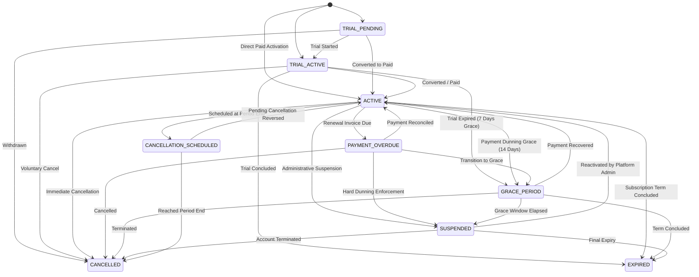

# CampusOS Enterprise Customer Success, Subscription Lifecycle & SaaS Entitlements (Step 38)

## 1. Domain Architecture & Business Separation

CampusOS is a multi-tenant higher education ERP SaaS platform. A fundamental architectural tenet established in Step 38 is the strict operational and domain boundary between:

1. **CampusOS SaaS Platform Subscriptions**: Managed globally by SaaS Platform Administrators (`SUPER_ADMIN`, `PLATFORM_OPERATOR`) to govern institutional packaging plans, commercial pricing, trial periods, resource allowances (user seats, students, storage, API RPM, AI tokens), enabled ERP modules, billing dunning, and account health telemetry.
2. **Institutional ERP Finance & Student Fee Operations**: Managed locally by institutional bursars and finance staff within an individual college tenant (`INSTITUTION_ADMIN`, `BURSAR`) to handle student fee schedules, tuition invoicing, student fee collections, and ledger journals.

Institutions are strictly prohibited from mutating packaging plans, altering their own limits or entitlements, forging payment statuses, or accessing subscription information belonging to any other college or university tenant.

---

## 2. Database Schema & Alembic Migration

The Step 38 relational schema is implemented with SQLAlchemy 2.0 and versioned under Alembic migration:
- **Migration ID**: `024_enterprise_customer_success_subscription_lifecycle.py`
- **Revises**: `023_enterprise_product_adoption_training_guidance`

### Relational Entities Summary

| Model Class | DB Table Name | Scope | Description |
| :--- | :--- | :--- | :--- |
| `SubscriptionPlan` | `subscription_plans` | Global | Commercial packaging tier with pricing, quotas, trial duration, and included modules. |
| `TenantSubscription` | `subscription_tenant_subscriptions` | Tenant | Current institutional subscription state, billing period, and immutable plan snapshot. |
| `SubscriptionLifecycleHistory` | `subscription_lifecycle_histories` | Tenant | Append-only audit trail of subscription state machine transitions with reason and actor. |
| `SubscriptionEntitlementOverride` | `subscription_entitlement_overrides` | Tenant | Time-limited administrative overrides for modules, quotas, and feature flags. |
| `SubscriptionUsageEvent` | `subscription_usage_events` | Tenant | Idempotently recorded raw usage events for metered resources (API calls, AI tokens, etc.). |
| `SubscriptionUsageAggregate` | `subscription_usage_aggregates` | Tenant | Monthly rolling aggregates with soft and hard quota threshold enforcement. |
| `SubscriptionInvoice` | `subscription_invoices` | Tenant | SaaS subscription billing invoice with standard 18% GST calculation and due dates. |
| `SubscriptionPaymentAttempt` | `subscription_payment_attempts` | Tenant | Transactional payment records linked to invoices and gateway references. |
| `SubscriptionWebhookEvent` | `subscription_webhook_events` | Global/Tenant | Cryptographically verified and idempotently processed gateway webhook events. |
| `SubscriptionChangeRequest` | `subscription_change_requests` | Tenant | Formal upgrade/downgrade requests with downgrade impact pre-flight analysis. |
| `CustomerSuccessHealthSnapshot` | `customer_success_health_snapshots` | Tenant | Composite 0-100 institutional health index, status tier, and prescriptive recommendations. |
| `CustomerSuccessNote` | `customer_success_notes` | Tenant | Confidential platform-internal customer success journal entries and risk notes. |

---

## 3. Subscription Lifecycle State Machine

The tenant subscription lifecycle is governed by an explicit state machine with validated transitions:



### Access Policies by Subscription State
- **ACTIVE / TRIAL_ACTIVE**: Full write and read access according to package plan entitlements.
- **PAYMENT_OVERDUE**: Standard operational access with warning banners displayed in UI.
- **GRACE_PERIOD**: Operational access maintained; warning banners and daily payment dunning reminders dispatched.
- **SUSPENDED**: Read-only access or authentication-level restriction; write operations to ERP databases blocked.
- **CANCELLED / EXPIRED**: Read-only archival access during statutory data retention period.

---

## 4. Enterprise Entitlements & Overrides Engine

The entitlement engine centrally resolves tenant capabilities at runtime:
1. **Base Plan Snapshot**: Stored directly on `TenantSubscription` at creation/upgrade (`snapshot_limits_json`, `snapshot_modules_json`, `snapshot_features_json`), safeguarding active subscriptions against accidental regressions if global plan definitions are updated.
2. **Active Overrides**: `SubscriptionEntitlementOverride` records are queried for `is_active=True`, `starts_at <= now`, and `expires_at >= now`.
3. **Evaluation Precedence**: Overrides take absolute precedence over base plan quotas and modules.
4. **Cache Invalidation**: Mutation of subscriptions or overrides invalidates tenant cache namespace `entitlements` immediately.

### Entitlement Interface Methods
- `get_effective_entitlements(db, tenant_id) -> dict[str, Any]`
- `is_module_enabled(db, tenant_id, module_code) -> bool`
- `check_quota(db, tenant_id, resource_type, requested_quantity) -> dict[str, Any]`
- `grant_override(db, tenant_id, dto, actor_id) -> SubscriptionEntitlementOverride`
- `revoke_override(db, tenant_id, override_id, actor_id) -> SubscriptionEntitlementOverride`

---

## 5. Usage Metering & Hard Quota Enforcement

Metered resources (e.g. `API_CALLS`, `AI_TOKENS`, `STORAGE_BYTES`) are tracked idempotently and atomically:
- **Idempotent Ingestion**: Every usage event requires a client/gateway-supplied `idempotency_key`. Duplicates return the existing record without duplicate quota deduction.
- **Atomic Billing Aggregates**: Usage updates `SubscriptionUsageAggregate` for the current month (`YYYY-MM`).
- **Quota Blocking**: When `enforce_hard_limit=True`, exceeding `hard_limit` records an audit event (`quota.hard_limit.blocked`) and raises `QuotaExceededException` with HTTP 429 status.

---

## 6. Non-Destructive Plan Changes & Downgrade Impact Assessments

When an institution requests or undergoes a plan downgrade (e.g. Enterprise to Starter):
1. **Pre-flight Impact Analysis**: `preview_downgrade(db, tenant_id, target_plan_id)` calculates the variance in quotas and highlights exceeding resources (e.g. current 1,200 active users vs target limit 500).
2. **Strict Data Preservation Policy**: Downgrading **never** deactivates users, deletes records, or purges academic or financial histories. Excess resources trigger overage warnings and restrict creation of *new* items until within capacity.
3. **Effective Scheduling**: Supports immediate application or scheduling for end-of-period (`PERIOD_END`).

---

## 7. SaaS Invoicing & Payment Provider Integration

- **Invoicing**: Generates sequential SaaS invoices (`INV-SAAS-{YYYY}-{HEX}`) with 18% GST tax breakdown, structured line items, due dates (15 days), and downloadable PDF routes.
- **Payment Gateway Abstraction**: `MockPaymentGateway` simulates webhook and checkout operations.
- **HMAC Webhook Verification**: Inbound webhooks (`POST /api/v1/subscriptions/webhooks/payment`) verify SHA256 signatures via configured webhook secret. Duplicate event IDs are acknowledged idempotently without double-reconciliation.

---

## 8. Customer Success Health Scoring Formula

Composite health score (0–100) is evaluated across four core operational pillars:

$$\text{Health Score} = (\text{Financial} \times 0.35) + (\text{Utilization} \times 0.25) + (\text{Support} \times 0.20) + (\text{Adoption} \times 0.20)$$

### Weighting Breakdown & Signals
1. **Financial Health (35%)**:
   - Deductions for payment overdue (-40), grace period (-50), or suspension (-80).
   - Past-due invoices deduct up to 30 points.
2. **Utilization Health (25%)**:
   - Ideal usage (30%–85% quota capacity) scores 95 points.
   - Low adoption (<10% quota usage) scores 50 points (risk of churn).
   - Strained capacity (>95% quota usage) scores 65 points (expansion opportunity).
3. **Support Telemetry (20%)**:
   - Integrates with Step 36 Service Desk. Open critical/high-severity tickets deduct 25 points each.
4. **Adoption Telemetry (20%)**:
   - Integrates with Step 37 In-App Guidance. Average onboarding journey completion drives score.

### Health Status Tiers
- **HEALTHY**: Composite $\ge 80$
- **GOOD**: $65 \le \text{Composite} < 80$
- **NEEDS_ATTENTION**: $50 \le \text{Composite} < 65$
- **AT_RISK**: $35 \le \text{Composite} < 50$
- **CRITICAL**: Composite $< 35$

---

## 9. Scheduled Sweeper Job

The scheduler (`apps/api/app/scheduler.py`) runs `sweep_subscription_lifecycle` periodically:
1. **Expired Trials**: Transitions expired trials to `GRACE_PERIOD` with a 7-day grace window.
2. **Expired Grace Periods**: Transitions elapsed grace periods to `SUSPENDED`.
3. **Expired Overrides**: Sets `is_active=False` on overrides whose `expires_at` has passed.
4. **Auto-Renewals**: Automatically extends eligible active subscriptions and generates new period invoices.

---

## 10. Operational Runbooks & Recovery

### Manual Quota Override Grant
```bash
curl -X POST https://api.campusos.internal/api/v1/platform/subscriptions/{tenant_id}/overrides \
  -H "Authorization: Bearer $PLATFORM_ADMIN_TOKEN" \
  -H "Content-Type: application/json" \
  -d '{
    "override_type": "RESOURCE_QUOTA",
    "target_key": "max_active_users",
    "override_value_json": 1500,
    "reason": "Approved annual campus intake expansion exception",
    "duration_days": 90
  }'
```

### Manual Account Suspension & Reversal
```bash
# Suspend delinquent account
curl -X POST https://api.campusos.internal/api/v1/platform/subscriptions/{tenant_id}/transition \
  -H "Authorization: Bearer $PLATFORM_ADMIN_TOKEN" \
  -H "Content-Type: application/json" \
  -d '{
    "target_status": "SUSPENDED",
    "reason": "Accounts delinquent past grace period. Confirmed by platform finance."
  }'

# Reactivate account upon payment recovery
curl -X POST https://api.campusos.internal/api/v1/platform/subscriptions/{tenant_id}/transition \
  -H "Authorization: Bearer $PLATFORM_ADMIN_TOKEN" \
  -H "Content-Type: application/json" \
  -d '{
    "target_status": "ACTIVE",
    "reason": "Payment received via wire transfer and reconciled."
  }'
```

### Database Migration Rollback Procedure
If Step 38 migration needs to be rolled back to Step 37:
```bash
python -m alembic downgrade 023_enterprise_product_adoption_training_guidance
```
All created Step 38 tables will be dropped in reverse dependency order without affecting institutional academic or student data.
