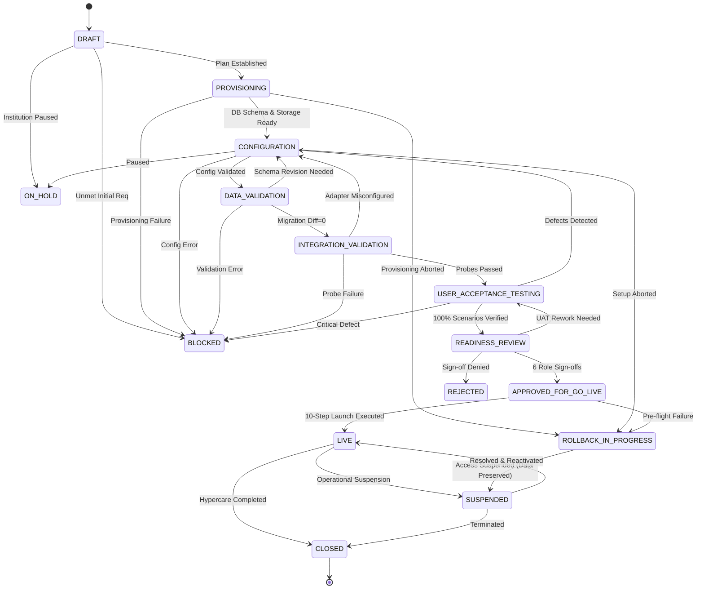

# CampusOS Tenant Onboarding & Go-Live Operational Runbooks (Step 35)

This operational manual documents verified procedures, state machine transitions, readiness criteria, data reconciliation rules, approval governance, launch execution, safe rollback, and hypercare operations for onboarding institutions onto CampusOS.

---

## 1. Onboarding Architecture & Lifecycle

CampusOS enforces an auditable, deterministic, zero-trust onboarding process. No institution transitions to production without satisfied readiness criteria, multi-role governance approvals, validated master data, and documented recovery procedures.

### Lifecycle State Machine



### Valid Transition Matrix

| From State | Allowed Target States | Enforcement Conditions |
| :--- | :--- | :--- |
| `DRAFT` | `PROVISIONING`, `BLOCKED`, `ON_HOLD` | Initial institution record and plan established |
| `PROVISIONING` | `CONFIGURATION`, `BLOCKED`, `ROLLBACK_IN_PROGRESS` | Automated tenant schema creation & storage initialization |
| `CONFIGURATION` | `DATA_VALIDATION`, `BLOCKED`, `ON_HOLD`, `ROLLBACK_IN_PROGRESS` | Academic calendar, departments, and role structures configured |
| `DATA_VALIDATION` | `INTEGRATION_VALIDATION`, `CONFIGURATION`, `BLOCKED`, `ON_HOLD` | Reconciliation difference = 0, zero unresolved duplicates |
| `INTEGRATION_VALIDATION` | `USER_ACCEPTANCE_TESTING`, `CONFIGURATION`, `BLOCKED`, `ON_HOLD` | Notification delivery and external adapter probes verified |
| `USER_ACCEPTANCE_TESTING` | `READINESS_REVIEW`, `CONFIGURATION`, `BLOCKED`, `ON_HOLD` | Zero unresolved `CRITICAL` or `MAJOR` defects |
| `READINESS_REVIEW` | `APPROVED_FOR_GO_LIVE`, `USER_ACCEPTANCE_TESTING`, `REJECTED`, `BLOCKED`, `ON_HOLD` | 100% mandatory checklist items passed/waived |
| `APPROVED_FOR_GO_LIVE` | `LIVE`, `ROLLBACK_IN_PROGRESS`, `BLOCKED`, `ON_HOLD` | All 6 governance approvals `APPROVED` for policy version |
| `LIVE` | `SUSPENDED`, `CLOSED` | 14-day hypercare initialized; active tenant |
| `ROLLBACK_IN_PROGRESS` | `CONFIGURATION`, `SUSPENDED`, `CLOSED` | Reversible actions suspended; imported data preserved |
| `SUSPENDED` | `LIVE`, `CLOSED` | Re-verification before reactivation |
| `CLOSED` | None (Terminal) | Hypercare handoff sign-off recorded |

---

## 2. Standard Readiness Checklist & Evaluation Rules

The checklist engine verifies 14 criteria across 7 categories. Every mandatory check must pass or have an authorized exception waiver before go-live approval.

| Code | Category | Title | Verification Method | Mandatory |
| :--- | :--- | :--- | :--- | :--- |
| `CHK_PLAT_01` | `PLATFORM_SETUP` | Tenant DB Schema & Isolation | Automated | **Yes** |
| `CHK_PLAT_02` | `PLATFORM_SETUP` | Storage & Event Namespace | Automated | **Yes** |
| `CHK_ID_01` | `IDENTITY_ACCESS` | Primary Institutional Admin | Automated | **Yes** |
| `CHK_ID_02` | `IDENTITY_ACCESS` | Default Role Matrix & Boundary | Automated | **Yes** |
| `CHK_ACAD_01` | `ACADEMIC_CONFIG` | Academic Year & Terms | Automated | **Yes** |
| `CHK_ACAD_02` | `ACADEMIC_CONFIG` | Department & Program Hierarchy | Manual Review | **Yes** |
| `CHK_FIN_01` | `FINANCE` | Fee Structures & Billing Schedules | Manual Review | **Yes** |
| `CHK_FIN_02` | `FINANCE` | Payment Sandbox Integration | Integration Probe | No (Optional) |
| `CHK_DATA_01` | `DATA_MIGRATION` | Master Data Import Reconciliation | Automated | **Yes** |
| `CHK_DATA_02` | `DATA_MIGRATION` | Referential Integrity & Duplicates | Automated | **Yes** |
| `CHK_INT_01` | `INTEGRATIONS_COMMS`| Notification Delivery Probes | Integration Probe | **Yes** |
| `CHK_INT_02` | `INTEGRATIONS_COMMS`| External Adapters & SSO | Integration Probe | No (Optional) |
| `CHK_SEC_01` | `SECURITY_OPERATIONS`| Security Vulnerability Scans | Automated | **Yes** |
| `CHK_SEC_02` | `SECURITY_OPERATIONS`| Backup Snapshot & Runbooks | Attestation | **Yes** |

### Waiver Governance Rules
- Optional criteria (`CHK_FIN_02`, `CHK_INT_02`) may be waived with documented technical justification.
- Mandatory criteria **cannot** be waived unless an explicit platform exception policy allows it and both `waiver_reason` and `waiver_approved_by` (Platform Operator or CISO) are recorded.
- Any regression in a checklist item (`PASSED` $\rightarrow$ `FAILED`/`BLOCKED`) immediately **invalidates** all previously granted go-live approvals.

---

## 3. Data Migration & Zero-Discrepancy Reconciliation

Data migration jobs process files in bounded batches with strict schema validation:
1. **Source Checksum Verification:** SHA-256 hash verified before processing.
2. **Duplicate Detection:** Natural identity keys (email, student_id, faculty_code) tracked across the batch. Duplicates are flagged and rejected.
3. **Dry-Run Mode:** Simulates parsing, entity mapping, and constraint validation without persisting records.
4. **Zero Discrepancy Formula:**
   $$\text{Discrepancy} = \text{Source Records} - (\text{Accepted Records} + \text{Rejected Records})$$
   A migration is marked `RECONCILED` only if $\text{Discrepancy} == 0$. If any records are unaccounted for, the job status transitions to `FAILED`.

---

## 4. Multi-Role Approval Governance

Six independent accountable roles must approve before launch:
1. **Institution Owner / Authorized Admin:** Business acceptance and operational commitment.
2. **Data Migration Owner:** Attestation of 100% data reconciliation and legacy cutoff.
3. **Technical Operations Reviewer:** Infrastructure capacity, database connections, and worker capacity.
4. **Security Reviewer:** Penetration testing, vulnerability status, and credential rotation.
5. **Business Acceptance Representative:** Academic, attendance, and finance workflow sign-off.
6. **Platform Release Approver:** Final release gate and multi-tenant blast radius sign-off.

Each approval records `role`, `approver_email`, `policy_version`, `decision` (`APPROVED` or `REJECTED`), `comments`, and timestamp. Stale approvals are invalidated upon material checklist changes.

---

## 5. Ten-Step Go-Live Execution Sequence

When triggered, the go-live coordinator executes the launch sequence in deterministic dependency order:

```
Step 1: Final Configuration Verification
   ↓
Step 2: Migration Reconciliation Verification (Diff = 0)
   ↓
Step 3: Required Integration Health Checks
   ↓
Step 4: User & Role Boundary Verification
   ↓
Step 5: Critical Workflow Smoke Tests
   ↓
Step 6: Notification Delivery Verification
   ↓
Step 7: Pre-Activation Backup Snapshot
   ↓
Step 8: Tenant Activation (Status: PROVISIONING → ACTIVE)
   ↓
Step 9: Post-Activation Health Checks
   ↓
Step 10: Final Go-Live Evidence Capture
```

### Safety & Idempotency
- **Dry-Run Mode (`is_dry_run: true`):** Runs the full sequence in simulation mode without mutating institution or tenant lifecycle status.
- **Idempotency Key:** Protects against network retries or concurrent worker execution. Re-submitting an identical idempotency key returns the existing step records without duplicate mutation.
- **Pre-Activation Isolation:** The institution tenant remains non-active until Step 8 completes successfully.

---

## 6. Safe Rollback & Data Preservation Rules

- **Data Preservation Guarantee:** A rollback or go-live abort **never** deletes tenant database records, tables, or imported historical data.
- **Access Suspension:** Newly provisioned access credentials and API tokens are revoked or placed in `SUSPENDED` status.
- **Irreversible Operations:** Financial transactions, payment gateway live charges, or external webhooks dispatched during launch cannot be automatically undone. They require documented manual recovery runbooks.
- **Audit Preservation:** All logs, dry-run traces, and approval records remain permanently intact in audit storage.

---

## 7. Hypercare Monitoring & Telemetry Window

Upon successful activation (`LIVE`), CampusOS initiates a **14-day hypercare monitoring window**.
- **Monitored Telemetry:**
  - Authentication failure rates.
  - API HTTP 5xx error rates.
  - Background job and outbox queue worker dead-letter counts.
  - Integration adapter circuit breaker trip events.
  - Data import exceptions.
  - Open support tickets / incident counts.
- **Exit Criteria for Operational Handoff:**
  - Hypercare duration elapsed ($\ge 14$ days).
  - Unresolved critical/high support tickets $= 0$.
  - Formal sign-off by Lead SRE / Operations Lead.

---

## Operational Runbooks

---

### Runbook 1: Successful End-to-End Onboarding

#### Goal
Take a newly contracted institution from draft establishment to verified live production operations.

#### Prerequisites
- Institution record created in SaaS database (`PROVISIONING` status).
- Assigned Onboarding Lead and Platform Operator credentials.

#### Step-by-Step Procedure
1. **Initialize Onboarding Plan:**
   ```bash
   curl -X POST "https://api.campusos.internal/api/v1/onboarding/plans" \
     -H "Authorization: Bearer $PLATFORM_TOKEN" \
     -H "Content-Type: application/json" \
     -d '{"tenant_id": "'"$TENANT_ID"'", "assigned_lead_email": "lead@campusos.internal"}'
   ```
2. **Transition to Provisioning & Execute Setup:**
   - Update checklist items `CHK_PLAT_01` and `CHK_PLAT_02` with automated schema creation audit IDs.
   - Transition state to `CONFIGURATION`.
3. **Configure Academic, Identity & Finance Structures:**
   - Establish primary administrator (`CHK_ID_01`), role assignments (`CHK_ID_02`).
   - Create academic calendar (`CHK_ACAD_01`) and department tree (`CHK_ACAD_02`).
   - Configure fee categories and invoices (`CHK_FIN_01`).
   - Transition state to `DATA_VALIDATION`.
4. **Execute Master Data Migration & Reconciliation:**
   - Run validation on student, faculty, and historical course CSV files.
   - Verify reconciliation discrepancy count $= 0$.
   - Transition state to `INTEGRATION_VALIDATION`.
5. **Verify Integrations & Notifications:**
   - Probe SMS and email gateway delivery (`CHK_INT_01`).
   - Transition state to `USER_ACCEPTANCE_TESTING`.
6. **Execute Institutional UAT:**
   - Institutional testers verify all 8 standard scenarios (Admissions, Enrollment, Attendance, Exam Grading, Invoicing, Placement, Documents, Security Boundaries).
   - Resolve any defects; confirm 100% passed sign-offs.
   - Transition state to `READINESS_REVIEW`.
7. **Complete Governance Sign-offs:**
   - Collect approvals from all 6 designated roles (Institution Owner, Data Migration Owner, Tech Ops, Security, Business Acceptance, Platform Release Approver).
   - Evaluate readiness: verify `overall_status == "READY"`.
   - Transition state to `APPROVED_FOR_GO_LIVE`.
8. **Simulate Launch (Dry-Run):**
   ```bash
   curl -X POST "https://api.campusos.internal/api/v1/onboarding/plans/$TENANT_ID/golive/execute" \
     -H "Authorization: Bearer $PLATFORM_TOKEN" \
     -H "Content-Type: application/json" \
     -d '{"is_dry_run": true, "idempotency_key": "dry_run_'"$TENANT_ID"'"}'
   ```
9. **Execute Live Activation:**
   ```bash
   curl -X POST "https://api.campusos.internal/api/v1/onboarding/plans/$TENANT_ID/golive/execute" \
     -H "Authorization: Bearer $PLATFORM_TOKEN" \
     -H "Content-Type: application/json" \
     -d '{"is_dry_run": false, "idempotency_key": "live_launch_'"$TENANT_ID"'"}'
   ```
10. **Verify Hypercare Initialization:**
    - Confirm institution status in `core_institutions` is `ACTIVE`.
    - Verify hypercare record is active with 14-day window.

---

### Runbook 2: Tenant Blocked by Missing Configuration

#### Symptoms & Signals
- Readiness diagnostic returns `overall_status: "BLOCKED"` or `"ACTION_REQUIRED"`.
- `can_progress_to_next_stage: false` with blocking reasons detailing incomplete mandatory criteria (e.g., `CHK_ACAD_01: Academic Year & Terms`).

#### Investigation Procedure
1. Call the readiness evaluation endpoint to obtain the explainable diagnostic:
   ```bash
   curl -X GET "https://api.campusos.internal/api/v1/onboarding/plans/$TENANT_ID/readiness" \
     -H "Authorization: Bearer $TOKEN"
   ```
2. Inspect `blocking_reasons`, `failed_requirements`, and `missing_evidence`.
3. Check whether the blocker is in Academic Config, Finance, or Security.

#### Remediation Actions
1. If academic calendar is unconfigured:
   - Navigate to `/app/academics/terms` in the administration interface.
   - Establish the active Academic Year (e.g. `2026-2027`) and Fall/Spring Term date ranges.
2. If fees are unconfigured:
   - Create institutional fee categories in `/app/finance/categories`.
3. Re-verify the corresponding checklist item:
   ```bash
   curl -X PATCH "https://api.campusos.internal/api/v1/onboarding/plans/$TENANT_ID/checklist/CHK_ACAD_01" \
     -H "Authorization: Bearer $TOKEN" \
     -H "Content-Type: application/json" \
     -d '{"status": "PASSED", "evidence_ref": "https://vault.campusos.internal/evidence/acad_terms_v1.pdf"}'
   ```
4. Re-evaluate readiness to confirm blocker is resolved.

---

### Runbook 3: Failed Data Migration & Schema Validation

#### Symptoms & Signals
- Migration job fails during dry-run with status `FAILED` or HTTP 422.
- `validation_findings` array contains schema mismatch or required field errors.

#### Investigation Procedure
1. Fetch migration job findings from the database or API:
   ```sql
   SELECT id, domain_name, source_filename, status, validation_findings
   FROM tenant_onboarding_migration_jobs
   WHERE tenant_id = :tenant_id
   ORDER BY created_at DESC LIMIT 1;
   ```
2. Identify missing columns (e.g., missing `postal_code`, invalid `email` format, or missing `department_code`).

#### Remediation Actions
1. Provide the institution data team with the standardized CampusOS import template:
   - Standard fields: `identifier`, `full_name`, `email`, `department_code`, `joining_date`.
2. Cleanse invalid records and re-compute the source file SHA-256 checksum:
   ```bash
   sha256sum students_cleaned_v2.csv
   ```
3. Re-submit the migration job for dry-run validation with the new checksum.
4. Verify `has_critical_errors == false` before advancing.

---

### Runbook 4: Unresolved Reconciliation Mismatch (Diff != 0)

#### Symptoms & Signals
- Migration job completes with `reconciliation_diff_count > 0`.
- Checklist item `CHK_DATA_01` remains in `BLOCKED` status.
- Rule engine prevents progression from `DATA_VALIDATION` to `INTEGRATION_VALIDATION`.

#### Investigation Procedure
1. Query reconciliation counts:
   $$\text{Diff} = \text{source\_record\_count} - (\text{accepted\_record\_count} + \text{rejected\_record\_count})$$
2. Determine why records were uncounted:
   - Duplicate natural keys discarded silently in legacy script?
   - Null identifiers causing parser skips?
   - Encoding errors in UTF-8 multibyte characters?
3. Check `duplicate_record_count` in `tenant_onboarding_migration_jobs`.

#### Remediation Actions
1. **Never** artificially override or zero out the reconciliation difference count.
2. Export the rejection log:
   ```bash
   # Extract duplicate and rejected row IDs from validation_findings JSON
   jq '.validation_findings[] | select(.issue_type == "DUPLICATE_KEY")' findings.json
   ```
3. Have the institutional data steward formally sign off on the duplicate disposition (deduplication or merging).
4. Re-run migration with cleansed dataset where every source row is explicitly categorized as either accepted or formally rejected.
5. Confirm $\text{Diff} == 0$.

---

### Runbook 5: External Integration Failing During Launch Smoke Test

#### Symptoms & Signals
- Step 3 (`REQUIRED_INTEGRATIONS_HEALTH_CHECK`) fails during go-live execution.
- Launch runner reports timeout or HTTP 503 connecting to external payment gateway, SMS provider, or LDAP/SSO provider.

#### Investigation Procedure
1. Check Step 3 error log:
   ```sql
   SELECT step_name, status, failure_reason, recovery_instruction
   FROM tenant_onboarding_golive_steps
   WHERE plan_id = :plan_id AND step_code = 'STEP_03_INTEGRATION_CHECKS';
   ```
2. Test network connectivity and credential validity:
   - Verify API credentials stored in secret management.
   - Check egress firewall / IP allowlisting for the institution's tenant environment.
   - Test health probe endpoint manually.

#### Remediation Actions
1. If integration is non-mandatory (e.g. optional sandbox payment adapter):
   - Review waiver policy with Technical Operations Lead.
   - If approved, apply authorized waiver on `CHK_INT_02`.
2. If integration is mandatory (e.g. notification delivery gateway):
   - Rotate API keys or switch to secondary backup delivery provider (e.g., SendGrid $\rightarrow$ AWS SES).
   - Test connectivity probe.
3. Once connectivity is restored, restart launch execution. The idempotency coordinator will resume from the failed step without duplicating previous steps.

---

### Runbook 6: Required Approval Rejected or Resubmission

#### Symptoms & Signals
- Onboarding plan state transitions to `REJECTED`.
- Go-live execution is blocked; readiness review indicates `Approval Decision: REJECTED`.

#### Investigation Procedure
1. Query rejection details:
   ```sql
   SELECT role, approver_email, rejection_reason, comments, decision_at
   FROM tenant_onboarding_approvals
   WHERE plan_id = :plan_id AND decision = 'REJECTED';
   ```
2. Contact the rejecting stakeholder (e.g. Security Reviewer noting open penetration test finding, or Bursar noting fee policy ambiguity).

#### Remediation Actions
1. Address the root cause identified in `rejection_reason`.
2. Update the affected configuration, security rule, or checklist item.
3. Note that updating checklist items will automatically invalidate existing approvals to prevent stale sign-offs.
4. Request the rejecting approver re-review and submit an `APPROVED` decision with updated comments.
5. Re-evaluate readiness and transition state back to `READINESS_REVIEW` $\rightarrow$ `APPROVED_FOR_GO_LIVE`.

---

### Runbook 7: Partially Completed Go-Live Execution & Safe Recovery

#### Symptoms & Signals
- Launch execution failed midway (e.g., at Step 7 before tenant activation, or Step 9 during post-activation probe).
- Plan remains in `APPROVED_FOR_GO_LIVE` or `ROLLBACK_IN_PROGRESS`.
- Institution users cannot log in.

#### Investigation Procedure
1. Query step execution state:
   ```sql
   SELECT step_order, step_code, step_name, status, failure_reason
   FROM tenant_onboarding_golive_steps
   WHERE plan_id = :plan_id
   ORDER BY step_order ASC;
   ```
2. Determine whether Step 8 (`TENANT_ACTIVATION`) completed:
   - If Step 8 did **not** run: The tenant was never activated. All data remains safe in pre-activation isolation.
   - If Step 8 did run: The tenant is marked `ACTIVE`, but post-activation smoke tests failed.

#### Remediation Actions
1. Fix the underlying environmental or smoke-test failure (e.g. flush application route cache or restart background job worker).
2. Re-trigger launch execution using the **same idempotency key**:
   - The coordinator skips already `COMPLETED` steps.
   - It safely resumes from the failed step.
3. If the failure cannot be resolved within the scheduled maintenance window:
   - Follow **Runbook 8** to initiate a safe rollback.

---

### Runbook 8: Tenant Requiring Immediate Rollback or Operational Suspension

#### Symptoms & Signals
- Post-launch critical defect detected (e.g. wrong tuition fee schedule applied across invoices or severe student record data corruption).
- CISO or Institutional Director orders immediate launch rollback.

#### Prerequisites
- Authorized request by Institution Owner or Platform Release Approver.

#### Step-by-Step Procedure
1. **Execute Safe Rollback API Call:**
   ```bash
   curl -X POST "https://api.campusos.internal/api/v1/onboarding/plans/$TENANT_ID/rollback" \
     -H "Authorization: Bearer $PLATFORM_TOKEN" \
     -H "Content-Type: application/json" \
     -d '{
       "rollback_reason": "Severe fee allocation discrepancy detected during live bursar reconciliation.",
       "preserve_imported_data": true
     }'
   ```
2. **Verify Safe Rollback Outcome:**
   - Plan state transitions to `ROLLBACK_IN_PROGRESS` $\rightarrow$ `SUSPENDED`.
   - Institution status in `core_institutions` is set to `SUSPENDED`.
   - **Data Preservation Check:** Verify that zero student records, courses, or historical data have been dropped.
   ```sql
   SELECT count(*) FROM core_institutions WHERE id = :tenant_id AND status = 'SUSPENDED';
   -- Confirm student records remain intact
   SELECT count(*) FROM people_students WHERE tenant_id = :tenant_id;
   ```
3. **Notify Institutional Leadership:**
   - Transmit formal incident notice documenting rollback timestamp, reason, and data preservation confirmation.
4. **Post-Mortem & Remediation:**
   - Convene joint CampusOS and institutional review board to determine remediation schedule.

---

### Runbook 9: Critical Incident During Post-Launch Hypercare

#### Symptoms & Signals
- Alert triggered during the 14-day hypercare period:
  - Spike in authentication failures.
  - High 5xx error rate on attendance or grading endpoints.
  - Unprocessed background outbox queue accumulation.

#### Investigation Procedure
1. Check current hypercare status:
   ```bash
   curl -X GET "https://api.campusos.internal/api/v1/onboarding/plans/$TENANT_ID/hypercare" \
     -H "Authorization: Bearer $TOKEN"
   ```
2. Check `telemetry_summary` for specific metric elevations:
   - `auth_failures_count`
   - `api_5xx_error_count`
   - `job_failures_count`
   - `unresolved_issues_count`
3. Identify affected subsystems using Prometheus metrics (`campusos_http_requests_total{tenant_id="..."}`).

#### Remediation Actions
1. Increment incident tracker and assign primary SRE incident commander.
2. If issue is performance-related:
   - Scale API or job worker replica count.
   - Optimize database index or hot tenant query.
3. If issue is tenant-configuration related:
   - Apply hotfix configuration under change management.
4. Record remediation in hypercare daily review notes.
5. Decrement `unresolved_issues_count` only after 24 hours of stable metric verification.

---

### Runbook 10: Closing Onboarding and Formal Hand-off to Steady-State Operations

#### Symptoms & Signals
- 14-day hypercare period has elapsed (`hypercare_end_date <= NOW()`).
- All telemetry indicators nominal.
- Zero unresolved critical or high support tickets (`unresolved_issues_count == 0`).

#### Prerequisites
- Written sign-off from Institutional Director and CampusOS Lead SRE.

#### Step-by-Step Procedure
1. **Verify Exit Criteria:**
   ```bash
   curl -X GET "https://api.campusos.internal/api/v1/onboarding/plans/$TENANT_ID/hypercare" \
     -H "Authorization: Bearer $PLATFORM_TOKEN"
   ```
   Confirm `unresolved_issues_count == 0`.
2. **Execute Operational Handoff:**
   ```bash
   curl -X POST "https://api.campusos.internal/api/v1/onboarding/plans/$TENANT_ID/hypercare/handoff" \
     -H "Authorization: Bearer $PLATFORM_TOKEN" \
     -H "Content-Type: application/json" \
     -d '{
       "signoff_by": "Alex Mercer, Lead SRE Operations",
       "notes": "14-day hypercare concluded with zero outstanding defects. Average API latency 42ms, 99.98% uptime. Handoff to Tier-2 Global Operations completed."
     }'
   ```
3. **Transition Onboarding Plan to Closed:**
   - Plan lifecycle state advances to `CLOSED`.
4. **Archive Onboarding Evidence Package:**
   - Package all checklist sign-offs, reconciliation certificates, UAT execution logs, and approval records into an immutable audit archive.
5. **Update Operations Dashboard:**
   - Remove tenant from Hypercare Active Watchlist.
   - Add tenant to standard production SLA monitoring.
