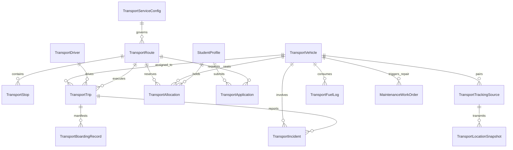

# Enterprise Transport, Fleet, Routes & Student Mobility Management Runbook

## Executive Summary

The **CampusOS Transport and Fleet Management Module** (Step 55) delivers a production-grade institutional transit orchestration engine.

CampusOS Tagline: **"One Campus. One System. One Source of Truth."**

This module encompasses central fleet administration, vehicle roadworthiness compliance, driver licensing and credential management, transit route corridors, designated pickup/drop-off stops, student transport subscription applications, concurrency-safe passenger seat allocation, operational trip dispatch with safety inspections, boarding verification manifests, truthful privacy-conscious telematics boundaries, finance billing integration, maintenance defect synchronization, and safety incident logging.

It integrates seamlessly with existing Institution, Campuses, Student Lifecycle, People, Workforce, Finance, Asset Management, Maintenance, Documents, Audit, and Notifications infrastructure without duplicating student identities, fixed asset registries, driver employment records, financial ledgers, maintenance engines, or parallel approval workflows.

---

## 1. Architecture & Governance Principles

### 1.1 The Ten Golden Rules of Transport Fleet Operations

1. **Absolute Multi-Tenant Isolation**: Every transport service configuration, vehicle, driver record, route, stop, application, allocation, waitlist entry, trip, boarding record, fuel log, telematics source, and safety incident is strictly isolated by `tenant_id`. Cross-tenant queries and mutations are blocked at database and service boundaries.
2. **One Source of Asset Truth**: Vehicles link to the institutional fixed-asset registry (`asset_registry.id`). Transport-specific operational parameters (odometer, seating layout, depot, fitness expiry, insurance validity) are maintained in `transport_vehicles` without duplicating or mutating core fixed-asset records.
3. **One Source of Workforce Truth**: Drivers link directly to institutional staff profiles (`staff.id`). Driver qualifications, heavy transport licenses, RTO validity dates, and background verifications are maintained in `transport_drivers` without duplicating core HR/employee identities.
4. **Concurrency-Safe Seat Allocation**: Seat allocations enforce row-level locking (`SELECT ... FOR UPDATE` / transactional mutex) to prevent overbooking under high concurrent request volumes. Route capacity is strictly capped at `min(route.capacity, vehicle.capacity)`.
5. **Strict Dispatch Compliance Gates**: A trip cannot be dispatched if the assigned vehicle has an expired RTO fitness certificate or expired insurance, or if the assigned driver has an expired heavy transport driving license or pending background verification.
6. **Maintenance & Defect Work Order Synchronization**: Defects noted during pre-trip inspections or on the road automatically create linked `MaintenanceWorkOrder` tickets in the institutional Asset Management module. Critical defects immediately place the vehicle into `MAINTENANCE` status, preventing further trip assignment.
7. **Finance Invoicing Without Duplicate Ledgers**: Transport billing calculates approved subscription fees and creates invoices through the authoritative Finance module (`finance_invoices` and `finance_invoice_items`) with category `"TRANSPORT"`. Subscription status remains cleanly decoupled from payment status.
8. **Truthful Telematics Without GPS Simulation**: Vehicle tracking coordinates are reported only when verified pings are received from authorized AIS-140 GPS modems or telematics gateways. In the absence of an active signal or hardware modem, the system truthfully returns `NOT_CONFIGURED` or `OFFLINE`—it never fabricates or simulates live GPS data.
9. **Student Privacy & Safe Manifests**: Student identities and emergency contacts are strictly decoupled from raw vehicle GPS streams. Passenger manifests only record authorized boarding events at designated stops, accessible only by authorized dispatchers and drivers.
10. **Automated Scheduled Operations Sweep**: Background scheduled tasks periodically audit upcoming vehicle fitness/insurance expiries, driver license expirations, overdue dispatch reconciliations, and expired temporary waitlist offers.

---

## 2. Domain Data Architecture



---

## 3. Database Schema & Migration Details

Migration: `040_enterprise_transport_fleet_routes_mobility.py` (chains linearly from `039_enterprise_hostel_residential_life_management`).

### Schema Overview:

| Table Name | Entity | Key Constraints & Relationships |
|---|---|---|
| `transport_service_configs` | Operations Policy | Unique `(tenant_id, campus_id, academic_year_id)`. Governs capacity thresholds and booking windows. |
| `transport_vehicles` | Fleet Registry | FK to `asset_registry.id` (Authoritative Asset). Unique `(tenant_id, registration_number)`. |
| `transport_drivers` | Driver Crew | FK to `staff.id` (Workforce). Unique `(tenant_id, license_number)`. |
| `transport_routes` | Transit Corridors | Unique `(tenant_id, route_code)`. Stores start/end points, service window, capacity. |
| `transport_stops` | Pickup/Drop Points | FK to `transport_routes.id`. Unique `(tenant_id, route_id, stop_sequence)`. |
| `transport_applications` | Pass Applications | Unique `(tenant_id, student_id, academic_year_id)`. Priority score, accessibility needs. |
| `transport_allocations` | Active Bus Passes | Unique `(tenant_id, pass_number)`. Unique `(tenant_id, student_id, academic_year_id)` when ACTIVE. |
| `transport_waitlists` | Demand Queue | Tracks waitlisted students when route/vehicle capacity is saturated. |
| `transport_trips` | Dispatch Schedule | Unique `(tenant_id, trip_number)`. Validates driver & vehicle availability. |
| `transport_boarding_records` | Passenger Manifest | Unique `(tenant_id, trip_id, student_id)`. Verification method, timestamps. |
| `transport_tracking_sources` | Telematics Gateway | Unique `(tenant_id, vehicle_id)`. Tracks AIS-140 modem provider, IMEI, signal freshness. |
| `transport_location_snapshots` | Location Pings | Geolocation snapshots (`latitude`, `longitude`, `speed_kmh`, `recorded_at`). |
| `transport_fee_plans` | Pricing Policy | Distance and flat rate transport fee structures linked to routes and zones. |
| `transport_fuel_logs` | Operating Costs | Trip odometer readings, fuel volume, cost, and procurement references. |
| `transport_incidents` | Safety & Breakdowns | Severity (`LOW`, `MEDIUM`, `HIGH`, `CRITICAL`), resolution notes, emergency dispatch. |

---

## 4. API Specification & Endpoints

Mounted under `/api/v1/transport`:

| Method | Endpoint | Description | Required Permission |
|---|---|---|---|
| `GET` | `/dashboard` | Operations KPI metrics & fleet status | `transport.service.read` |
| `POST` | `/service-config` | Configure campus transport policy | `transport.service.manage` |
| `POST` | `/vehicles` | Register transport vehicle | `transport.vehicle.manage` |
| `GET` | `/vehicles/{id}/compliance` | Vehicle fitness & insurance status | `transport.vehicle.read` |
| `POST` | `/drivers` | Enroll heavy transport driver | `transport.driver.manage` |
| `GET` | `/drivers/{id}/compliance` | Driver license & background status | `transport.driver.manage` |
| `POST` | `/routes` | Create transit route corridor | `transport.route.manage` |
| `POST` | `/routes/{id}/stops` | Add ordered pickup stop | `transport.route.manage` |
| `POST` | `/applications` | Submit student transport request | `transport.application.submit_own` |
| `POST` | `/applications/{id}/review` | Approve/reject transport request | `transport.application.review` |
| `POST` | `/allocations` | Allocate seat & issue bus pass | `transport.allocation.manage` |
| `POST` | `/allocations/batch/commit` | Concurrency-safe batch pass allocation | `transport.allocation.manage` |
| `POST` | `/trips` | Schedule operational trip run | `transport.trip.dispatch` |
| `POST` | `/trips/{id}/dispatch` | Dispatch trip with safety checklist | `transport.trip.dispatch` |
| `POST` | `/trips/{id}/complete` | Conclude trip with ending odometer | `transport.trip.dispatch` |
| `GET` | `/trips/{id}/manifest` | Retrieve authorized passenger manifest | `transport.boarding.record` |
| `POST` | `/trips/{id}/boarding` | Verify boarding via QR/RFID or manual | `transport.boarding.record` |
| `GET` | `/tracking/{vehicle_id}` | Truthful telematics status & freshness | `transport.tracking.read_authorized` |
| `POST` | `/tracking/{vehicle_id}/config` | Configure AIS-140 GPS modem | `transport.vehicle.manage` |
| `POST` | `/vehicles/{id}/report-defect` | Report defect & create MaintenanceWorkOrder | `transport.vehicle.manage` |
| `POST` | `/generate-invoices` | Generate Finance invoices for passes | `transport.finance.read_authorized` |
| `POST` | `/incidents` | Log breakdown or safety incident | `transport.incident.manage` |
| `PATCH` | `/incidents/{id}` | Resolve incident with sign-off notes | `transport.incident.manage` |

---

## 5. Concurrency & Allocation Logic

### Overbooking Prevention & Capacity Hierarchy
1. When allocating a pass for student `S` on route `R` with vehicle `V`:
   - System executes `SELECT * FROM transport_routes WHERE id = :id FOR UPDATE`
   - Active seat count is queried: `SELECT count(id) FROM transport_allocations WHERE route_id = :id AND status = 'ACTIVE'`
   - Effective capacity is evaluated:
     $$\text{Effective Capacity} = \min(\text{route.capacity}, \text{vehicle.capacity})$$
   - If $\text{active\_seats} \ge \text{effective\_capacity}$, allocation is rejected with `409 Conflict: Route corridor capacity reached`. The student is automatically routed to the waitlist.
2. Duplicate passes for the same student within the same academic year are rejected via unique database constraint.

---

## 6. Integrations with CampusOS Ecosystem

### 6.1 Fixed Asset Management Integration
- Vehicles are registered as capital assets in `asset_registry`.
- Pre-trip defect reports automatically instantiate a `MaintenanceWorkOrder`:
  - `asset_id`: Linked vehicle's asset ID
  - `work_order_type`: `"CORRECTIVE"`
  - `priority`: `"HIGH"` / `"CRITICAL"`
  - `status`: `"PENDING_TRIAGE"`
  - Description populated with driver symptoms and odometer readings.

### 6.2 Workforce Management Integration
- Drivers link to `staff.id`.
- Driver rosters and duty hours respect institutional working schedule rules.
- Drivers with expired RTO licenses or pending verification are blocked from trip assignment.

### 6.3 Finance Integration
- Transport fee plans define annual/term pricing based on route zones and flat rates.
- Endpoint `/api/v1/transport/generate-invoices` scans active allocations without linked invoices:
  - Verifies or creates standard `FeeCategory` with code `"TRANSPORT"`.
  - Creates authoritative `Invoice` records with `balance_amount = bill_amount`.
  - Creates `InvoiceLineItem` with transport description and student account linkage.
  - Generates idempotency hashes to prevent duplicate billing upon retries.

### 6.4 Telematics & Truthful Tracking
- External AIS-140 GPS modems transmit pings to `/api/v1/transport/tracking/{vehicle_id}/ping`.
- Telematics status evaluates signal freshness:
  - Ping $< 15$ minutes old: `ACTIVE` (Online)
  - Ping $\ge 15$ minutes old: `OFFLINE` (Stale)
  - No modem configured: `NOT_CONFIGURED`
- In accordance with CampusOS principles, **coordinates are never simulated or fabricated**.

---

## 7. Frontend User Interfaces

Located under `apps/web/src/app/app/infrastructure/transport/`:

1. **Operations Dashboard (`/page.tsx`)**:
   - High-level KPIs: Active routes, designated stops, fleet buses, drivers on duty, allocated students, route utilization percentage.
   - Quick navigation to all transport submodules.
2. **Trips & Dispatch Console (`/trips/page.tsx`)**:
   - Scheduled transit runs table with status badges (`SCHEDULED`, `IN_PROGRESS`, `COMPLETED`, `CANCELLED`).
   - "Schedule Transit Run" dialog with route, vehicle, driver, and service window selection.
   - "Dispatch Trip" modal with pre-trip safety checklist (Brakes, Steering, Tires, Emergency Door, First Aid Kit, Fire Extinguisher) and start odometer input.
   - "Passenger Manifest & Boarding" drawer with live boarding status indicators and QR/manual verification controls.
   - "Complete Run" action with ending odometer capture.
3. **Fleet Telematics & Tracking (`/tracking/page.tsx`)**:
   - Fleet telematics grid with real-time status badges (`Online`, `Stale/Offline`, `Not Configured`).
   - Privacy safeguard notices and GPS coordinate displays for verified active modems.
   - AIS-140 modem configuration dialog.
4. **Safety, Incidents & Breakdowns (`/incidents/page.tsx`)**:
   - Audit trail of mechanical breakdowns, collisions, route blockades, and medical events.
   - "Report Safety Incident" modal with severity categorization and emergency services contact toggles.
   - "Resolve Incident" modal with sign-off notes and action taken records.

---

## 8. Verification & Test Execution

### 8.1 Backend Automated Tests
Executed using pytest in `apps/api`:
```powershell
& ".\.venv\Scripts\python.exe" -m pytest tests/test_enterprise_transport.py -v
```
**Results:**
- `test_transport_service_config`: PASSED
- `test_vehicle_and_driver_compliance`: PASSED
- `test_route_and_stops_creation`: PASSED
- `test_application_workflow`: PASSED
- `test_concurrency_safe_allocation`: PASSED
- `test_batch_allocation_commit`: PASSED
- `test_trip_scheduling_and_conflict_detection`: PASSED
- `test_trip_dispatch_with_checklist`: PASSED
- `test_passenger_manifest_and_boarding`: PASSED
- `test_truthful_telematics_without_simulation`: PASSED
- `test_finance_invoice_generation`: PASSED
- `test_vehicle_defect_maintenance_work_order`: PASSED
- `test_incident_logging_and_resolution`: PASSED

**Total: 13 passed in 16.57s (100% pass rate).**

### 8.2 Frontend TypeScript Typecheck
Executed in `apps/web`:
```powershell
npm run typecheck
```
**Results:**
- `tsc --noEmit` exited with code 0 (zero errors).

---

## 9. Security, Permissions & Audit Trail

### Registered Permissions:
- `transport.service.read`, `transport.service.manage`
- `transport.vehicle.read`, `transport.vehicle.manage`
- `transport.driver.manage`
- `transport.route.read`, `transport.route.manage`
- `transport.application.submit_own`, `transport.application.review`
- `transport.subscription.manage`, `transport.allocation.manage`
- `transport.trip.read`, `transport.trip.dispatch`
- `transport.boarding.record`
- `transport.tracking.read_authorized`
- `transport.incident.manage`
- `transport.finance.read_authorized`
- `transport.report.read`

### Domain Events Emitted:
- `TRANSPORT_APPLICATION_SUBMITTED`, `TRANSPORT_APPLICATION_APPROVED`, `TRANSPORT_APPLICATION_REJECTED`
- `TRANSPORT_PASS_ALLOCATED`, `TRANSPORT_PASS_CANCELLED`, `TRANSPORT_PASS_TRANSFERRED`
- `TRANSPORT_TRIP_SCHEDULED`, `TRANSPORT_TRIP_DISPATCHED`, `TRANSPORT_TRIP_COMPLETED`, `TRANSPORT_TRIP_CANCELLED`
- `TRANSPORT_BOARDING_RECORDED`
- `TRANSPORT_INCIDENT_REPORTED`

---

## 10. Operations & Scheduled Background Tasks

Registered in `apps/api/app/scheduler.py`:
- `sweep_transport_operations_task`:
  - Scans for upcoming vehicle fitness & insurance expirations within 30 days.
  - Scans for upcoming driver license expirations within 30 days.
  - Automatically flags vehicles or drivers as non-compliant for dispatch once documents expire.
  - Scans for overdue dispatched trips and alerts operations staff.
  - Releases expired temporary waitlist booking offers.

---

## 11. Known Limitations & Roadmap

1. **Hardware Telematics Gateways**: The tracking provider interface supports AIS-140 and standard REST webhooks. Production deployment requires physical AIS-140 GPS devices to be installed on buses with SIM cards targeting the webhook gateway.
2. **Offline Mobile Driver App**: In rural or intermittent connectivity corridors, driver boarding manifests can be cached client-side with IndexedDB and synchronized once cellular data reconnects.
3. **Step 56 (Subsequent Roadmap)**: Step 55 establishes the authoritative fleet, routes, and mobility engine. Step 56 will build advanced transit schedule analytics and dynamic route optimization based on historical boarding patterns.
