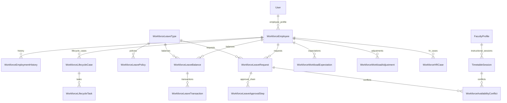

# Enterprise Workforce Management, Staff Lifecycle, Leave & Workload Administration Runbook

## Executive Summary

The **CampusOS Workforce Management, Staff Lifecycle, Leave Ledger & Academic Workload Module** (Step 51) provides a production-grade human resources orchestration engine for higher education and enterprise campuses.

CampusOS Tagline: **“One Campus. One System. One Source of Truth.”**

This module manages the entire employee lifecycle—from onboarding checklists and appointment activation to leave entitlement versioning, ledger-backed leave balances, multi-level approval workflows, privacy-preserving calendars, faculty availability conflict detection against published timetable schedules, workload target aggregation, and employee self-service HR cases.

It integrates seamlessly with existing Institution, Departments, Campuses, People (`User`, `FacultyProfile`, `StaffProfile`), Timetable (`TimetableSession`, `TimetableVersion`), Audit, Permissions, and Notification domains without creating duplicate personnel identities, parallel department hierarchies, or redundant scheduling engines.

---

## 1. Architecture & Governance Principles

### 1.1 Golden Rules of Workforce Governance
1. **One Authoritative Person Identity**: `WorkforceEmployee` does not duplicate core user attributes (name, email, primary auth credentials). The authoritative person profile remains in `people_users`. The workforce domain holds strictly HR-specific attributes (`employee_number`, `joining_date`, `employment_status`, `reporting_manager_id`, `qualifications`).
2. **Absolute Multi-Tenant Boundary Isolation**: Every employee, history record, lifecycle case, task, leave type, policy, balance, ledger transaction, request, approval step, workload target, and HR case is explicitly scoped by `tenant_id`. Cross-tenant queries are blocked at both database and service layers.
3. **Immutable Leave Transaction Ledger**: `workforce_leave_transactions` is an append-only transaction ledger. Balances (`opening`, `accrued`, `used`, `pending`, `adjusted`, `carried_forward`, `available`) are maintained through auditable ledger entries (`ACCRUAL`, `GRANT`, `CONSUMPTION`, `REVERSAL`, `ADJUSTMENT`, `CARRY_FORWARD`, `EXPIRY`).
4. **Separation of Duties (No Self-Approval)**: Approving one's own leave request is strictly prohibited by policy and server-side checks. Requests submitted by managers or HODs automatically escalate to designated secondary authorities.
5. **Onboarding & Offboarding Gatekeeping**: Staff records in `ONBOARDING` status cannot be activated until all mandatory tasks (credentials, IT provisioning, facilities access, compliance acknowledgments) are completed with verified evidence. Offboarding coordinates asset returns and access revocations prior to separation.
6. **Academic Timetable Collision Detection**: Leave requests submitted by instructional faculty are checked against published `TimetableSession` records. Collisions generate `WorkforceAvailabilityConflict` warnings and alert scheduling administrators to arrange substitutes.
7. **Privacy-Preserving Calendar Queries**: Public and department calendar endpoints expose only non-sensitive absence blocks ("Unavailable / Approved Absence"). Medical notes, diagnosis documents, and private leave justifications are restricted to the applicant, reporting manager, and authorized HR personnel.
8. **Workload Expectations vs. Timetable Realities**: Scheduled teaching duties from published timetable sessions are aggregated alongside research, administration, and examination duties. Authorized adjustments provide workload credits without altering academic records.
9. **Traceable Employment History**: Every change of designation, job title, department, reporting manager, contract extension, or status transition writes an immutable `WorkforceEmploymentHistory` entry with effective dates and actor identifiers.
10. **Idempotent Background Jobs**: The periodic scheduler sweeps expired leaves, runs accruals, checks approaching contract expirations (90/60/30 days), and alerts overdue lifecycle tasks without duplicating ledger transactions.

---

## 2. Domain Data Architecture



### 2.1 Database Models (`app/models/workforce.py`)

| Model | Table Name | Purpose |
|---|---|---|
| `WorkforceEmployee` | `workforce_employees` | Canonical workforce profile linking `people_users`, `core_departments`, `core_campuses` |
| `WorkforceEmploymentHistory` | `workforce_employment_history` | Immutable chronological trail of designation, status, and department changes |
| `WorkforceLifecycleCase` | `workforce_lifecycle_cases` | State machine tracking onboarding, offboarding, and probation reviews |
| `WorkforceLifecycleTask` | `workforce_lifecycle_tasks` | Actionable checklist items assigned to HR, IT, Facilities, and Department leads |
| `WorkforceLeaveType` | `workforce_leave_types` | Master leave categories (Casual, Earned, Sick, Duty, Maternity, Unpaid) |
| `WorkforceLeavePolicy` | `workforce_leave_policies` | Versioned, effective-dated policy rules (entitlements, carry-forward, accrual rates) |
| `WorkforceLeaveBalance` | `workforce_leave_balances` | Authoritative annual leave balances per employee and leave type |
| `WorkforceLeaveTransaction` | `workforce_leave_transactions` | Append-only ledger recording accruals, consumption, reversals, adjustments |
| `WorkforceLeaveRequest` | `workforce_leave_requests` | Formal leave applications with dates, half-day flags, reasons, and status |
| `WorkforceLeaveApprovalStep` | `workforce_leave_approval_steps` | Multi-step approval chain records with actor identity and timestamps |
| `WorkforceAvailabilityConflict` | `workforce_availability_conflicts` | Collisions between approved/submitted leaves and scheduled timetable sessions |
| `WorkforceWorkloadExpectation` | `workforce_workload_expectations` | Target hours per week (teaching, research, admin, examination) |
| `WorkforceWorkloadAdjustment` | `workforce_workload_adjustments` | Authorized concessions and duty credits (e.g. grant release hours) |
| `WorkforceHRCase` | `workforce_hr_cases` | Employee self-service tickets and profile update proposals with resolutions |

---

## 3. API Surface & Endpoints

All endpoints are mounted under `/api/v1/workforce` with strict tenant resolution and PBAC verification.

### 3.1 Employee Master & Lifecycle

- `GET /api/v1/workforce/employees`: List employees with search, department, campus, employment type, and status filtering.
- `POST /api/v1/workforce/employees`: Create new employee master record with automated concurrency-safe number generation (`EMP-YYYY-XXXX`).
- `GET /api/v1/workforce/employees/{id}`: Detailed employee view with user, department, and campus information.
- `PATCH /api/v1/workforce/employees/{id}`: Update mutable employment attributes (designation, department, manager).
- `POST /api/v1/workforce/employees/{id}/transition-status`: State machine transition (`DRAFT` → `ONBOARDING` → `ACTIVE` → `ON_LEAVE` / `NOTICE_PERIOD` → `SEPARATED`).
- `GET /api/v1/workforce/employees/{id}/employment-history`: Retrieve chronological audit trail.

### 3.2 Onboarding & Offboarding

- `GET /api/v1/workforce/lifecycle/cases`: List onboarding and offboarding cases.
- `POST /api/v1/workforce/lifecycle/cases`: Initiate lifecycle workflow.
- `PATCH /api/v1/workforce/lifecycle/tasks/{task_id}`: Update task status with completion evidence.
- `POST /api/v1/workforce/offboarding/initiate`: Initiate staff separation with notice-period calculations and auto-generated exit checklist.

### 3.3 Leave Management Engine

- `GET /api/v1/workforce/leave/types` & `POST /api/v1/workforce/leave/types`: Leave types administration.
- `GET /api/v1/workforce/leave/policies` & `POST /api/v1/workforce/leave/policies`: Versioned policy configurations.
- `GET /api/v1/workforce/leave/balances`: Query authoritative balances per employee and year.
- `POST /api/v1/workforce/leave/balances/adjust`: Authorized balance corrections with mandatory audit reason.
- `GET /api/v1/workforce/leave/requests`: List leave requests with role-based filtering.
- `POST /api/v1/workforce/leave/requests`: Submit leave request with balance reservation and timetable collision checking.
- `POST /api/v1/workforce/leave/requests/{id}/approve`: Authorized approval, balance consumption, and ledger entry.
- `POST /api/v1/workforce/leave/requests/{id}/reject`: Rejection releasing reserved balance with mandatory explanation.
- `POST /api/v1/workforce/leave/requests/{id}/cancel`: Cancellation returning consumed or reserved days.
- `GET /api/v1/workforce/leave/calendar`: Privacy-preserving calendar view of absences.

### 3.4 Availability & Workload Planning

- `GET /api/v1/workforce/availability/check`: Evaluate date range for absences and collisions with scheduled timetable sessions.
- `GET /api/v1/workforce/workload/summary`: Aggregate weekly teaching hours from timetable, target expectations, and duty adjustments.
- `POST /api/v1/workforce/workload/expectations`: Define teaching, research, and admin workload targets.
- `POST /api/v1/workforce/workload/adjustments`: Authorize duty concession credits with documented justification.

### 3.5 HR Service Desk & Reporting

- `GET /api/v1/workforce/hr-cases` & `POST /api/v1/workforce/hr-cases`: Self-service request tracking.
- `PATCH /api/v1/workforce/hr-cases/{id}`: HR resolution and status update.
- `GET /api/v1/workforce/reports/overview`: Executive headcount, milestone, contract expiry, and SLA analytics.

---

## 4. Security & Permissions Matrix

All operations require explicit PBAC permissions defined in `app/core/permissions.py`:

| Permission | Description | Assigned System Roles |
|---|---|---|
| `workforce:employee:read` | View employee directory and profiles | Super Admin, Institution Admin, HOD, Faculty, Staff |
| `workforce:employee:manage` | Create and modify employee records | Super Admin, Institution Admin |
| `workforce:lifecycle:manage` | Manage onboarding and offboarding tasks | Super Admin, Institution Admin, HOD |
| `workforce:leave:policy:manage` | Configure leave types and versioned policies | Super Admin, Institution Admin |
| `workforce:leave:request:read` | View team or departmental leave requests | Super Admin, Institution Admin, HOD |
| `workforce:leave:request:submit` | Submit personal leave requests | All authenticated employees |
| `workforce:leave:request:approve` | Approve or reject staff leave requests | Super Admin, Institution Admin, HOD |
| `workforce:leave:balance:manage` | Execute authorized balance adjustments | Super Admin, Institution Admin |
| `workforce:workload:read` | View workload summary and allocations | Super Admin, Institution Admin, HOD, Faculty |
| `workforce:workload:manage` | Configure targets and duty adjustments | Super Admin, Institution Admin, HOD |
| `workforce:case:manage` | Resolve and process HR service tickets | Super Admin, Institution Admin |
| `workforce:reports:read` | View workforce composition and metrics | Super Admin, Institution Admin, HOD |

---

## 5. Background Jobs & Scheduler Integration

Integrated into `app/scheduler.py` via `sweep_workforce_deadlines_and_accruals_task`:

1. **Leave Accrual Sweep**: Idempotently evaluates active leave policies with `MONTHLY` or `QUARTERLY` accrual frequencies and posts ledger credits.
2. **Contract Expiry Reminders**: Flags fixed-term and visiting faculty contracts reaching 90, 60, and 30-day thresholds.
3. **Probation Reviews**: Alerts HODs and HR administrators of upcoming confirmation dates.
4. **Overdue Lifecycle Tasks**: Flags onboarding blockers and escalation notices for incomplete checklists.

---

## 6. Verification & Test Execution Results

All automated tests have been executed and verified in the project virtual environment (`apps/api`):

```bash
# Backend Workforce Test Suite
.venv\Scripts\python.exe -m pytest tests/test_enterprise_workforce_management.py -v -p no:logging --show-capture=no

# Result:
tests\test_enterprise_workforce_management.py ........... [100%]
======================= 11 passed in 10.48s =======================

# Multi-Suite Regression Verification
.venv\Scripts\python.exe -m pytest tests/test_enterprise_workforce_management.py tests/test_core_and_people.py tests/test_enterprise_timetable_scheduling.py -v -p no:logging --show-capture=no

# Result:
tests\test_enterprise_workforce_management.py ........... [ 37%]
tests\test_core_and_people.py ........                    [ 65%]
tests\test_enterprise_timetable_scheduling.py ..........  [100%]
======================= 29 passed in 15.14s =======================

# Frontend Typecheck Verification (apps/web)
npm run typecheck

# Result:
> campusos-web@0.1.0 typecheck
> tsc --noEmit
# Exit code: 0 (Zero errors)
```
